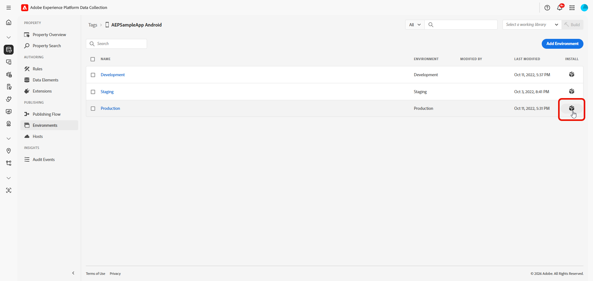

# Extensión de marcas para Android {#android-extension-integration-guide}

En esta guía se describe cómo integrar la extensión Flags con Adobe Experience Platform Mobile SDK en Android.

## Requisitos previos {#prerequisites}

Antes de implementar la extensión Banderas, asegúrese de lo siguiente:

* Una propiedad móvil configurada en [Recopilación de datos de Adobe Experience Platform](https://experience.adobe.com/#/data-collection)
* La extensión Adobe Flags está instalada y configurada en su propiedad móvil
* Un ID de organización de Adobe Experience Cloud
* Un conjunto de datos de Edge Network configurado en su propiedad móvil para recibir análisis de exposición
* API de Android 21 (Android 5.0 Lollipop) o posterior
* Mobile Core 3.6.0 o posterior (incluido en `sdk-bom` 3.17.0 y posterior)

## Dependencias de extensión {#extension-dependencies}

La extensión Flags requiere las siguientes extensiones de Adobe Experience Platform:

| Extensión | Descripción | Requerido |
|---|---|---|
| [Núcleo móvil](https://developer.adobe.com/client-sdks/home/base/mobile-core/) | Proporciona configuración, procesamiento de eventos e inicialización de SDK | Sí |
| [Ciclo de vida](https://developer.adobe.com/client-sdks/home/base/mobile-core/lifecycle/) | Informa cuando la aplicación se mueve al primer o segundo plano | Sí |
| [Edge Network](https://developer.adobe.com/client-sdks/edge/edge-network/) | Envía análisis de exposición a Adobe Experience Platform | Sí |
| [Identidad de Edge Network](https://developer.adobe.com/client-sdks/edge/identity-for-edge-network/) | Proporciona las identidades utilizadas para asignar usuarios a variantes | Sí |

Asegúrese de que estas extensiones estén instaladas en la propiedad móvil de recopilación de datos y se incluyan en las dependencias de la aplicación.

## Configuración de la extensión Flags en la recopilación de datos {#configure}

### Instalación de la extensión {#install-extension}

1. Inicie sesión en [Adobe Experience Platform Data Collection](https://experience.adobe.com/#/data-collection).

1. Seleccione el menú **[!UICONTROL Etiquetas]** y elija su propiedad móvil.

1. Vaya a **[!UICONTROL Extensiones]** > **[!UICONTROL Catálogo]**.

1. Busque **[!DNL Adobe Flags]** y seleccione **[!UICONTROL Instalar]**.

   

1. Configure las opciones de extensión:

   * **[!UICONTROL espacio aislado]**: El espacio aislado de Adobe Experience Platform que contiene la configuración de Marcas.
   * **[!UICONTROL ID de aplicación]**: El identificador de su aplicación en Banderas.

1. Seleccione **[!UICONTROL Guardar]**.

1. Siga el [proceso de publicación](https://experienceleague.adobe.com/es/docs/experience-platform/tags/publish/overview) para actualizar la configuración.

### Obtener el ID del archivo de entorno {#environment-file-id}

1. En su propiedad móvil, vaya a **[!UICONTROL Entornos]**.

1. Seleccione el icono de cuadro en la columna **[!UICONTROL Instalar]** del entorno seleccionado.

   

1. En el cuadro de diálogo **[!UICONTROL Instrucciones de instalación de Mobile]**, copie el **[!UICONTROL Id. de archivo de entorno]**.

   

## Añadir la extensión de marcas a la aplicación {#add-to-app}

### Añadir dependencias {#add-dependencies}

>[!IMPORTANT]
>
>La extensión Banderas no forma parte de la LDM de SDK móvil. Reemplazar `<latest-version>` por la última versión de Maven Central. Sin una versión, Gradle no puede resolver la dependencia.
>
></br>
>&gt;Para aplicaciones de producción, Adobe recomienda utilizar números de versión explícitos en lugar de versiones dinámicas como 3.+. Consulte [Administración de dependencias de Gradle](https://docs.gradle.org/current/userguide/dependency_management.html) para obtener más información.

Agregue las siguientes dependencias al archivo `build.gradle.kts` (Kotlin) o `build.gradle` (Groovy) de su aplicación:

>[!BEGINTABS]

>[!TAB Kotlin]

```kotlin
dependencies {
    // Adobe Experience Platform Mobile SDK BOM (3.17.0 or later)
    implementation(platform("com.adobe.marketing.mobile:sdk-bom:3.+"))

    // Required extensions (versions managed by the BOM)
    implementation("com.adobe.marketing.mobile:core")
    implementation("com.adobe.marketing.mobile:lifecycle")
    implementation("com.adobe.marketing.mobile:edge")
    implementation("com.adobe.marketing.mobile:edgeidentity")

    // Flags extension (not managed by the BOM; specify the version)
    implementation("com.adobe.marketing.mobile:flags:<latest-version>")
}
```

>[!TAB Groovy]

```groovy
dependencies {
    // Adobe Experience Platform Mobile SDK BOM (3.17.0 or later)
    implementation platform('com.adobe.marketing.mobile:sdk-bom:3.+')

    // Required extensions (versions managed by the BOM)
    implementation 'com.adobe.marketing.mobile:core'
    implementation 'com.adobe.marketing.mobile:lifecycle'
    implementation 'com.adobe.marketing.mobile:edge'
    implementation 'com.adobe.marketing.mobile:edgeidentity'

    // Flags extension (not managed by the BOM; specify the version)
    implementation 'com.adobe.marketing.mobile:flags:<latest-version>'
}
```

>[!ENDTABS]

### Inicialización de SDK {#initialize-sdk}

>[!IMPORTANT]
>
>Para aplicaciones de producción, use `LoggingMode.ERROR` solamente. No use `DEBUG` ni `VERBOSE` en las compilaciones de versión.

Inicialice Mobile SDK en la clase `Application` antes de llamar a las API de extensión Flags. Utilice el ID del archivo de entorno de su propiedad móvil para que la aplicación capte la configuración de las marcas que ha publicado en la recopilación de datos.

`MobileCore.initialize` registra todas las extensiones de Adobe incluidas en las dependencias de Gradle, incluida la extensión Flags.

Tenga en cuenta que cuando use `MobileCore.initialize`, no llame también a `MobileCore.registerExtensions`, `MobileCore.lifecycleStart` o `MobileCore.lifecyclePause`. Estos se gestionan por usted.

>[!BEGINTABS]

>[!TAB Kotlin]

```kotlin
import android.app.Application
import com.adobe.marketing.mobile.LoggingMode
import com.adobe.marketing.mobile.MobileCore

class MainApplication : Application() {

    override fun onCreate() {
        super.onCreate()

        MobileCore.setLogLevel(LoggingMode.ERROR)

        // Initialize with your Environment File ID from Data Collection
        MobileCore.initialize(this, "YOUR_ENVIRONMENT_FILE_ID")
    }
}
```

>[!TAB Java]

```java
import android.app.Application;
import com.adobe.marketing.mobile.LoggingMode;
import com.adobe.marketing.mobile.MobileCore;

public class MainApplication extends Application {

    @Override
    public void onCreate() {
        super.onCreate();

        MobileCore.setLogLevel(LoggingMode.ERROR);

        // Initialize with your Environment File ID from Data Collection
        MobileCore.initialize(this, "YOUR_ENVIRONMENT_FILE_ID");
    }
}
```

>[!ENDTABS]

### Registrar la clase Application {#register-application}

Registre su clase `Application` en `AndroidManifest.xml`:

```xml
<application
    android:name=".MainApplication"
    ... >
</application>
```

### Si registra las extensiones manualmente {#register-manually}

Si su aplicación no puede usar `MobileCore.initialize` y registra extensiones con `MobileCore.registerExtensions`, agregue `Flag.EXTENSION` a la lista. Use la clase Identity for Edge Network `com.adobe.marketing.mobile.edge.identity.Identity`, no la clase heredada `com.adobe.marketing.mobile.Identity`.

```kotlin
import com.adobe.marketing.mobile.Edge
import com.adobe.marketing.mobile.Lifecycle
import com.adobe.marketing.mobile.MobileCore
import com.adobe.marketing.mobile.edge.identity.Identity
import com.adobe.marketing.mobile.flags.Flag

MobileCore.setApplication(this)
MobileCore.configureWithAppID("YOUR_ENVIRONMENT_FILE_ID")
MobileCore.registerExtensions(
    listOf(Lifecycle.EXTENSION, Identity.EXTENSION, Edge.EXTENSION, Flag.EXTENSION)
) { }
```

En esta configuración, el ciclo de vida no se rastrea automáticamente. Llamar a `MobileCore.lifecycleStart(null)` en `onResume` y `MobileCore.lifecyclePause()` de cada actividad en su `onPause`. Sin estas llamadas, la extensión sigue actualizando los indicadores mientras la aplicación está en segundo plano y los análisis de exposición se envían más tarde.

## Contexto de evaluación {#evaluation-context}

`FeatureEvaluationContext` contiene los atributos de segmentación que utilizan las reglas de marcador. No pasa una identidad: la extensión la lee desde Identity for Edge Network en cada evaluación. Ver [identidad personalizada](#custom-identity).

| Método | Requerido | Descripción |
|---|---|---|
| `withAttributes(map)` | No | `Map<String, List<String>>`. Cada clave es un nombre de atributo utilizado por las reglas de marcador (por ejemplo, `locale` o `appVersion`). Cada valor es la lista de valores del usuario actual (por ejemplo, `["en_US"]`). |

* Se requiere un contexto para cada evaluación. Si no tiene atributos, pase `FeatureEvaluationContext.builder().build()`.
* Llamar a `withAttributes` como máximo una vez por generador.
* Un contexto creado no se puede cambiar, por lo que puede reutilizarlo en todas las evaluaciones.

### Uso {#evaluation-context-usage}

>[!BEGINTABS]

>[!TAB Kotlin]

```kotlin
import com.adobe.marketing.mobile.flags.FeatureEvaluationContext

val ctx = FeatureEvaluationContext.builder()
    .withAttributes(
        mapOf(
            "locale" to listOf("en_US"),
            "platform" to listOf("ANDROID")
        )
    )
    .build()
```

>[!TAB Java]

```java
import com.adobe.marketing.mobile.flags.FeatureEvaluationContext;
import java.util.Arrays;
import java.util.HashMap;
import java.util.List;
import java.util.Map;

Map<String, List<String>> attrs = new HashMap<>();
attrs.put("locale", Arrays.asList("en_US"));
attrs.put("platform", Arrays.asList("ANDROID"));

FeatureEvaluationContext ctx = FeatureEvaluationContext.builder()
        .withAttributes(attrs)
        .build();
```

>[!ENDTABS]

### Atributos de segmentación de muestra {#sample-attributes}

| Atributo | Descripción | Valores de ejemplo |
|---|---|---|
| `locale` | Configuración regional del usuario | `["en_US"]`, `["fr_FR"]` |
| `platform` | Plataforma | `["ANDROID"]` |
| `appVersion` | Versión de aplicación | `["3.0.0"]` |
| `deviceType` | Tipo de dispositivo | `["phone"]`, `["tablet"]` |

Los nombres y valores de los atributos deben coincidir con los utilizados en las reglas de los indicadores.

## Identidad personalizada {#custom-identity}

La extensión de marcas usa la identidad de [Edge Network extension](https://developer.adobe.com/client-sdks/edge/identity-for-edge-network/) para la resolución de identidades. Se puede cohortar un indicador de funcionalidad en una identidad personalizada, por ejemplo, un ID de CRM o un ID de fidelidad, de modo que las divisiones de variante y los análisis estén vinculados a la identidad que importa a su aplicación.

El área de nombres de identidad personalizada debe estar seleccionada en la interfaz de usuario de marcas cuando se crea el indicador de funcionalidad. Para evaluar un indicador con respecto a esa identidad, la misma identidad debe estar presente en la identidad de Edge `identityMap` en el dispositivo, utilizando el área de nombres correspondiente. Proporciónelo durante la ejecución con la API Identity for Edge Network `updateIdentities`.

### Añadir la identidad personalizada al mapa de identidad {#add-identity}

Agregue la identidad en el mismo área de nombres configurada en el indicador de funcionalidad antes de evaluar el indicador.

Tenga en cuenta lo siguiente al agregar la identidad:

* El área de nombres debe coincidir exactamente, incluidas mayúsculas y minúsculas.
* Si el área de nombres tiene más de una identidad, se utiliza la marcada como principal. De lo contrario, se utiliza la primera.
* Si falta la identidad cuando se evalúa el indicador, el usuario se asigna mediante un ID temporal que cambia cada vez que se inicia la aplicación. La variante del usuario puede cambiar entre inicios de la aplicación. Establezca siempre la identidad antes de evaluar los indicadores que la utilizan.

>[!BEGINTABS]

>[!TAB Kotlin]

```kotlin
import com.adobe.marketing.mobile.edge.identity.AuthenticatedState
import com.adobe.marketing.mobile.edge.identity.Identity
import com.adobe.marketing.mobile.edge.identity.IdentityItem
import com.adobe.marketing.mobile.edge.identity.IdentityMap

val identityMap = IdentityMap()
identityMap.addItem(
    IdentityItem("1111", AuthenticatedState.AUTHENTICATED, true),
    "userCRMId" // must match the namespace configured on the feature flag
)
Identity.updateIdentities(identityMap)
```

>[!TAB Java]

```java
import com.adobe.marketing.mobile.edge.identity.AuthenticatedState;
import com.adobe.marketing.mobile.edge.identity.Identity;
import com.adobe.marketing.mobile.edge.identity.IdentityItem;
import com.adobe.marketing.mobile.edge.identity.IdentityMap;

IdentityMap identityMap = new IdentityMap();
identityMap.addItem(
        new IdentityItem("1111", AuthenticatedState.AUTHENTICATED, true),
        "userCRMId"); // must match the namespace configured on the feature flag
Identity.updateIdentities(identityMap);
```

>[!ENDTABS]

## Referencia de API {#api-reference}

### Llamadas de retorno y gestión de errores {#callbacks-errors}

Estas reglas se aplican a `isFeatureEnabled` y `getFeature`:

* Proporcione siempre una experiencia predeterminada. Pase un `AdobeCallbackWithError` y muestre su experiencia predeterminada en `fail`. Con un `AdobeCallback` sin formato, no se llama a nada cuando se produce un error.

* La extensión carga previamente las definiciones de indicadores cuando se inicia la aplicación. Después, los indicadores se evalúan en el dispositivo.

* Otros errores: Se llama a `fail` con `AdobeError.UNEXPECTED_ERROR` cuando:

  * la clave de función está vacía,
  * la configuración de Marcas o el ID de organización de Experience Cloud no aparecen en la configuración publicada, o
  * no se pudieron descargar las definiciones de indicadores al iniciar la aplicación (por ejemplo, el dispositivo estaba sin conexión). La extensión vuelve a intentarlo en la siguiente actualización de configuración, normalmente el siguiente inicio de la aplicación.

### isFeatureEnabled {#is-feature-enabled}

Devuelve si una característica está habilitada para el usuario actual.

**Firma**

>[!BEGINTABS]

>[!TAB Kotlin]

```kotlin
Flag.isFeatureEnabled(
    featureKey: String,
    evaluationContext: FeatureEvaluationContext,
    callback: AdobeCallback<Boolean>
)
```

>[!TAB Java]

```java
Flag.isFeatureEnabled(
    String featureKey,
    FeatureEvaluationContext evaluationContext,
    AdobeCallback<Boolean> callback);
```

>[!ENDTABS]

**Parámetros**

| Parámetro | Tipo | Descripción |
|---|---|---|
| `featureKey` | Cadena | Clave de la función que se debe evaluar |
| `evaluationContext` | FeatureEvaluationContext | Atributos de segmentación. Use `FeatureEvaluationContext.builder().build()` si no tiene ninguna. Consulte [Contexto de evaluación](#evaluation-context). |
| `callback` | AdobeCallback&lt;Boolean> | Se llama con `true` si la característica está habilitada para el usuario. Se llama con `false` si no se encuentra la característica, si no coinciden las reglas de segmentación o si el usuario está en el grupo de control. Pase un `AdobeCallbackWithError<Boolean>` para recibir también errores. |

**Ejemplos**

>[!BEGINTABS]

>[!TAB Kotlin]

```kotlin
import com.adobe.marketing.mobile.AdobeCallbackWithError
import com.adobe.marketing.mobile.AdobeError
import com.adobe.marketing.mobile.flags.Flag

Flag.isFeatureEnabled(
    "new-checkout",
    ctx,
    object : AdobeCallbackWithError<Boolean> {
        override fun call(isEnabled: Boolean?) {
            runOnUiThread {
                if (isEnabled == true) showNewCheckout() else showDefaultCheckout()
            }
        }

        override fun fail(error: AdobeError?) {
            runOnUiThread { showDefaultCheckout() }
        }
    }
)
```

>[!TAB Java]

```java
import com.adobe.marketing.mobile.AdobeCallbackWithError;
import com.adobe.marketing.mobile.AdobeError;
import com.adobe.marketing.mobile.flags.Flag;

Flag.isFeatureEnabled(
    "new-checkout",
    ctx,
    new AdobeCallbackWithError<Boolean>() {
        @Override
        public void call(Boolean isEnabled) {
            runOnUiThread(() -> {
                if (Boolean.TRUE.equals(isEnabled)) {
                    showNewCheckout();
                } else {
                    showDefaultCheckout();
                }
            });
        }

        @Override
        public void fail(AdobeError error) {
            runOnUiThread(() -> showDefaultCheckout());
        }
    }
);
```

>[!ENDTABS]

### getFeature {#get-feature}

Devuelve la característica evaluada para el usuario actual, incluidos sus metadatos. Utilice esta API cuando necesite más de habilitar o deshabilitar.

**Firma**

>[!BEGINTABS]

>[!TAB Kotlin]

```kotlin
Flag.getFeature(
    featureKey: String,
    evaluationContext: FeatureEvaluationContext,
    callback: AdobeCallback<FeatureEvaluationResult>
)
```

>[!TAB Java]

```java
Flag.getFeature(
    String featureKey,
    FeatureEvaluationContext evaluationContext,
    AdobeCallback<FeatureEvaluationResult> callback);
```

>[!ENDTABS]

**Parámetros**

| Parámetro | Tipo | Descripción |
|---|---|---|
| `featureKey` | Cadena | Clave de la función que se debe evaluar |
| `evaluationContext` | FeatureEvaluationContext | Atributos de segmentación. Use `FeatureEvaluationContext.builder().build()` si no tiene ninguna. Consulte [Contexto de evaluación](#evaluation-context). |
| `callback` | AdobeCallback&lt;FeatureEvaluationResult> | Se llama con la característica evaluada o con `null` cuando la característica no se proporciona al usuario: la clave es desconocida, no se cumplen los criterios de segmentación o el usuario está en una cohorte de control. `null` es un resultado normal, no un error. Las exposiciones de cohorte de control aún se comunican a los análisis. Pase un `AdobeCallbackWithError<FeatureEvaluationResult>` para recibir `fail(...)` en caso de errores reales, como tiempos de espera. |

Trate un resultado de `null` como &quot;característica desactivada&quot; y muestre su experiencia predeterminada. Mostrar también la experiencia predeterminada cuando se llama a `fail`, lo cual solo ocurre en errores reales, como los tiempos de espera.

**Respuesta**

*FeatureEvaluationResult*

| Campo | Tipo | Descripción |
|---|---|---|
| `id` | Int | ID de función |
| `key` | Cadena | Tecla de función |
| `featureGroupKey` | ¿String? | Clave de grupo de funciones, si la función pertenece a un grupo |
| `meta` | ¿String? | Metadatos configurados para la característica, como texto sin formato, o `null` si no se ha establecido ninguno. Si ha almacenado JSON, analice la cadena en la aplicación. |
| `analyticsParam` | ¿AnalyticsParam? | Detalles de Analytics para la evaluación |

*Parámetro de análisis*

| Campo | Tipo | Descripción |
|---|---|---|
| `featureGroupId` | Int | ID de grupo de funciones |
| `featureId` | Int | ID de función |
| `variantId` | ¿String? | ID de la variante a la que se asignó el usuario |

**Ejemplos**

>[!BEGINTABS]

>[!TAB Kotlin]

```kotlin
import com.adobe.marketing.mobile.AdobeCallbackWithError
import com.adobe.marketing.mobile.AdobeError
import com.adobe.marketing.mobile.flags.FeatureEvaluationResult
import com.adobe.marketing.mobile.flags.Flag

Flag.getFeature(
    "new-checkout",
    ctx,
    object : AdobeCallbackWithError<FeatureEvaluationResult> {
        override fun call(feature: FeatureEvaluationResult?) {
            val meta = feature?.meta
            runOnUiThread {
                if (!meta.isNullOrEmpty()) applyExperience(meta) else showDefaultExperience()
            }
        }

        override fun fail(error: AdobeError?) {
            runOnUiThread { showDefaultExperience() }
        }
    }
)
```

>[!TAB Java]

```java
import com.adobe.marketing.mobile.AdobeCallbackWithError;
import com.adobe.marketing.mobile.AdobeError;
import com.adobe.marketing.mobile.flags.FeatureEvaluationResult;
import com.adobe.marketing.mobile.flags.Flag;

Flag.getFeature(
    "new-checkout",
    ctx,
    new AdobeCallbackWithError<FeatureEvaluationResult>() {
        @Override
        public void call(FeatureEvaluationResult feature) {
            final String meta = feature != null ? feature.getMeta() : null;
            runOnUiThread(() -> {
                if (meta != null && !meta.isEmpty()) {
                    applyExperience(meta);
                } else {
                    showDefaultExperience();
                }
            });
        }

        @Override
        public void fail(AdobeError error) {
            runOnUiThread(() -> showDefaultExperience());
        }
    }
);
```

>[!ENDTABS]

### extensionVersion {#extension-version}

Devuelve la versión de la extensión Flags.

**Sintaxis**

```kotlin
Flag.extensionVersion(): String
```

**Ejemplo**

*Kotlin*

```kotlin
val version = Flag.extensionVersion()
```

*Java*

```java
String version = Flag.extensionVersion();
```

## Resumen de API {#api-summary}

| de visitante | Devuelve |
|---|---|
| `isFeatureEnabled(featureKey, evaluationContext, callback)`. Consulte [isFeatureEnabled](#is-feature-enabled). | Booleano mediante llamada de retorno |
| `getFeature(featureKey, evaluationContext, callback)`. Ver [getFeature](#get-feature). | FeatureEvaluationResult mediante llamada de retorno |
| `extensionVersion()` | Cadena |

## Depuración {#debugging}

Para depurar, establezca `MobileCore.setLogLevel(LoggingMode.DEBUG)` en una compilación de depuración y filtre Logcat por `Flags`. Debería ver un mensaje de `Discovered extension` de MobileCore para `com.adobe.marketing.mobile.flags.FlagExtension`.


