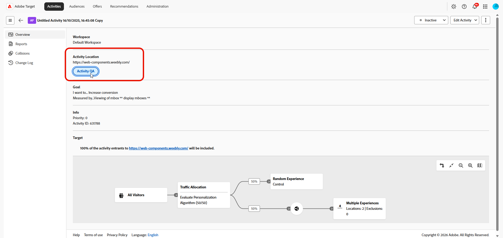

# Introducción al control de calidad de la actividad {#activity-qa}

>[!BEGINSHADEBOX]

**En esta página:** Aprenda a utilizar los vínculos de control de calidad de la actividad para probar una actividad de principio a fin, revisar los informes de control de calidad y liberarse del modo de control de calidad.

>[!ENDSHADEBOX]

El **[!UICONTROL control de calidad de la actividad]** le permite probar por completo sus actividades [!DNL Adobe Target] antes de lanzarlas en vivo, con vínculos de vista previa invariables, segmentación de audiencia opcional e informes de control de calidad que permanecen separados de los datos de actividades activas. La funcionalidad **[!UICONTROL Control de calidad de la actividad]** incluye:

* **Vínculos permanentes:** Comparta vínculos con integrantes del equipo que nunca cambian ni requieren regeneración, independientemente de las actualizaciones realizadas en las experiencias o actividades.
* **Segmentación de audiencia opcional:** Pruebe los criterios de segmentación o ignórelos para comprobar el aspecto de las experiencias sin tener que cumplir las condiciones de audiencia.
* **Informes de control de calidad por separado:** Confirme que las métricas aumentan según lo esperado. Los datos del informe de control de calidad se mantienen separados de los informes de producción (para los informes que no son de A4T).
* **Vista previa con otras actividades:** Vista previa de una experiencia de forma aislada o con otras actividades activas que cumplan los criterios de entrega (página/[!DNL Target] solicitud/audiencia).
* **recorrido completo del usuario:** Acceda a su sitio una vez con el vínculo de control de calidad y, a continuación, explore todo el sitio en **[!UICONTROL control de calidad de la actividad]**. Permanece en el control de calidad de la actividad **hasta que finaliza la sesión o hasta que usa el bookmarklet [QA Target](/help/main/c-activities/c-activity-qa/activity-qa-bookmark.md) para forzar su salida.** Esta función es útil si tiene una actividad que abarca varias páginas web.

  >[!NOTE]
  >
  >Esta funcionalidad es verdadera para implementaciones at.js con versión 2.*x* o posterior. En implementaciones at.js 1.*x*, esta funcionalidad solo se cumple si el explorador del visitante no bloquea las cookies de terceros.

## Acceso y uso compartido de una URL de control de calidad {#section_1C59BAA247B247BDB125D1BE8EAD4547}

Los vínculos de control de calidad de la actividad permiten al usuario y a su equipo ver cada experiencia de una actividad en el sitio antes de que la actividad se ponga en marcha. El tráfico de control de calidad se comunica por separado del tráfico en directo, por lo que las pruebas no afectan a los informes en directo.

1. En la página **[!UICONTROL Información general]** de la actividad, haz clic en **[!UICONTROL Control de calidad de la actividad]**.

   

1. Establezca **[!UICONTROL Coincidir reglas de audiencia para ver las experiencias]** a fin de elegir si los probadores deben cumplir los requisitos para la audiencia. Actívelo para confirmar que la coincidencia de audiencias funciona o desactívelo para comprobar el aspecto de la actividad.

   * **Activado:** Los probadores deben cumplir los requisitos de segmentación para ver las experiencias. Para las actividades de segmentación de experiencias (XT), se proporciona una sola URL de actividad y la experiencia que vea depende de la regla de segmentación para la que sea apto.
   * **Desactivado:** Los vínculos muestran las experiencias independientemente de si califica o no. Puede cambiar entre las dos configuraciones en cualquier momento durante el control de calidad.

   

1. Establezca **[!UICONTROL Mostrar contenido predeterminado para todas las demás actividades]** para elegir si aparecerán otras actividades activas en la página.

   * **Activado:** Se muestra el contenido predeterminado para todas las demás actividades. La vista previa se muestra de forma aislada, sin considerar las demás actividades activas en la misma solicitud de página/[!DNL Target].
   * **Desactivado:** Si hay conflictos entre la actividad que está probando y otras actividades activas, se aplican [reglas de prioridad normales](/help/main/c-activities/priority.md#priority), por lo que es posible que no vea la actividad que desea realizar el control de calidad. Las métricas aumentan para las actividades vistas, pero solo en el entorno de realización de informes de control de calidad.

1. Haga clic en **[!UICONTROL Hecho]** para guardar los cambios.

1. Comparta las direcciones URL de los vínculos de actividad con miembros de su organización para realizar pruebas.

   Cada URL de vínculo (para la Experiencia A, Experiencia B, etc.) inicia el recorrido del usuario a partir de la experiencia correspondiente. Se genera una única URL por experiencia, aunque esta abarque múltiples páginas (prueba de plantilla o prueba multipágina).

   Los vínculos nunca caducan y los cambios en una actividad o experiencia no requieren que los reenvíe. Sin embargo, si aplica una audiencia diferente de la **[!UICONTROL Biblioteca de audiencias]** en lugar de editar la actividad, se genera un nuevo vínculo que debe volver a compartir.

1. Haga clic en la dirección URL de una experiencia y, a continuación, explore el sitio normalmente para ver las experiencias en varias páginas (si existen varias).

   Puede navegar por el sitio para ver las demás páginas porque el modo de **[!UICONTROL control de calidad de la actividad]** persiste entre páginas. Esto es así en implementaciones de at.js con versión 2.*x* o posterior. En implementaciones at.js 1.*x*, esto solo es así si el explorador del visitante no bloquea las cookies de terceros.

1. Para ver los informes generados a partir de las direcciones URL de los vínculos de actividad, accede a la página **[!UICONTROL Informes]** de la actividad, haz clic en el icono **[!UICONTROL Configuración]** (  ) y, a continuación, selecciona **[!UICONTROL Tráfico en modo de control de calidad]** en la lista desplegable **[!UICONTROL Entorno]**.

   

## Salir del modo de control de calidad de actividades

El modo **[!UICONTROL Control de calidad de la actividad]** persiste hasta que lo abandona. Después de examinar un sitio web en **[!UICONTROL control de calidad de la actividad]**, permanecerá en modo de control de calidad hasta que expire su sesión de [!DNL Target] o se excluirá automáticamente. Debe salir antes de poder ver el sitio como lo vería un visitante.

### at.js 2.*x*

Si su sitio tiene implementado at.js 2.*x*, use el [bookmarklet de control de calidad de Target](/help/main/c-activities/c-activity-qa/activity-qa-bookmark.md) para forzar su salida de **[!UICONTROL control de calidad de la actividad]**. Al cargar una página en su sitio con un valor vacío, como se describe en la sección siguiente, *no* elimina la cookie de control de calidad del explorador cuando se implementa at.js 2.*x*.

### at.js 1.*x*

Si su sitio tiene implementado at.js 1.*x*, además de usar el [bookmarklet de control de calidad de Target](/help/main/c-activities/c-activity-qa/activity-qa-bookmark.md), puede forzar la salida manualmente cargando una página en su sitio con el parámetro `at_preview_token` establecido en un valor vacío. Por ejemplo:

`https://www.mysite.com/?at_preview_token=`

### [!DNL Adobe Experience Platform Web SDK]

Si el sitio tiene implementado [[!UICONTROL Platform Web SDK]](https://experienceleague.adobe.com/docs/target-dev/developer/client-side/aep-web-sdk.html?lang=es){target=_blank}, puede forzar la salida manualmente cargando una página en el sitio con el parámetro `at_qa_mode` establecido en un valor vacío. Por ejemplo:

`https://www.mysite.com/?at_qa_mode=`

## Consideraciones {#section_B256EDD7BFEC4A6DA72A8A6ABD196D78}

### Disponibilidad y límites {#availability}

+++ URL de vista previa de Automated Personalization Experience

**[!UICONTROL El control de calidad de la actividad]** ya está disponible para todos los tipos de actividad de [!DNL Target], por lo que la función &quot;Previsualizar actividades de Automated Personalization con URL de vista previa de experiencia&quot; ya no es necesaria.

+++

+++ Analytics como fuente de informes (A4T)

Las direcciones URL de **[!UICONTROL control de calidad de la actividad]** están disponibles con actividades con [Analytics como fuente de informes](/help/main/c-integrating-target-with-mac/a4t/a4t.md) (A4T). Las visitas generadas al realizar el control de calidad mediante **[!UICONTROL control de calidad de la actividad]** fluyen al mismo grupo de informes donde los datos de la actividad fluyen incluso después de que esta se active.

+++

+++ Actividades archivadas o finalizadas

**[!UICONTROL El control de calidad de la actividad]** no muestra el contenido de las actividades archivadas o las actividades que han pasado sus fechas de finalización. Si desactiva una actividad finalizada, debe volver a guardar la actividad para que funcione **[!UICONTROL Control de calidad de la actividad]**.

+++

+++ Actividades importadas

Las actividades importadas en [!DNL Target Standard/Premium] (desde [!DNL Target Classic], por ejemplo) no admiten direcciones URL de control de calidad.

+++

+++ Modelos de asignación automática y Recommendations

En las actividades **[!UICONTROL Asignación automática]** y **[!UICONTROL Recommendations]**, el modelo no se ve afectado por las visitas capturadas en **[!UICONTROL Control de calidad de la actividad]**.

+++

### Vínculos y exploración {#links-and-browsing}

+++ Actividades con una condición &quot;La URL es&quot;

Si ha especificado &quot;la dirección URL es&quot; al crear la actividad en [refinamientos en el Compositor basado en formularios](/help/main/c-experiences/form-experience-composer.md) o en las opciones de [entrega de páginas en el Compositor de experiencias visuales](/help/main/c-experiences/c-visual-experience-composer/viztarget-options.md), la dirección URL de control de calidad no funciona, porque **[!UICONTROL Control de calidad de la actividad]** adjunta parámetros de dirección URL. Para solucionar este problema, haga clic en la URL de control de calidad para ir a su sitio, elimine los parámetros añadidos a la URL y cargue la nueva dirección.

+++

+++ Exploradores que bloquean cookies de terceros (at.js 1.*x*)

Si tiene at.js 1.*x*, el modo **[!UICONTROL Control de calidad de la actividad]** no persiste en todas las páginas si utiliza Safari u otro explorador que bloquee cookies de terceros. En estos casos, debe agregar los parámetros de vista previa a cada dirección URL a la que vaya. Lo mismo ocurre si ha implementado [CNAME](https://experienceleague.adobe.com/docs/target-dev/developer/implementation/implement-cname-support-in-target.html?lang=es){target=_blank}.

+++

+++ Actividades con varias audiencias de experiencia

Si una actividad utiliza varias audiencias de experiencia (por ejemplo, un sitio con versiones para Reino Unido y Estados Unidos incluidas en la misma actividad), no se generan vínculos de control de calidad para las cuatro combinaciones (experiencia A/sitio EE. UU., experiencia A/sitio RU, experiencia B/sitio EE. UU., experiencia B/sitio RU). Solo se crean dos vínculos de control de calidad (Experiencia A y Experiencia B), y los usuarios deben cumplir los requisitos para que la audiencia adecuada vea la página. Una persona con control de calidad del Reino Unido no puede ver el sitio de EE. UU.

+++

+++ Actividades de varias páginas

La interfaz de usuario **[!UICONTROL Modo de control de calidad de Target]** solo muestra la primera URL de una experiencia en una actividad de varias páginas. Se supone que está creando una prueba de recorrido y pasa de la URL 1 a la URL 2. Sin embargo, si desea ir a la URL 2 de forma independiente, copie todos los parámetros de la URL proporcionados para la URL 1 y aplíquelos a la URL 2 después de colocar &quot;?&quot; como se ve en la URL 1.

+++

### Vínculos de vista previa que no se cargan {#preview-not-loading}

+++ Demasiadas actividades guardadas

**[!UICONTROL Es posible que los vínculos de vista previa del control de calidad de la actividad]** para las actividades guardadas no se carguen si hay demasiadas guardadas en su cuenta. Reinténtelo con los vínculos de previsualización. Para evitar que este problema se repita, archive las actividades guardadas que ya no se utilizan de forma activa.

+++

+++ Parámetros de vista previa codificados doble

Todos los parámetros y valores de `at_preview` ya están codificados en la URL. La mayoría de las veces, todo funciona según lo esperado. Sin embargo, algunos clientes utilizan equilibradores de carga o servidores web que intentan codificar de nuevo los parámetros de cadena de consulta.

Con esta doble codificación, [!DNL Target] no puede extraer el valor de token correcto cuando intenta descodificar `at_preview_token`, por lo que la vista previa no funciona.

[!DNL Adobe] le recomienda que hable con su equipo de TI para asegurarse de que todos los parámetros de vista previa estén incluidos en la lista de permitidos de modo que estos valores no se transformen en modo alguno.

En la tabla siguiente se enumeran los parámetros que se pueden ver incluidos en la lista de permitidos en el dominio:

| Parámetro | Tipo | Valor | Descripción |
|--- |--- |--- |--- |
| `at_preview_token` | Cadena cifrada | Obligatorio; no hay valor predeterminado | Una entidad cifrada que contiene la lista de ID de campaña que se pueden ejecutar en modo de control de calidad. |
| `at_preview_index` | Cadena | Vacío | El formato del parámetro es `<campaignIndex>` o `<campaignIndex>_< experienceIndex>` Ambos índices comienzan con 1. |
| `at_preview_listed_activities_only` | Booleano (true/false) | Valor predeterminado: false | Si es “true”, se procesan todas las campañas especificadas en los parámetros `at_preview_index`. Si es “false”, se procesan todas las campañas de la página, aunque no se especificaran en el token de vista previa. |
| `at_preview_evaluate_as_true_audience_ids` | Cadena | Vacío | Lista de ID de segmento separados por guiones bajos (&quot;_&quot;) que siempre (en los niveles de segmentación e informes) deben evaluarse como &quot;true&quot; en el ámbito de la solicitud [!DNL Target]. |
| `_AT_Debug` | Cadena | Ventana o consola | Registro de consola o nueva ventana. |
| `adobe_mc_ref` |  |  | Pasa la URL de referencia de la página predeterminada a la nueva página. Cuando se utiliza con `AppMeasurement.js` versión 2.1 (o posterior), [!DNL Adobe Analytics] usa este valor de parámetro como URL de referencia en la nueva página. |
| `adobe_mc_sdid` |  |  | Pasa [!DNL Supplemental Data Id] (SDID) y [!DNL Experience Cloud Org Id] de la página predeterminada a la nueva página. Al pasar estos identificadores, [!UICONTROL Analytics for Target] (A4T) puede &quot;unir&quot; la solicitud [!DNL Target] de la página predeterminada con la solicitud [!DNL Analytics] de la nueva página. |

+++

## Compatibilidad con la biblioteca JavaScript de destino [!UICONTROL Modo QA] {#compatibility}

[!DNL Target] admite las siguientes bibliotecas de JavaScript:

* [at.js 1.x](https://experienceleague.adobe.com/docs/target-dev/developer/client-side/at-js-implementation/at-js/how-atjs-works.html?lang=es)
* [at.js 2.x](https://experienceleague.adobe.com/docs/target-dev/developer/client-side/at-js-implementation/at-js/how-atjs-works.html?lang=es)
* [Adobe Experience Platform Web SDK](https://experienceleague.adobe.com/docs/target-dev/developer/client-side/aep-web-sdk.html?lang=es)

En la tabla siguiente se enumeran los distintos tipos de actividades y se indica si se admite el modo **[!UICONTROL Control de calidad de la actividad]** para cada biblioteca:

| Tipo de actividad | at.js 1.x | at.js 2.x | Platform Web SDK |
| --- | --- | --- | --- |
| [!UICONTROL Prueba A/B] | Sí | Sí | Sí |
| [!UICONTROL Asignación automática] | Sí | Sí | Sí |
| [!UICONTROL Segmentación automática] | Sí | Sí | Sí |
| [!UICONTROL Automated Personalization] (AP) | Sí | Sí | Sí |
| [!UICONTROL Segmentación de experiencias] (XT) | Sí | Sí | Sí |
| [!UICONTROL Prueba multivariada] (MVT) | Sí | Sí | Sí |
| [!UICONTROL Recommendations] | Sí | Sí | Sí |
