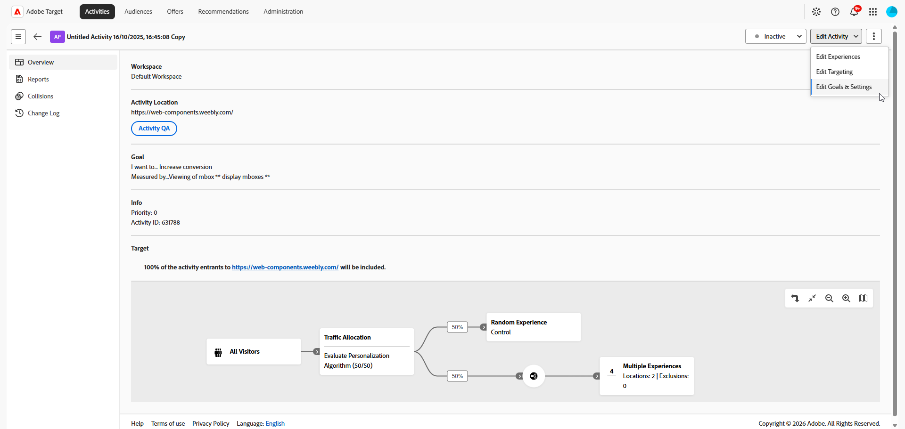

# Editar una actividad {#edit-activity}

>[!BEGINSHADEBOX]

**En esta página:** Obtenga información sobre cómo editar una actividad existente desde la página **[!UICONTROL Actividades]**, cómo copiar una actividad cuando se usan espacios de trabajo y qué acciones se aplican a actividades heredadas.

>[!ENDSHADEBOX]

Las actividades existentes se pueden editar desde varios lugares de la interfaz [!DNL Adobe Target], por lo que los cambios en las experiencias, las reglas de segmentación o los objetivos no requieren volver a crear la actividad. Los pasos varían según el método elegido. La característica **[!UICONTROL Guardar como borrador]** ya no está disponible. Para obtener más información, consulte **[!UICONTROL Estado]** en [Aplicar filtros a la lista de actividades](/help/main/c-activities/activities.md#filters).

## Editar desde el icono [!UICONTROL Más acciones] {#section_29EE2ECA6B88473A8F9AC5600FFBB174}

Para editar una actividad siguiendo el flujo de trabajo guiado de tres pasos:

1. En la página **[!UICONTROL Actividades]**, haga clic en el icono **[!UICONTROL Más acciones]** (  ) que está junto a la actividad y, a continuación, haga clic en **[!UICONTROL Editar]**.

   [!DNL Target] abre la actividad en el **[!UICONTROL Compositor de experiencias visuales]** (VEC) y muestra la página **[!UICONTROL Experiencias]**, que es el primer paso del flujo de trabajo.

   

1. Edite la actividad mediante las [opciones de VEC](/help/main/c-experiences/c-visual-experience-composer/viztarget-options.md).

1. Haga clic en **[!UICONTROL Siguiente]** para avanzar al siguiente paso y realice las modificaciones que sean necesarias.

1. En la página **[!UICONTROL Objetivos y configuración]**, guarde los cambios mediante una de las siguientes opciones:

   * **[!UICONTROL Guardar y cerrar]:** Guarda los cambios y muestra la página **[!UICONTROL Información general]** de la actividad.
   * **[!UICONTROL Guardar]:** Haga clic en el icono de **[!UICONTROL Más acciones]** (  ) y, a continuación, seleccione **[!UICONTROL Guardar]** para guardar los cambios y permanecer en el VEC, donde podrá realizar más cambios. Espere a que se acabe de guardar antes de realizar cambios adicionales. Después de guardarse, VEC vuelve a cargarse con los cambios actualizados.

     

## Edite desde el nombre de la actividad {#section_176180DAD17E40CEA441903F39E0AA1C}

Para ir directamente al paso que necesita cambios, sin pasar por el flujo de trabajo:

1. En la página **[!UICONTROL Actividades]**, haga clic en la actividad para abrirla y, a continuación, seleccione una de las opciones de la lista desplegable **[!UICONTROL Editar actividad]**:

   * **[!UICONTROL Editar experiencias]:** Abre la página de **[!UICONTROL Experiencias]** (el primer paso del flujo de trabajo).
   * **[!UICONTROL Editar segmentación]:** Abre la página **[!UICONTROL Segmentación]** (el segundo paso del flujo de trabajo).
   * **[!UICONTROL Objetivos y configuración]:** Abre la página **[!UICONTROL Objetivos y configuración]** (el tercer paso del flujo de trabajo).

     

1. Realice los cambios y, a continuación, guarde la actividad con **[!UICONTROL Guardar y cerrar]** o **[!UICONTROL Guardar]**, tal como se describe en la sección anterior.

## Copia y edición con espacios de trabajo {#section_45A92E1DD3934523B07E71EF90C4F8B6}

Un espacio de trabajo permite que una organización asigne un conjunto de usuarios específico a un conjunto de propiedades concretas. En muchos aspectos, un espacio de trabajo es parecido a un grupo de informes en [!DNL Adobe Analytics].

>[!NOTE]
>
>Los espacios de trabajo son parte de la funcionalidad **[!UICONTROL Propiedades y permisos]** disponible como parte de la solución [!DNL Target Premium]. No están disponibles en [!DNL Target Standard] sin una licencia de [!DNL Target Premium].

Si forma parte de una organización multinacional, puede tener un espacio de trabajo para sus páginas web, propiedades o sitios europeos y otro para sus páginas web, propiedades o sitios estadounidenses. Si forma parte de una organización de varias marcas, puede contar con un espacio de trabajo independiente para cada una.

Para obtener más información acerca de los espacios de trabajo y la funcionalidad Permisos de usuario de Enterprise, consulte [Permisos de usuario de Enterprise](/help/main/administrating-target/c-user-management/property-channel/property-channel.md).

Si tiene **[!UICONTROL Permisos de usuario de Enterprise]** habilitados en su entorno, puede copiar actividades en el mismo área de trabajo o en otra área de trabajo. No puede trasladar actualmente una actividad de un espacio de trabajo a otro. Para copiar una actividad en otro espacio de trabajo, en la página **[!UICONTROL Actividades]**, haga clic en el icono **[!UICONTROL Más acciones]** (  ) junto a la actividad que desea copiar y, a continuación, haga clic en **[!UICONTROL Copiar]**.

Tenga en cuenta la siguiente información cuando utilice la funcionalidad de copiar/editar con espacios de trabajo:

* Si copia una actividad en el mismo espacio de trabajo o desde el espacio de trabajo predeterminado a un espacio de trabajo no predeterminado, se abrirá automáticamente el Asistente para actividades. En las copias entre espacios de trabajo, es posible que solo necesite actualizar las propiedades de la actividad.
* Cuando se copia una actividad de un espacio de trabajo no predeterminado a otro espacio de trabajo (ya sea predeterminado o no predeterminado), se abre el Asistente de actividad y se requiere alguna entrada manual para completar la configuración:
  * **[!UICONTROL Propiedades]**: las propiedades pueden diferir entre espacios de trabajo. Esta situación podría generar un déclencheur de advertencia:

    * En el **[!UICONTROL Compositor de experiencias basadas en formularios]**, las advertencias se muestran directamente en la interfaz de usuario para una visibilidad inmediata.

      

    * En el VEC, las advertencias aparecen al hacer clic en **[!UICONTROL Configurar]** > **[!UICONTROL Propiedades]**.

      Para resolver este problema, haga clic en **[!UICONTROL Agregar/Quitar]** de modo que solo se muestren las propiedades disponibles en el área de trabajo de destino para su selección.

  * **Audiencias y ofertas**: Al copiar una actividad en un área de trabajo nueva, todas las audiencias y ofertas asociadas de [!DNL Target] o ad hoc del área de trabajo original se duplican con el formato: `<Entity Name> Copy <Date>` para audiencias de [!DNL Target] y para ofertas ad hoc `<Entity Name>`.

    Detalles del comportamiento:

    * Las audiencias y ofertas copiadas no aparecerán en las listas **[!UICONTROL Audiencias]** y **[!UICONTROL Ofertas]** hasta que se guarde y se vuelva a abrir la actividad.
    * Estas entidades no se pueden editar inmediatamente después de copiarlas. Es posible que los clientes vean contenido vacío en el VEC para estos elementos durante la sesión de edición inicial.
    * Los clientes pueden reemplazar audiencias u ofertas copiadas con otras desde el espacio de trabajo de destino si es necesario.

    Este proceso garantiza una duplicación más fluida de las actividades entre espacios de trabajo al tiempo que mantiene la flexibilidad para la personalización.

    Al copiar una actividad, las audiencias que no sean de destino y las ofertas que no se guarden en el espacio de trabajo actual o en el predeterminado deben reemplazarse manualmente.

    Sustituir manualmente estas audiencias y ofertas que no sean de destino garantiza que solo se utilicen entidades válidas y accesibles en la actividad copiada y evita errores durante la edición o el envío.

    

>[!NOTE]
>
>Si su entorno no tiene habilitada la funcionalidad **[!UICONTROL Permisos de usuario de Enterprise]**, todas las actividades se abrirán en el modo de edición antes de copiarse.

## Actividades heredadas de [!DNL Recommendations Classic] {#classic}

La lista **[!UICONTROL Actividades]** muestra actividades creadas en varias fuentes, entre ellas [!DNL Recommendations Classic]. Las siguientes acciones están disponibles para las actividades heredadas creadas en [!DNL Recommendations Classic]:

* **[!UICONTROL Activar]**
* **[!UICONTROL Desactivar]**
* **[!UICONTROL Archivar]**
* **[!UICONTROL Copiar]**
* **[!UICONTROL Eliminar]**

Una actividad [!DNL Recommendations] no se puede editar directamente. Para editarla, cree una copia de la actividad con [!DNL Target Premium] y guarde la nueva actividad, que se podrá editar según sea necesario.
