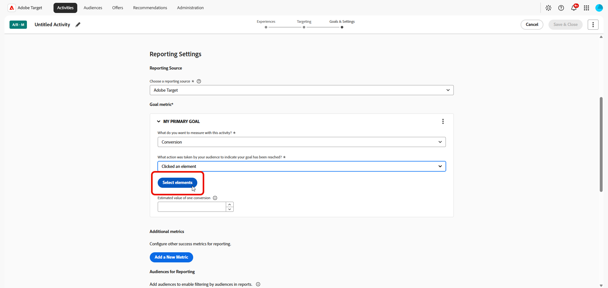
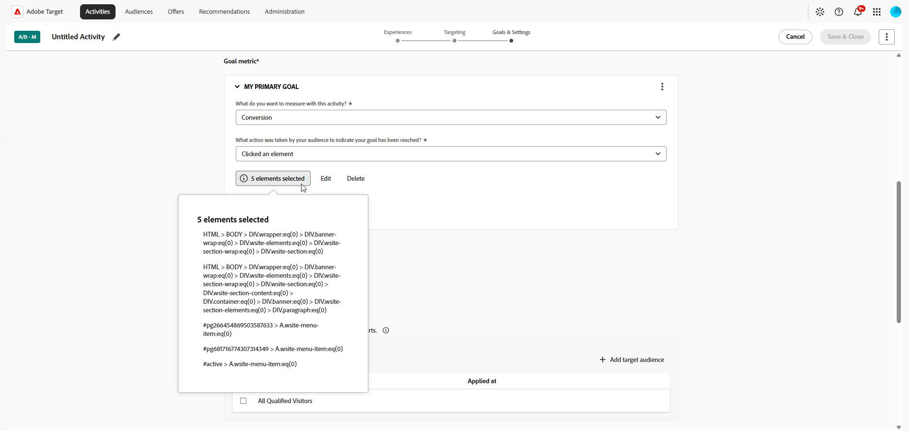
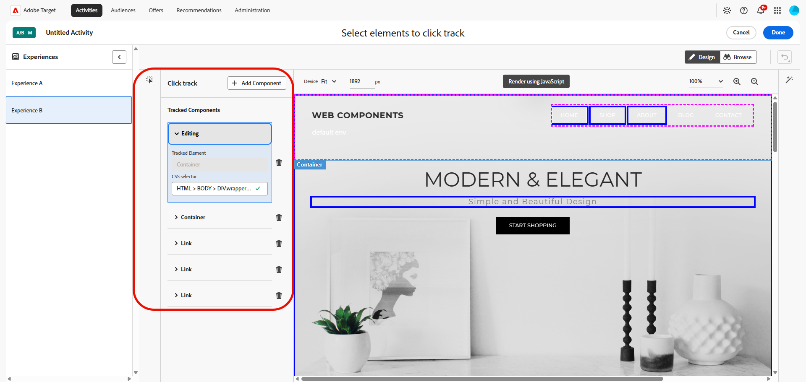
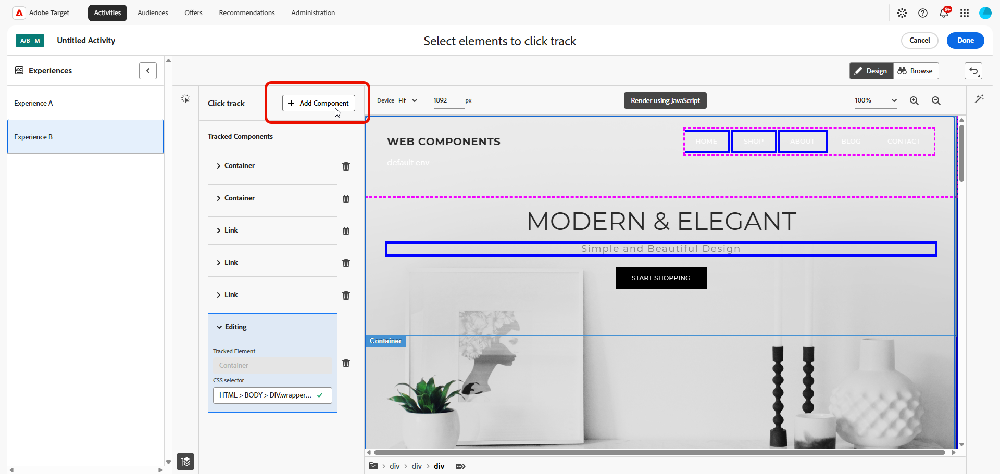
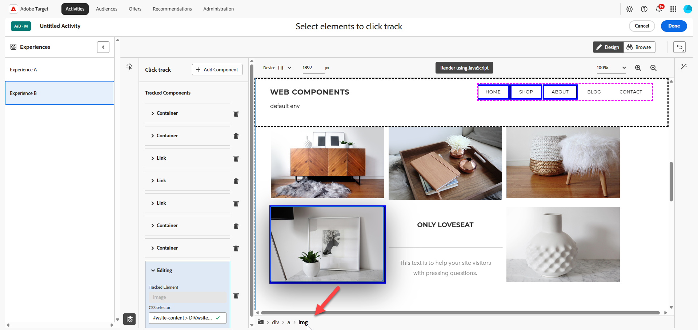

# Rastreo de clics {#click-tracking}

>[!BEGINSHADEBOX]

**En esta página:** Aprenda a rastrear clics en elementos de página como una métrica de éxito, a administrar los elementos seleccionados y a tener en cuenta al seleccionar elementos.

>[!ENDSHADEBOX]

[!DNL Adobe Target] le permite rastrear clics en cualquier elemento como una métrica de éxito. El rastreo de clics hace referencia al proceso de monitorización y registro de interacciones del usuario, específicamente los clics, en elementos dentro de una página web o experiencia. Esto es una parte clave de la medición de la participación y el rendimiento en pruebas A/B, pruebas multivariable y actividades de personalización.

>[!NOTE]
>
>El rastreo de clics no se admite en la solicitud global de [!DNL Target] cuando se utiliza como ubicación en una actividad basada en formularios.

## Configuración del rastreo de clics {#section_5540C5A533114E57BAE022A600B02E72}

El rastreo de clics es un tipo de métrica de éxito de conversión. Cuenta los clics que los visitantes hacen en los elementos de la página que selecciona, de modo que puede medir cómo interactúan los visitantes con esos elementos. Se puede realizar el seguimiento de cualquier elemento de una página, como un vínculo, un botón o una imagen.

1. Al establecer tus metas en la página **[!UICONTROL Objetivos y configuración]** de tu actividad, selecciona la métrica de éxito **[!UICONTROL Conversión]**.

1. Para la acción, seleccione **[!UICONTROL Se hizo clic en un elemento]** y luego haga clic en **[!UICONTROL Seleccionar elementos]**.

   

   La página se abre en el **[!UICONTROL Compositor de experiencias visuales]** (VEC).

1. Seleccione los elementos que desee rastrear.

   Consulte [Consideraciones](#considerations) para obtener sugerencias sobre la selección de elementos.

1. Haga clic en **[!UICONTROL Listo]** en la parte superior de la pantalla para guardar las selecciones.

   La métrica de objetivo de la página **[!UICONTROL Objetivos y configuración]** muestra el número de elementos seleccionados. Pase el ratón sobre él para ver los elementos.

   

Cuando el participante de una actividad hace clic en un elemento seleccionado, ese clic se cuenta como una conversión.

## Panel Elementos seleccionados {#selected-elements}

Para las actividades de **[!UICONTROL Prueba A/B]**, **[!UICONTROL Segmentación de experiencias]** (XT), **[!UICONTROL Automated Personalization]** (AP) y **[!UICONTROL Prueba multivariable]** (MVT), un panel de **[!UICONTROL Elementos seleccionados]** enumera los elementos seleccionados para el rastreo de clics en el lado izquierdo.

Hay varias acciones que se pueden aplicar al hacer clic en un elemento del panel **[!UICONTROL Elementos seleccionados]**. La siguiente tabla describe cada acción que se puede realizar en un elemento:

| Acción | Descripción |
| --- | --- |
| **[!UICONTROL Acciones rastreadas]** | Muestra la acción del elemento. |
| **[!UICONTROL selector de CSS]** | Permite editar el selector de CSS. |
| [!DNL Delete] | Elimina el elemento. |

### Agregar elemento

Si ya conoce la ruta DOM al selector, puede agregarla manualmente si hace clic en el icono **[!UICONTROL Agregar componente]** en la parte superior del panel.

## Consideraciones {#considerations}

### Seleccionar elementos

* Al hacer clic en un elemento, aparece el menú de opciones de VEC y la ruta DOM del elemento en la parte inferior de la página. Utilice la ruta DOM para ver información sobre el elemento (tipo, ID y clase) y para subir o bajar por la ruta y seleccionar el elemento que desee.

  El elemento que seleccione en la ruta DOM se mostrará como **[!UICONTROL Seleccionado]** en el VEC. Para anular su selección, vuelva a hacer clic en él en la ruta DOM o haga clic en el cuadro **[!UICONTROL Seleccionado]** del VEC.

  

  Para obtener más información, consulte [Desplazamiento por elementos utilizando la ruta DOM](/help/main/c-experiences/c-visual-experience-composer/viztarget-options.md#dom-path) en *Opciones del Compositor de experiencias visuales*.

* Puede buscar una página diferente para rastrear clics en una página donde podría no estar modificando contenido. Se debe incluir esta página diferente en la actividad que usa la [característica multipágina](/help/main/c-experiences/c-visual-experience-composer/multipage-activity.md) y se debe implementar [!DNL at.js] en ella.
* Asegúrese de seleccionar el nivel de elemento que desee rastrear. Por ejemplo, al especificar un botón, asegúrese de seleccionar el vínculo y no el texto del botón.
* Si selecciona más de un elemento, si un participante hace clic en cualquiera de los elementos elegidos, se cuenta el clic. Para contar cada elemento por separado, configure métricas de éxito individuales para cualquier elemento. Para contar un elemento haciendo clic en varios elementos de una página, edite el selector de elementos CSS para que coincida con varios elementos.
* Para las actividades de **[!UICONTROL Automated Personalization]** (AP) y Segmentación automática en aplicaciones de una sola página (SPA), puede seleccionar elementos para el rastreo de clics que pertenezcan a una vista [!DNL Target] específica. Para obtener más información acerca de las vistas, vea [Vistas de Adobe Target y Aplicaciones de una sola página](/help/main/c-experiences/spa-visual-experience-composer.md).

### Cómo se cuentan los clics

* Los eventos de clic se envían a [!DNL Target] en la misma página que el clic.
* Las métricas de seguimiento de clics no están vinculadas a ninguna experiencia específica de una actividad.
* Utilice públicos si es necesario restringir el ámbito de las métricas de rastreo de clics.
* Varias actividades pueden definir una métrica de rastreo de clics para el mismo selector. Si es así, cuando un visitante cumple los requisitos para una de esas actividades y hace clic en ese selector, la métrica de rastreo de clics aumenta para todas las actividades asociadas para las que el visitante cumple los requisitos.

### Analytics y at.js

* Si la métrica de rastreo de clics es la métrica objetivo de una actividad de **[!UICONTROL Analytics for Target]** (A4T), el visitante debe hacer clic en este elemento en un plazo de 60 segundos desde la carga de la página para que la métrica se rastree.
* Si utiliza el rastreo de clics de [!DNL at.js] y también [!DNL Analytics] AppMeasurement, el rastreo de clics de [!DNL at.js] cancela cualquier otro controlador de eventos de clic. Como resultado, el controlador de eventos de AppMeasurement nunca llega a ejecutarse.

  [!DNL at.js] tiene un controlador especial para el rastreo de clics cuando el elemento subyacente es una etiqueta `A` (vínculo) o `FORM`. [!DNL at.js] ejecuta los siguientes pasos cuando el evento de rastreo de clics se adjunta una etiqueta `A`A (vínculo) o `FORM`:

  1. Invocar..`event.preventDefault()`

  1. Active la solicitud de [!DNL Target].

  1. En caso de que la solicitud de [!DNL Target] se complete correctamente o produzca una llamada de retorno de error, ejecute el comportamiento predeterminado:

     * Etiqueta`A` (vínculo): el comportamiento predeterminado es ir a la URL definida por el atributo HREF.
     * Etiqueta `FORM`: el comportamiento predeterminado es enviar el formulario.

  Este comportamiento predeterminado podría interferir en el rastreo de clics de [!DNL Analytics]. Si utiliza [!DNL Analytics], se recomienda confiar en [!DNL Analytics] para el rastreo de clics en vez de en [!DNL Target].

### Límites

* El rastreo de clics no funciona en elementos que incluyen caracteres de escape en los selectores, incluyendo los siguientes:

  | Carácter | Descripción |
  |---|---|
  | # | Signo de número o hash |
  | : | Dos puntos |
  | . | Periodo |
  | $ | Símbolo del dólar |
  | `[ ]` | Corchetes |

* El rastreo de clics no se registra en páginas en las que la URL de la página y de la actividad pertenecen a propiedades diferentes. Los permisos de usuario de Enterprise son una función de [!DNL Target Premium]. Para obtener más información, consulte [Permisos de usuario de Enterprise](/help/main/administrating-target/c-user-management/property-channel/property-channel.md).

## Vídeo de formación {#section_36607204DAE146E3B8E2C609D244EDB1}

Este vídeo contiene información sobre la creación de métricas de éxito del rastreo de clics.

* Qué son las métricas de “objetivo”
* Comprenda y cree las métricas **[!UICONTROL Conversión]**, **[!UICONTROL Ingresos]** y **[!UICONTROL Participación]**
* Compilar una métrica para el rastreo de clics

>[!VIDEO](https://video.tv.adobe.com/v/17380)
