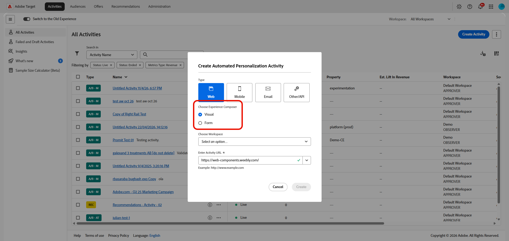
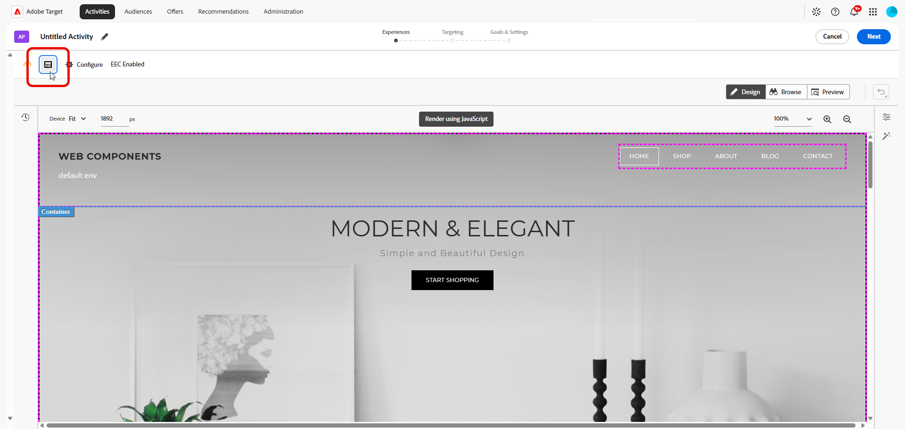

# Crear una actividad [!UICONTROL Automated Personalization] {#create-ap-activity}

>[!BEGINSHADEBOX]

**En esta página:** Aprenda a crear una actividad de **[!UICONTROL Automated Personalization]** (AP) en el **[!UICONTROL Compositor de experiencias visuales]** (VEC). Puede crear sus experiencias, establecer un grupo de segmentación y un grupo de control y, a continuación, configurar los objetivos y la configuración.

>[!ENDSHADEBOX]

El flujo de trabajo de la actividad **[!UICONTROL Automated Personalization]** en [!DNL Target] varía con respecto al flujo de trabajo de los otros tipos de actividad. Sigue el flujo de trabajo guiado de tres pasos en **[!UICONTROL Compositor de experiencias visuales]**:

1. [Creación de experiencias](#build-experiences)
1. [Establecer segmentación](#set-targeting)
1. [Configurar objetivos y opciones](#configure-goals-and-settings)

## Antes de empezar {#before-you-begin}

Para obtener un rendimiento óptimo, mantén tus actividades de **[!UICONTROL Automated Personalization]** y **[!UICONTROL Segmentación automática]** dentro de estos límites:

* De 4 a 6 ubicaciones, con de 4 a 6 ofertas por ubicación.
* Menos de 5000 experiencias totales para obtener los mejores resultados. El límite estricto es de 30 000, y el mismo límite se aplica cuando la opción **[!UICONTROL No permitir duplicados]** está habilitada.

El número total de experiencias crece a partir de la combinación cartesiana de ubicaciones y ofertas. Las configuraciones más grandes pueden provocar una carga o edición lentas en **[!UICONTROL Compositor de experiencias visuales]**.

## Paso 1: Crear experiencias {#build-experiences}

Defina el grupo de variaciones de contenido con las que **[!UICONTROL Automated Personalization]** puede personalizar. Cuanto más enriquecidas y distintas sean sus experiencias y ofertas, mejor podrá el algoritmo hacer coincidir el contenido adecuado con cada visitante.

### Creación de la actividad {#create-activity}

Inicie la actividad y abra la página que desee personalizar en el **[!UICONTROL Compositor de experiencias visuales]** (VEC).

1. En la lista [!DNL Target] **[!UICONTROL Actividades]**, haga clic en **[!UICONTROL Crear actividad]** > **[!UICONTROL Automated Personalization]**.

   

1. Elija su Compositor de experiencias:

   * Para usar el **[!UICONTROL Compositor de experiencias visuales]** (VEC), haz clic en **[!UICONTROL Visual]**.

   * Para usar el **[!UICONTROL Compositor de experiencias basadas en formularios]**, seleccione **[!UICONTROL Formulario]** en su lugar. Consulte [Compositor de experiencias basadas en formularios](/help/main/c-experiences/form-experience-composer.md) para obtener más información.

     >[!NOTE]
     >
     >Además del VEC y **[!UICONTROL Compositor de experiencias basadas en formularios]**, [!DNL Target] ofrece el **[!UICONTROL VEC de aplicaciones de una sola página]**. Para obtener más información sobre los distintos compositores, consulte [Experiencias y ofertas](/help/main/c-experiences/experiences.md). Para obtener información de solución de problemas acerca del VEC, consulte [Solución de problemas del Compositor de experiencias visuales](/help/main/c-experiences/c-visual-experience-composer/r-troubleshoot-composer/troubleshoot-composer.md).

     

1. (Condicional) [Elija un área de trabajo](/help/main/administrating-target/c-user-management/property-channel/property-channel.md).

1. En el cuadro **[!UICONTROL Introducir URL de actividad]**, especifique la [URL de actividad](/help/main/c-activities/t-test-ab/t-test-create-ab/ab-activity-url.md). Si la cuenta se [configura con una dirección URL predeterminada](/help/main/administrating-target/visual-experience-composer-set-up.md) esa dirección URL aparece de manera predeterminada. Puede cambiar la dirección URL predeterminada por otra dirección si es necesario.

   Tenga en cuenta que [!DNL Target] no diferencia entre los protocolos de URL ([!DNL https] y [!DNL http]). Como resultado, [!DNL `http://www.adobe.com`] y [!DNL `https://www.adobe.com`] coinciden.

1. A continuación, haga clic en **[!UICONTROL Crear]**. Se abre la página con la dirección URL especificada en el VEC.

1. Para asignar un nombre a la actividad, haz clic en el icono **[!UICONTROL Editar]** (  ), especifica un nombre descriptivo para la actividad y luego haz clic en **[!UICONTROL Guardar]**.

   {{activity-name-rules}}

   

### Diseño del contenido {#design-content}

Configure el contenido que puede combinar el algoritmo y excluya las experiencias que no desee.

1. Modifique los elementos de página tal como se explica en [Opciones del Compositor de experiencias visuales](/help/main/c-experiences/c-visual-experience-composer/viztarget-options.md).

   * Para previsualizar varias imágenes rápidamente, seleccione varias imágenes a la vez en el administrador de recursos. A continuación, puede ver la página con cada una de las imágenes configuradas para la actividad.
   * Para cambiar el texto de las ofertas, edite el elemento de texto directamente en la página.

   Cuando edita un elemento, aparecen barras en él para indicar que lo ha cambiado.

1. Haga clic en el icono **[!UICONTROL Administrar contenido]** (  ) para configurar las combinaciones disponibles.

   El cuadro de diálogo **[!UICONTROL Administrar contenido]** se abre con dos fichas: **[!UICONTROL Experiencias]** y **[!UICONTROL Ofertas]**.

   

1. En la ficha **[!UICONTROL Experiencias]**, revise la lista de fragmentos de contenido y la ubicación a la que están asignados cada uno.

1. (Opcional) Para excluir experiencias de la actividad, seleccione la casilla de verificación de cada experiencia que desee excluir y, a continuación, haga clic en el icono **[!UICONTROL Excluir]**.

   Para obtener más opciones, consulte [Administración de exclusiones](/help/main/c-activities/t-automated-personalization/managing-exclusions.md).

   

1. (Condicional) Haga clic en la pestaña **[!UICONTROL Ofertas]** para administrar las ofertas de la actividad.

   * Para organizar las ofertas para los informes, seleccione fragmentos de contenido y asígnelos a grupos de informes. Para obtener más información, consulte [Grupos de informes de ofertas en Automated Personalization](/help/main/c-activities/t-automated-personalization/offer-reporting-groups-in-automated-personalization.md).
   * Para limitar quién ve una oferta, utilice la segmentación para permitir que solo determinados visitantes vean esa oferta.

<!--
1. (Conditional) Click **[!UICONTROL Exclusion Groups]** to choose any combination of elements that you want to exclude from the activity.

   

   Although you can create up to 30,000 experiences in an AP test, the algorithm performs its best when fewer than 10,000 distinct experiences are used. This same limit is applied even when the activity has enabled the **[!UICONTROL Disallow Duplicates]** option.

   If you do not currently have any exclusion groups included in your activity, click **Create Exclusion Group**. You can filter to create a list that shows only the combinations you want to exclude. Name your exclusion group, then click **Save**.

   To edit an existing exclusion group, hover over the group you want to edit, then click the pencil icon.
-->

1. Haga clic en **[!UICONTROL Listo]** cuando haya terminado de configurar el contenido de su actividad.

## Paso 2: Establecer el objetivo {#set-targeting}

Decida qué visitantes entran en la actividad y cuánto de su tráfico está expuesto. Emparejarlos con un grupo de control para que [!DNL Target] pueda medir el alza que ofrece la personalización.

1. Haga clic en **[!UICONTROL Segmentación]** en la parte superior de **[!UICONTROL Compositor de experiencias visuales]** para pasar al siguiente paso en el flujo de trabajo guiado de tres pasos.

   

1. (Condicional) Haga clic en el control **[!UICONTROL Todos los visitantes]** para [seleccionar otra audiencia](/help/main/c-activities/t-test-ab/t-test-create-ab/ab-audience.md) para la actividad y establecer su porcentaje de visitantes.

   La audiencia **[!UICONTROL Todos los visitantes]** está establecida como predeterminada. Si selecciona otra audiencia, su nombre se muestra en el control situado más a la izquierda. Por ejemplo, podría limitar las entradas al 50 % de todos los visitantes o al 45 % del público de California.

1. Haga clic en el control **[!UICONTROL Asignación del tráfico]** y elija una de las siguientes opciones:

   

   +++Opciones de objetivo de asignación de tráfico

   | Opción | Cuándo utilizarla |
   |--- |--- |
   | **[!UICONTROL Evaluar el algoritmo de Personalization (50/50)]** | El objetivo es probar el algoritmo. Los visitantes se dividen al 50 % entre el control y el algoritmo seleccionado. Esta división proporciona la estimación más precisa del alza y es la forma más rápida y precisa de probar si el algoritmo tiene un mejor rendimiento que la falta de personalización (por ejemplo, un control servido aleatoriamente). Se sugiere usar con &quot;experiencias aleatorias&quot; como control. |
   | **[!UICONTROL Maximización del tráfico de Personalization (90/10)]** | Su objetivo es crear una actividad &quot;siempre activada&quot;. El 10 % de los visitantes entra en el control, lo que garantiza que haya suficientes datos para que los algoritmos continúen aprendiendo a lo largo del tiempo. Esta es la forma más rápida y precisa de maximizar la cantidad de tráfico personalizado cuando se está menos preocupado por el alza exacta. La compensación es que tiene menos precisión en lo que es el alza exacta. Independientemente del objetivo, esta opción es la división de tráfico recomendada cuando se utiliza una experiencia específica como control. |
   | **[!UICONTROL Asignación personalizada]** | Desea dividir el porcentaje manualmente. |

   +++

1. (Condicional) En la lista desplegable **[!UICONTROL Control]**, [seleccione una experiencia específica para usarla como control](/help/main/c-activities/t-automated-personalization/experience-as-control.md) o seleccione **[!UICONTROL Experiencia aleatoria]**.

   La experiencia de control ofrece una comparación para determinar cuánta alza se proporciona con la prueba automatizada. **[!UICONTROL Automated Personalization]** siempre mide el rendimiento con respecto a un grupo de control. Lo mejor es colocar al menos el 10 % de los participantes en el grupo de control.

   >[!NOTE]
   >
   >En las actividades **[!UICONTROL Automated Personalization]**, los criterios de entrada (segmentación por URL, reglas de plantilla y objetivos de audiencia) se evalúan en cada solicitud. En las versiones anteriores, los criterios de entrada se evaluaban una vez por sesión.

## Paso 3: Configurar los objetivos y la configuración {#configure-goals-and-settings}

Indique a [!DNL Target] la apariencia del éxito. El objetivo de optimización que elija es la métrica con la que se entrena el algoritmo de personalización, por lo que debe elegir el resultado que más importe para esta actividad.

1. Haga clic en **[!UICONTROL Siguiente]** para mostrar la página de **[!UICONTROL Objetivos y configuración]**.

1. Configure la actividad con las siguientes opciones y luego haga clic en **[!UICONTROL Guardar y cerrar]**.

   | Configuración | Descripción |
   |--- |--- |
   | **[!UICONTROL Nombre]** | Asigne un nombre a la actividad. Asigne a la actividad un nombre que sea lo suficientemente descriptivo como para que los integrantes del equipo puedan reconocerlo en la lista **[!UICONTROL Actividades]**. Siga las reglas de nombre de actividad descritas en [Paso 1: Generar experiencias](#build-experiences). |
   | **[!UICONTROL Objetivo]** | (Opcional) Escriba el objetivo de la prueba. El objetivo le ayuda a recordar la finalidad de la actividad. |
   | **[!UICONTROL Prioridad]** | Decide qué actividad se muestra cuando varias actividades comparten una ubicación y una audiencia. Ver [Establecer la prioridad](#set-priority). |
   | **[!UICONTROL Duración]** | Defina las fechas de inicio y finalización de la actividad. Puede seleccionar **[!UICONTROL Al activarlo]** o especificar una fecha y hora específicas. |
   | **[!UICONTROL Objetivo de optimización]** | La métrica con la que se entrena el algoritmo de personalización. Consulte [Establecer el objetivo de optimización](#set-optimization-goal). |
   | **[!UICONTROL Métrica de conversión]** | De forma predeterminada, la métrica de conversión es la misma que la métrica de objetivo de optimización. Sin embargo, puede definir una métrica de conversión independiente desmarcando la opción **[!UICONTROL Igual que el objetivo de optimización]**. |
   | **[!UICONTROL Métricas adicionales]** | Añada las métricas adicionales de creación de informes que desee utilizar. Puede agregar métricas de conversión, participación o ingresos.
**Nota**: La métrica **[!UICONTROL Participación]** no se admite como métrica adicional. Es posible que la interfaz de usuario [!DNL Target] le permita seleccionar la métrica **[!UICONTROL Participación]**, pero los datos no se muestran con precisión en los informes. |
   | **[!UICONTROL Audiencias para informes]** | Añada audiencias para habilitar el filtrado por audiencias en los informes. De manera predeterminada, el informe muestra los resultados para todos los visitantes que cumplen los criterios. Añada audiencias para filtrar los resultados para subconjuntos de visitantes más específicos.
**Nota**: a diferencia de otros tipos de actividades, **[!UICONTROL Automated Personalization]** no puede usar **[!UICONTROL Adobe Analytics]** como fuente de informes (A4T). |
   | **[!UICONTROL Notas]** | Escriba cualquier información sobre la actividad que sea útil para usted o para otros integrantes del equipo. Se puede cambiar el tamaño del panel **[!UICONTROL Notas]**. |

   Al nombrar o cambiar el nombre de una métrica, no se permiten los siguientes caracteres: `/`, `?`, `#`, `:`, `=`, `+`, `-` y `@`.

### Establecer la prioridad {#set-priority}

La prioridad se utiliza si se asignan varias actividades a la misma ubicación con el mismo público. Si se asignan dos o más actividades a una ubicación, se mostrará la actividad con la prioridad más alta.

Según la configuración, la interfaz de usuario de [!DNL Target] y las opciones de **[!UICONTROL Prioridad]** varían:

* **Prioridades heredadas (predeterminado):** Si las prioridades específicas no están habilitadas, especifique una prioridad de **[!UICONTROL Baja]**, **[!UICONTROL Medium]** o **[!UICONTROL Alta]**.
* **Prioridades específicas:** Especifique un valor de 0 a 999, donde 0 = Bajo y 999 = Alto. Para habilitar esta opción, haga clic en **[!UICONTROL Administración]** > **[!UICONTROL Informes]** y luego coloque la opción **[!UICONTROL Habilitar prioridades específicas]** en la posición &quot;Activado&quot;.

Para las actividades creadas en versiones anteriores de [!DNL Target Standard/Premium], la prioridad **[!UICONTROL Low]** se convierte en 0, la prioridad **[!UICONTROL Medium]** se convierte en 5 y la prioridad **[!UICONTROL High]** se convierte en 10. Si lo necesita, puede ajustar estos valores.

>[!NOTE]
>
>Para deshabilitar las prioridades específicas después de usarlas, hay que volver a fijar todas las prioridades en 0, 5 y 10.

### Establecimiento del objetivo de optimización {#set-optimization-goal}

El objetivo de optimización consta de dos parámetros:

* Qué quiere medir con la actividad
* La acción realizada por un participante de la actividad que muestra que se ha alcanzado el objetivo

Puede elegir nombrar el objetivo de optimización seleccionando los tres puntos a la derecha de **[!UICONTROL Mi objetivo principal]**. Las actividades de **[!UICONTROL Automated Personalization]** pueden medir **[!UICONTROL Conversión]** o **[!UICONTROL Ingresos]**. La conversión se puede realizar viendo una página o un mbox. También se realiza un seguimiento de los clics.

El objetivo principal también se convierte en la métrica de modelado que utiliza el sistema de modelado para calcular el éxito de la experiencia.

Los visitantes pueden continuar en la actividad con fines de seguimiento después de alcanzar el objetivo de modelado. Por ejemplo, a menudo se usa una actividad **[!UICONTROL Automated Personalization]** para mejorar las tasas de clics, y eso se establece como objetivo de modelado. Sin embargo, es importante ver cómo el aumento de las tasas de clics conduce a la conversión final, por lo que el seguimiento a través de la conversión final es esencial.

#### Hacer que una métrica dependa de otra {#add-dependency}

Dispone de dependencia respecto a varias métricas y tiene la posibilidad de elegir si una métrica debe alcanzarse o no para que su contador aumente. Debe definir ambas (o varias) métricas de éxito antes de poder hacer una dependiente de la otra. La opción **[!UICONTROL Añadir dependencia]** permite que la métrica de éxito aumente si se alcanza otra métrica de éxito (o todo lo contrario, si no se alcanza).

Para agregar una dependencia:

1. Después de agregar métricas adicionales, haz clic en **[!UICONTROL Configuración avanzada]** en el menú de tres puntos a la derecha de **[!UICONTROL Objetivo adicional]**.

1. Haga clic en la opción **[!UICONTROL Agregar dependencia]** en la parte inferior de la sección **[!UICONTROL Configuración de informes]**.

1. Arrastre y suelte las métricas deseadas del panel izquierdo al panel derecho y, a continuación, haga clic en **[!UICONTROL Alcanzado]** para alternar el valor entre **[!UICONTROL Alcanzado]** y **[!UICONTROL No alcanzado]**.

Puede editar o eliminar dependencias después de añadirlas.

## Previsualizar las experiencias {#preview-experiences}

Compruebe el aspecto de las experiencias en el sitio antes de iniciar la actividad.

1. Después de hacer clic en **[!UICONTROL Guardar y cerrar]**, se muestra la página **[!UICONTROL Información general]** de la actividad. Haga clic en **Previsualizar experiencias**.

1. En la ventana emergente que aparece, vea y comparta vínculos a sus experiencias AP en el sitio. Estos vínculos ofrecen una &quot;auténtica vista previa&quot; de las experiencias fuera de **[!UICONTROL Target]** **[!UICONTROL Compositor de experiencias visuales]** (VEC).

   >[!NOTE]
   >
   >Debe compartir los vínculos del mensaje para compartir la vista previa. No funciona hacer clic en un vínculo y copiar la dirección URL directamente desde el explorador. Si se copia el vínculo, la dirección URL contiene un parámetro que muestra la página correctamente solo cuando se accede a la página desde el vínculo del mensaje.

Para obtener información sobre los informes, consulte [Informes de Personalización automatizada](/help/main/c-reports/personalization-reports/reports-ap.md).
