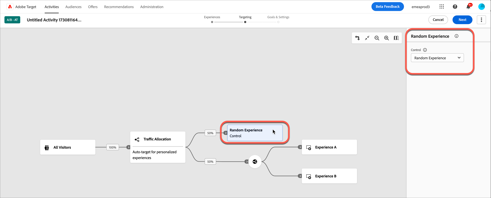
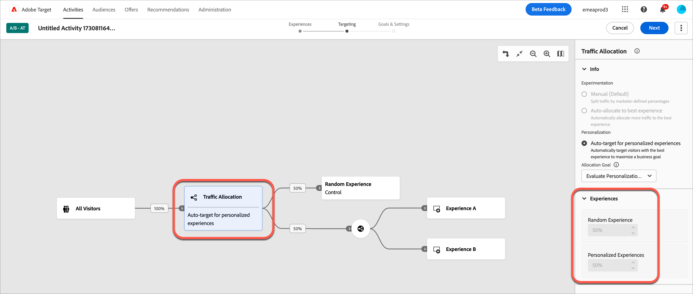

# Selección de la experiencia de control {#experience-as-control}

>[!BEGINSHADEBOX]

**En esta página:** Aprenda a elegir el control de una actividad de **[!UICONTROL Automated Personalization]** o **[!UICONTROL Segmentación automática]**, y qué debe tener en cuenta al usar una experiencia específica como control.

>[!ENDSHADEBOX]

Puede seleccionar una experiencia servida aleatoriamente o una experiencia específica para utilizarla como control al crear una actividad [**[!UICONTROL Automated Personalization]**](/help/main/c-activities/t-automated-personalization/automated-personalization.md#automated-personalization-overview) (AP) o [**[!UICONTROL Segmentación automática]**](/help/main/c-activities/auto-target/auto-target-to-optimize.md) (AT). El tráfico de control se enruta a las experiencias relevantes en función del porcentaje de asignación de tráfico configurado en la actividad, de modo que se puedan evaluar los informes de rendimiento del tráfico personalizado respecto al tráfico de control.

En una prueba manual **[!UICONTROL A/B Test]**, puede cambiar lo que el informe muestra como control y el alza se calcula a partir de esa experiencia, ya que el tráfico se sirve aleatoriamente a todas las experiencias, independientemente del control. En las actividades **[!UICONTROL Automated Personalization]** y **[!UICONTROL Segmentación automática]**, el control afecta al modo en que se sirve el tráfico de visitantes, por lo que debe elegirlo con cuidado.

Hay dos opciones disponibles para el control:

* **Servido de forma aleatoria:** El porcentaje de control de tráfico proporciona todas las experiencias de la actividad sin tener en cuenta el perfil del visitante. Funciona como una **[!UICONTROL Prueba A/B]** dentro de tu actividad y muestra la tasa de conversión no personalizada de cada experiencia u oferta, lo que te ayuda a analizar los resultados.

* **Experiencia específica:** El porcentaje de control de tráfico proporciona solo una experiencia de forma aleatoria. Esta opción le permite comparar el tráfico servido por los modelos de personalización de [!DNL Target] con una experiencia específica que usted define, por ejemplo, su página principal predeterminada.

## Consideraciones {#considerations}

Tenga en cuenta los siguientes puntos al utilizar una experiencia específica como control:

* No se recomienda cambiar la experiencia de control en una actividad ya activa. La última experiencia de control seleccionada se nombra en los informes, incluso si los informes anteriores se basan en otra experiencia.

* No se recomienda eliminar la experiencia de control.

* No se recomienda añadir muchas ofertas o experiencias nuevas a una actividad en directo con una experiencia específica como control.

* En **[!UICONTROL Automated Personalization]** actividades no se recomienda incluir la segmentación en la experiencia de control que podría restringir aún más a los usuarios que ven esa experiencia.

* En las actividades de **[!UICONTROL Automated Personalization]**, la información de crecimiento y de confianza está *no* disponible en el informe de nivel de oferta si se selecciona una experiencia específica. Esto se debe a que la comparación de la tasa de conversión de una experiencia específica con la tasa de conversión de una oferta no es lógica debido a la diferencia en las unidades. La información de crecimiento y de confianza está disponible en el nivel de tráfico &quot;segmentado&quot; y &quot;de control&quot; para la actividad, y en todos los niveles si se selecciona &quot;aleatorio&quot; como control. La información disponible en una actividad **[!UICONTROL Segmentación automática]** es la misma, independientemente del tipo de control seleccionado.

* Al seleccionar una experiencia específica como control, todo el tráfico de control se dirige a una única experiencia o conjunto de ofertas. Con un control aleatorio, el tráfico de control se divide sobre la cantidad de experiencias u ofertas de la actividad. Como resultado, generalmente no necesita tanta cantidad de tráfico para fluir al control con una experiencia específica. 10% es una buena cifra para empezar.

* Si realiza una de las siguientes acciones en una actividad en directo con una experiencia específica como control, el control se restablece automáticamente a experiencias servidas aleatoriamente (en lugar de a la experiencia específica seleccionada anteriormente):

  * Eliminar una experiencia.
  * Quitar una ubicación u oferta (**[!UICONTROL Automated Personalization]** solamente).
  * Excluir una experiencia manualmente, eliminando ofertas duplicadas o mediante un grupo de exclusión (**[!UICONTROL Automated Personalization]** solamente).

## Especificar una experiencia determinada como control {#specify-control}

Especificar una experiencia específica como control proporciona al tráfico personalizado una experiencia conocida con la que comparar, como la experiencia predeterminada actual, en los informes de la actividad.

1. Al crear o editar una actividad [**[!UICONTROL Automated Personalization ]**](/help/main/c-activities/t-automated-personalization/create-ap-activity.md#create-ap-activity) o una actividad [**[!UICONTROL Segmentación automática]**](/help/main/c-activities/auto-target/create-auto-target.md#create-auto-target-activity), configure las experiencias como desee.

1. En la página **[!UICONTROL Segmentación]** (paso 2 del flujo de trabajo guiado de tres partes), haga clic en la experiencia de control para mostrar las opciones de **[!UICONTROL Control]** en el panel derecho.

   

1. En la lista desplegable **[!UICONTROL Control]**, seleccione **[!UICONTROL Experiencia aleatoria]** o la experiencia que desee usar como control.

1. Haga clic en el control **[!UICONTROL Asignación del tráfico]** y, a continuación, especifique la asignación del tráfico para la experiencia de control y las demás experiencias.

   

   Para un control de experiencia específico, se recomienda el 10% y el 30%.

1. Continúe con la página **[!UICONTROL Objetivos y configuración]**.

Una vez que la actividad está activa, sus informes comparan el tráfico personalizado con la experiencia de control seleccionada. Revise las [consideraciones](#considerations) antes de cambiar una actividad en directo, ya que algunos cambios restablecen automáticamente el control a las experiencias servidas aleatoriamente.
