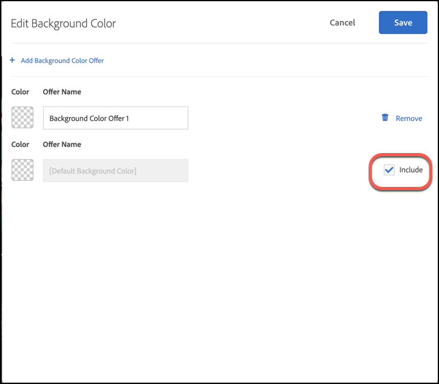

# Gestión de exclusiones {#manage-exclusions}

>[!BEGINSHADEBOX]

**En esta página:** Aprenda a evitar ofertas duplicadas, excluir experiencias específicas y excluir contenido predeterminado en actividades **[!UICONTROL Automated Personalization]**.

>[!ENDSHADEBOX]

Las exclusiones controlan qué ofertas y experiencias sirve una actividad **[!UICONTROL Automated Personalization]** (AP). Evitan que la misma oferta se muestre dos veces, eliminan las combinaciones de ofertas que no funcionan juntas y eliminan el contenido predeterminado, de modo que la actividad ofrezca experiencias más limpias y relevantes que se alineen con los objetivos y la audiencia.

## Permitir o no permitir ofertas duplicadas {#allow-duplicate-offers}

Impida que las ofertas de la biblioteca de ofertas se dupliquen cuando se utilicen en distintas ubicaciones en actividades AP.

Una actividad puede tener, por ejemplo, seis ubicaciones en una página con 12 ofertas, por lo que la misma oferta podría colocarse en más de una ubicación. Si no se permiten ofertas duplicadas, la misma oferta no se muestra al mismo tiempo en diferentes ubicaciones dentro de la misma actividad.

1. Mientras [crea o edita una actividad AP](/help/main/c-activities/t-automated-personalization/create-ap-activity.md#create-ap-activity), haga clic en el icono **[!UICONTROL Configurar]** (  ).

1. Haga clic en **[!UICONTROL Permitir ofertas duplicadas]** para activar o desactivar esta característica, según sus necesidades.

   

## Excluir experiencias específicas {#exclude-experiences}

Excluya experiencias específicas para eliminar determinadas combinaciones de ofertas de la actividad de AP. Es posible que algunas combinaciones no funcionen juntas o que limite el número de experiencias probadas para reducir los requisitos de tráfico de la actividad.

1. Mientras [crea o edita una actividad de AP](/help/main/c-activities/t-automated-personalization/create-ap-activity.md#create-ap-activity), haga clic en el icono **[!UICONTROL Administrar contenido]** (  ).

   La lista de **[!UICONTROL Experiencias]** muestra cada experiencia generada a partir de las permutaciones de todas las opciones de contenido y ubicación.

1. Excluya las experiencias que no desee probar.

   * Para excluir una sola experiencia, haga clic en el icono **[!UICONTROL Más acciones]** (  ) y, a continuación, haga clic en **[!UICONTROL Excluir]**.
   * Para excluir varias experiencias a la vez, selecciona la casilla de verificación de cada experiencia y luego haz clic en **[!UICONTROL Excluir]**. El icono **[!UICONTROL Excluir]** se muestra cuando se seleccionan una o más experiencias.

   

   Las experiencias ahora se excluyen de la actividad y su **[!UICONTROL estado]** se muestra como **[!UICONTROL Excluido]**.

## Excluir contenido predeterminado {#exclude-default-content}

Excluya el contenido predeterminado cuando no desee que forme parte de su actividad de AP, de modo que una ubicación contenga solo una oferta que difiera del contenido predeterminado. Este método también permite cambiar el aspecto del resto de la página para adaptarla a las ofertas que pruebe. Por ejemplo, para que coincida con la paleta de colores de las ofertas, puede cambiar el color de fondo de la página y excluir el color de fondo predeterminado.

1. Mientras [crea o edita una actividad AP](/help/main/c-activities/t-automated-personalization/create-ap-activity.md#create-ap-activity), selecciona el contenido que deseas reemplazar y luego haz clic en **[!UICONTROL Cambiar texto/HTML]**, **[!UICONTROL Cambiar oferta de imagen]** o **[!UICONTROL Cambiar color de fondo]**. Las opciones disponibles varían según el tipo de contenido.

   

1. Cree su nuevo contenido.

1. Haga clic en el icono **[!UICONTROL Más acciones]** (  ) y, a continuación, haga clic en el botón **Excluir oferta predeterminada/Incluir oferta predeterminada** para excluir o incluir la oferta predeterminada.

   <!--
   Depending on the content or offer type, the [!UICONTROL Include] checkbox is in a slightly different place. 

   For Text/HTML content: 

   

   For Image/Video content: 

   

   For background color: 

   
   -->

<!--
1. Click **[!UICONTROL Save]**.

   You can see the experiences created from the offers you specified under [!UICONTROL Manage Content]. You notice that no experiences are created in [!UICONTROL Manage Content] using the default offer you excluded. 

   

**To exclude default content using the [!UICONTROL Form-Based Experience Composer]:** 

1. While creating or editing an AP activity, click **[!UICONTROL Change Text/HTML]** or **[!UICONTROL Change Image Offer]** under **[!UICONTROL Content]**. 
1. In the dialog box, create your new content and uncheck **[!UICONTROL Include]** to the right of the default content (or uncheck the Default Image/Video in the [!UICONTROL Select Content] screen). 

   Depending on the content or offer type, the [!UICONTROL Include] checkbox is in a slightly different place. 

   For Text/HTML content: 

   

   For Image/Video content: 

   

1. Click **[!UICONTROL Save]**. 

   You can see the experiences created from the offers you specified under [!UICONTROL Manage Content]. You notice that no experiences are created in [!UICONTROL Manage Content] using the default offer you excluded. 

   
-->
