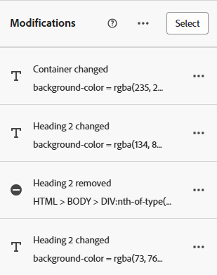
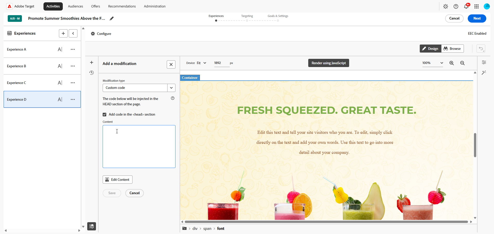

# Introducción a las modificaciones {#vec-code-editor}

>[!BEGINSHADEBOX]

**En esta página:** Aprenda a ver, editar, eliminar y agregar modificaciones en el panel **[!UICONTROL Modificaciones]** del [!UICONTROL Compositor de experiencias visuales] (VEC) y a utilizar código personalizado.

>[!ENDSHADEBOX]

El panel **[!UICONTROL Modificaciones]** de [!DNL Adobe Target] muestra todos los cambios realizados en la página en el [!UICONTROL Compositor de experiencias visuales] (VEC), y permite realizar cambios adicionales al hacer clic en cada elemento de la página y [seleccionar una acción](/help/main/c-experiences/c-visual-experience-composer/viztarget-options.md). Cada cambio aparece como una acción o elemento independiente en la lista **[!UICONTROL Modificaciones]**. Las modificaciones también se pueden agregar directamente, de los siguientes tipos: Selector de CSS, Mbox y Código personalizado.

## Información general sobre modificaciones {#modifications-overview}

La página **[!UICONTROL Modificaciones]** realiza pequeños cambios en el selector que [!DNL Target] elige cuando el VEC configura el modo en que se entrega el contenido. Se puede cambiar el contenido o un atributo de HTML. El código también se puede editar para crear el equivalente de una oferta de HTML dentro de un mbox.


La página **[!UICONTROL Modificaciones]** se puede usar para:

* Ver una acción realizada en el compositor visual.

  

* Editar una acción existente. Acceda al menú avanzado y seleccione **[!UICONTROL Editar]**.

  

  Realice los cambios.

  

* Eliminar una acción existente. Acceda al menú avanzado y seleccione **[!UICONTROL Eliminar modificación]**.

  

* Agregar una nueva modificación. Acceda al menú avanzado **[!UICONTROL Modificaciones]** y seleccione **[!UICONTROL Agregar una modificación]**; a continuación, especifique los cambios tal como se describe en [Agregar modificaciones](#add-modifications).

  

## Añadir modificaciones {#add-modifications}

Las modificaciones se agregan desde el panel **[!UICONTROL Modificaciones]** para la experiencia seleccionada en el VEC.

1. Para mostrar **[!UICONTROL Modificaciones]**, haga clic en **[!UICONTROL Mostrar modificaciones]**.

   

   Para abrir el panel **[!UICONTROL Modificaciones]** en el Compositor de experiencias basadas en formularios, cree o edite una oferta de HTML. Para obtener más información, consulte [Compositor de experiencias basadas en formularios](/help/main/c-experiences/form-experience-composer.md).

1. Para agregar una modificación:

   * Si no se han realizado modificaciones previas en la experiencia, haga clic en **[!UICONTROL Agregar modificación]** en el panel **[!UICONTROL Modificaciones]**.
   * Si hay modificaciones previas en la experiencia, accede al menú avanzado **[!UICONTROL Modificaciones]** y selecciona **[!UICONTROL Agregar una modificación]**.

   Se muestra el panel **[!UICONTROL Modificaciones]**:

   

1. En la lista desplegable **[!UICONTROL Tipo de modificación]**, elija el tipo que desee:

   | Tipo de modificación | Detalles |
   |--- |--- |
   | Selector de CSS | En el cuadro **[!UICONTROL Selector de elemento CSS]**, especifique el elemento CSS que desea modificar, seleccione un tipo de acción (**[!UICONTROL Establecer contenido]** o **[!UICONTROL Establecer atributo]**) y, a continuación, rellene la información necesaria y el contenido deseado. |
   | Mbox | Especifique el nombre del mbox y el contenido deseado. |
   | Código personalizado | Especifique un nombre opcional, seleccione o anule la selección de la casilla de verificación **[!UICONTROL Agregar código en la sección `<HEAD>`]**, según sus preferencias, y después agregue el código personalizado. Para obtener más información, consulte [Código personalizado](#custom-code). |

   >[!NOTE]
   >
   >Los mboxes ya no son compatibles con el VEC en páginas que usan at.js 2.*x*. Como solución alternativa:
   >
   >* Si usa at.js 2.*x*, agregue una modificación del selector de CSS en lugar de una modificación de Mbox y agregue el contenido en el selector que estaba usando el mbox.
   >* Usar actividades basadas en formularios (funciona con mboxes y at.js 1.*x* y at.js 2.*x*).
   >* Usar at.js 1.*x* en el VEC.

1. Agregue todas las modificaciones que sean necesarias.

## Código personalizado {#custom-code}

Código personalizado ofrece una interfaz no visual para ver, modificar y agregar nuevas acciones dentro del VEC, del Compositor de experiencias basadas en formularios y del editor de ofertas HTML. El panel proporciona una vista de código de una experiencia para ayudar a crear experiencias más complejas, ajustar las existentes y solucionar problemas.

Código personalizado está pensado para usuarios avanzados que se sientan cómodos con HTML, JavaScript y CSS. La vista de código puede ayudar a modificar o ajustar los cambios, o a solucionar problemas con el selector. También se puede usar para agregar nuevo código y nuevas acciones personalizados. Se puede agregar más de un código personalizado y, opcionalmente, se puede asignar un nombre a cada uno.



El código personalizado se comporta de la siguiente manera:

* Cuando se selecciona **[!UICONTROL Agregar código en la sección `<HEAD>`]**, se agrega código personalizado a la sección `<head>` y su ejecución no espera a eventos de cuerpo o de carga de página. Añada solo los elementos `<script>` y `<style>`. Si se agregan etiquetas de `<div>` y otros elementos, es posible que `<head>` elementos restantes pasen al `<body>`. Si se utiliza at.js, todas las ofertas se entregan de forma asíncrona.
* Cuando **[!UICONTROL Agregar código en la sección `<HEAD>`]** no está seleccionado, el código personalizado se ejecuta inmediatamente después de la etiqueta `<body>`. Agrupe todos los códigos en un único `<div>` para conservar la estructura del DOM. Si se utiliza at.js, todas las ofertas se entregan de forma asíncrona.
* Si la HTML de `<BODY>` contiene `<SCRIPT>` y `<DIV>`, `<DIV>` se anexa a `<BODY>` y `<SCRIPT>` se ejecuta en `<HEAD>`. `<SCRIPT>` que carga un archivo externo también se anexa a `<HEAD>`.
* Los scripts se ejecutan de forma asincrónica. Esto significa que no se pueden usar `document.write` y métodos de script similares.
* Código personalizado está disponible actualmente solo para actividades A/B y de segmentación de experiencias (XT). Código personalizado se desactiva para el solapamiento y si se aplica una oferta de redirección.

Código personalizado admite los siguientes casos de uso:

* Añada JavaScript, HTML o CSS personalizados para ejecutarlos en la parte superior de la página
* Ver o editar el código generado por el VEC después de realizar modificaciones
* Establecer contenido HTML para un selector (selectores CSS solamente)
* Establecer un atributo en un elemento HTML
* Agregar contenido de oferta para que se entregue en un mbox regional
* Intercambiar el DOM listo, con jQuery
* Intercambiar el DOM listo, sin jQuery (no admite Internet Explorer 8)
* Intercambiar con sondeo DOM mediante el complemento &quot;elementOnLoad&quot;
* Redireccionamiento personalizado

Código personalizado proporciona:

* Números de línea para mejorar el uso.
* Resaltado de sintaxis para evitar una sintaxis incorrecta para las ofertas de HTML.
* Capacidad para crear varios códigos personalizados y, si lo desea, proporcionar un nombre para cada uno. La creación de varios códigos personalizados facilita la depuración futura. Por ejemplo, en lugar de crear un único código personalizado para realizar varias modificaciones, se puede crear un código personalizado independiente para cada modificación, con un nombre descriptivo. Los códigos personalizados independientes hacen que las modificaciones sean más modulares y manejables. No se garantiza que la ejecución de varios códigos personalizados en una actividad se produzca en la secuencia en que se crearon.

El panel **[!UICONTROL Modificaciones]** divide la pantalla entre el modo visual y el modo de código. Ambos modos permanecen sincronizados. Toda modificación realizada visualmente tiene una fila correspondiente en la vista de código. Igualmente, cada cambio realizado en la vista de código se muestra en la experiencia visual. Al hacer clic en cualquier fila de la vista de código, se selecciona el elemento correspondiente de la página visual.

Código personalizado admite HTML, scripts y estilos. Se puede agregar o editar cualquier script o código HTML válido.

## Ejemplos de código personalizado {#custom-code-examples}

El panel **[!UICONTROL Código personalizado]** contiene código que se ejecuta cuando la página empieza a cargarse. El código JavaScript se puede ejecutar en la etiqueta `<head>`. La ejecución del código no espera a que la etiqueta `<body>` esté presente en el DOM. Los selectores para acciones visuales siguientes dependen de los elementos HTML agregados en esta pestaña.

El panel **[!UICONTROL Código personalizado]** se usa comúnmente para agregar JavaScript o CSS al principio de la página.

Use la pestaña **[!UICONTROL Código personalizado]** para:

* Usar JavaScript en línea o vincular a un archivo JavaScript externo

  Por ejemplo, para cambiar el color de un elemento:

  ```javascript
  <script type="text/javascript"> 
  document.getElementById("element_id").style.color = "blue"; 
  </script> 
  ```

* Configurar un estilo en línea o vincular a una hoja de estilos externa

  Por ejemplo, para definir una clase para un elemento overlay:

  ```html
  <style> 
  .overlay 
  { position: absolute; top:0; left: 0; right: 0; bottom: 0; background: red; } 
  </style> 
  ```

* Agregar fragmentos de código HTML para definir nuevos elementos

  Por ejemplo, use el siguiente fragmento de código de HTML para crear una superposición `<div>` que use la clase CSS definida anteriormente:

  ```html
  <div class="overlay"></div>
  ```

* Intercambiar el DOM listo, con jQuery

  El ejemplo siguiente supone que el sitio web del cliente tiene jQuery disponible en la página cuando [!DNL Target] ejecuta las ofertas.

  ```javascript
  <style>#default_content {visibility:hidden;}</style> 
  <script> 
  jQuery( document ).ready(function() { 
      jQuery("#default_content").html( "<span style='color:red'>Hello <strong>Again</strong></span>" ); 
      jQuery("#default_content").css("visibility","visible"); 
  }); 
  </script> 
  ```

* Intercambiar el DOM listo, sin jQuery (no admite Internet Explorer 8)

  ```javascript
  <style>#default_content {visibility:hidden;}</style> 
  <script> 
  document.addEventListener("DOMContentLoaded", function(event) {  
      document.getElementById("default_content").innerHTML = "<span style='color:red'>Hello <strong>Again</strong></span>"; 
      document.getElementById("default_content").style.visibility="visible"; 
  }); 
  </script> 
  ```

* Redireccionamiento personalizado que pasa los parámetros existentes, el parámetro `s_tnt` (para la integración heredada con Analytics), el parámetro referrer y la sesión mbox

  ```javascript
  <style type="text/css">body{display:none!important;}</style> 
  <script type="text/javascript"> 
   var qs='';window.location.search?qs=window.location.search+'&':qs='?'; 
   window.location.replace('//www.mywebsite.com/'+qs+'s_tnt=${campaign.id}:${campaign.recipe.id}:${campaign.recipe.trafficType}&s_tntref='+encodeURIComponent(document.referrer)+'&mboxSession='+mboxFactoryDefault.getSessionId().getId()+''+window.location.hash+''); 
  </script> 
  ```

* Agregar [!DNL Adobe Target] plantillas de experiencia para usar en código personalizado

  Las plantillas de experiencia son muestras precodificadas con entradas configurables que se utilizan para ejecutar casos de uso habituales para expertos en marketing. Se proporcionan gratuitamente a los desarrolladores y especialistas en marketing como punto de partida para la ejecución de casos de uso comunes, ya sea mediante el VEC o el Compositor de experiencias basadas en formularios. Los casos de uso incluyen cajas de luz, carruseles, cuentas atrás y más. Para obtener más información, consulte [Plantillas de experiencias](/help/main/c-experiences/c-visual-experience-composer/c-vec-code-editor/experience-templates.md).

## Prácticas recomendadas de código personalizado {#custom-code-best-practices}

* **Siempre ajuste el código personalizado en un elemento.**

  Por ejemplo:

```html
<div id="custom-code"> 
// My Code goes here 
</div>
```

Si es necesario realizar modificaciones, realice los cambios dentro de este contenedor. Si el código personalizado ya no es necesario, deje este contenedor vacío, pero no lo elimine. Esto garantiza que otras modificaciones de la experiencia no se vean afectadas.

* **No use el ID de elemento “CDQID” para modificaciones de la página realizadas en el Editor de código.**

  [!DNL Target] aplica un nuevo identificador de elemento con el valor &quot;CDQID&quot; a cualquier elemento de la página que haya sido modificado por [!DNL Target]. [!DNL Target] ha aplicado este identificador, por lo que no debería utilizarse para realizar más modificaciones o ajustes en el Editor de código.

* **No realice `document.write` acciones en scripts de código personalizado.**

  Los scripts se ejecutan de forma asincrónica. Esto a menudo hace que `document.write` acciones aparezcan en el lugar incorrecto de la página. No se recomienda el uso de `document.write` en scripts creados con código personalizado.

* **Si se crea y después se modifica un elemento, no elimine el elemento original.**

  Cada cambio crea un nuevo elemento en el panel **[!UICONTROL Modificaciones]**. La segunda acción modifica al Elemento 1, por lo que si se elimina el Elemento 1, esa acción ya no tiene nada que modificar y el cambio ya no funciona. Consulte [Solución de problemas con el código personalizado](#troubleshooting-custom-code) para obtener más información.

* **Tenga cuidado al usar la característica de código personalizado para dos actividades dirigidas a la misma dirección URL.**

  Cuando se utiliza la función de código personalizado para dos actividades dirigidas a la misma dirección URL, JavaScript se inserta en la página desde ambas actividades. [!DNL Target] determina automáticamente el orden del contenido enviado. Asegúrese de que el código no depende de la ubicación. El autor del código es responsable de asegurarse de que no haya conflictos en el código.

## Solución de problemas de código personalizado {#troubleshooting-custom-code}

+++ ¿Por qué no se ejecuta el código personalizado al usar `triggerView`?

Las ofertas de código personalizado del VEC no se vuelven a procesar cuando `triggerView()` se llama con `{page: false}` como la opción.

+++

+++ ¿Qué significa la advertencia de que una acción no se puede aplicar debido a cambios estructurales en una página?

Este mensaje indica que la estructura de la página ha cambiado desde la última vez que se guardó la actividad.


Se puede acceder a los selectores que faltan mediante el modo Examinar. Adobe recomienda eliminar y volver a crear cada experiencia para garantizar que el contenido tiene el aspecto esperado, tal como se indica en el mensaje de advertencia.

+++

+++ ¿Qué significa la advertencia &quot;Eliminar esta acción puede afectar a las acciones siguientes&quot;?

Por ejemplo, se podrían haber realizado dos acciones:

* Ha agregado una clase al Elemento 1
* Ha editado el HTML del Elemento 1

Cada cambio crea un nuevo elemento en el panel **[!UICONTROL Modificaciones]**. La segunda acción modifica al Elemento 1, por lo que si se elimina el Elemento 1, la segunda acción ya no tiene nada que modificar y el cambio ya no funciona.

En otras palabras, si se agrega un elemento con texto y el elemento se edita con texto diferente en una acción independiente, el panel **[!UICONTROL Modificaciones]** muestra ambas acciones como elementos independientes. Al editar el elemento, se crea un nuevo elemento que modifica el original y contiene el texto editado. Si a continuación se elimina el elemento original, el texto editado no encontrará el elemento editado y no se mostrará. El segundo elemento permanece en la lista de elementos, pero no afecta a la página porque el elemento al que cambia ya no existe.

+++

+++ ¿Por qué un elemento creado con `document.write` en un script no aparece donde se esperaba?

Los scripts se ejecutan de forma asincrónica. Esto a menudo hace que `document.write` acciones aparezcan en el lugar incorrecto de la página. Adobe no recomienda el uso de `document.write` en scripts creados con código personalizado.

+++

+++ ¿Por qué JavaScript muestra errores en el código personalizado?

Cualquier JavaScript en línea que no sea un JavaScript válido muestra errores en el código personalizado.

+++

+++ ¿Por qué no se puede deshacer un cambio en el código personalizado?

En este momento no se admite deshacer para las acciones de edición y eliminación del panel **[!UICONTROL Modificaciones]** ni en el código personalizado. Deshacer una de estas operaciones podría provocar que la experiencia en el VEC no parezca coherente con las acciones que se muestran en el código personalizado. Sin embargo, las acciones del código personalizado están en el estado correcto y no afectan a la entrega. Este es un problema de la interfaz de usuario. Para actualizar la experiencia, guarde y abra de nuevo o vaya al paso siguiente y regrese. Cualquiera de estas acciones vuelve a cargar la experiencia, por lo que aparece como se espera y es coherente con las acciones del panel **[!UICONTROL Modificaciones]**.

+++

+++ ¿Por qué el código personalizado no produce los resultados esperados en Internet Explorer 8?

[!DNL Target] ya no admite Internet Explorer 8.

+++
