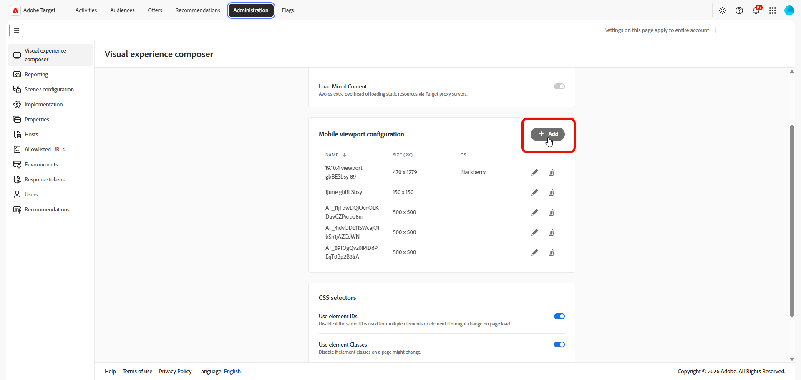

# Ventanillas móviles para las experiencias adaptables {#mobile-viewports}

>[!BEGINSHADEBOX]

**En esta página:** Aprenda a configurar las ventanillas móviles y a utilizarlas para obtener una vista previa y crear experiencias para pantallas de diversos tamaños.

>[!ENDSHADEBOX]

Las ventanillas móviles muestran [!DNL Adobe Target] actividades en los tamaños de pantalla de varios dispositivos. Están diseñadas para sitios adaptables, que se adaptan automáticamente a equipos de escritorio, portátiles, tabletas y teléfonos móviles, y permiten comprobar que una experiencia se procesa bien en cada uno de ellos.

>[!NOTE]
>
> * Utilice ventanillas móviles cuando el sitio sea adaptable y la página móvil vuelva a utilizar los elementos de la página de escritorio con un diseño diferente. Cuando el sitio móvil sea independiente y tenga su propia estructura, como `m.mysite.com`, use una [actividad multipágina](/help/main/c-experiences/c-visual-experience-composer/multipage-activity.md#multipage-activity) en su lugar.
>
>* Las ventanillas móviles no están disponibles cuando una superposición de oferta de redireccionamiento se superpone con ellas.

## Ventanillas y puntos de interrupción CSS

Una ventanilla móvil es el área de la pantalla que rellena una página web: el tamaño de la ventana del explorador, menos las barras de desplazamiento y las barras de herramientas. Los navegadores lo miden en píxeles CSS, por lo que en muchos dispositivos, como los que tienen pantallas de retina, la ventanilla es más pequeña que la resolución del dispositivo anunciada. Utilice siempre el tamaño de ventanilla móvil en [!DNL Target]. La siguiente tabla enumera ambos valores para dispositivos populares.

+++ Ventanillas y resoluciones de dispositivos populares

>[!NOTE]
>
>Diversos sitios web enumeran los tamaños de las ventanillas para dispositivos populares. Por ejemplo, consulte `https://viewportsizer.com/devices/`. Consulte el sitio web del fabricante del dispositivo para obtener la información más precisa y actualizada.
>
>Tamaños de las ventanillas marcadas como &quot;est&quot;. son estimaciones.

| Dispositivo | Tamaño de la ventanilla (anchura x altura) | Resolución del dispositivo (ancho x alto) |
|---|---|---|
| iPhone 18 Pro Max | 440 x 956 | 1320 x 2868 |
| iPhone 18 Pro | 402 x 874 | 1206 x 2622 |
| iPhone 17 Pro Max | 440 x 956 | 1320 x 2868 |
| iPhone 17 Pro | 402 x 874 | 1206 x 2622 |
| iPhone Air | 420 x 912 | 1260 x 2736 |
| iPhone 17 | 402 x 874 | 1206 x 2622 |
| iPhone 16e | 390 x 844 | 1170 x 2532 |
| iPad (A16) | 820 x 1180 | 1640 x 2360 |
| iPad mini (A17 Pro) | 744 x 1133 | 1488 x 2266 |
| iPad Air 11″ (M3/M4) | 820 x 1180 | 1640 x 2360 |
| iPad Pro 11″ (M5) | 834 x 1210 | 1668 x 2420 |
| Google Pixel 11 | 412 x 924 (est.) | 1080 x 2424 |
| Google Pixel 11 Pro | 410 x 914 (est.) | 1280 x 2856 |
| Google Pixel 11 Pro XL | 448 x 997 (est.) | 1344 x 2992 |
| Google Pixel 10 | 412 x 924 | 1080 x 2424 |
| Google Pixel 10 Pro | 410 x 914 (est.) | 1280 x 2856 |
| Google Pixel 10 Pro XL | 448 x 997 (est.) | 1344 x 2992 |
| Samsung Galaxy S26 | 360 x 780 | 1080 x 2340 |
| Samsung Galaxy S26 Ultra | 412 x 891 | 1440 x 3120 |
| iPhone Duo (desplegado) | 890 x 626 (est.) | 2670 x 1878 |
| iPhone Duo (plegado) | 466 x 678 (est.) | 1398 x 2034 |
| Samsung Galaxy Z Fold 7 (plegado) | 412 x 960 (est.) | 1080 x 2520 |
| Samsung Galaxy Z Flip 8 | 360 x 840 (est.) | 1080 x 2520 |
| Google Pixel 11 Pro Fold (desplegado) | 791 x 820 (est.) | 2076 x 2152 |

+++

Un sitio adaptable cambia a un diseño diferente en tamaños de pantalla específicos. Estos tamaños se denominan puntos de interrupción CSS o [consultas de medios](https://developer.mozilla.org/en-US/docs/Web/CSS/Media_Queries/Using_media_queries). Guardar los puntos de interrupción CSS del sitio en [!DNL Target] permite obtener una vista previa de cada vista, y al hacer clic en una ventanilla a lo largo de la parte superior de la pantalla se abre la vista para ese tamaño de pantalla.

Para enviar una actividad a un dispositivo concreto, seleccione la audiencia de dicho dispositivo en el diagrama de actividad y, a continuación, edite la página de dicho dispositivo en el Compositor web móvil. La misma herramienta se utiliza para ver un sitio que no responde cuando la actividad se dirige a un dispositivo específico. Para ejecutar una actividad en todos los dispositivos, no aplique ningún objetivo y previsualice la actividad en cada tamaño de pantalla con ventanillas móviles.

>[!IMPORTANT]
>
>Las experiencias se pueden editar desde las ventanillas móviles, pero los cambios se aplican a todas las ventanillas y todos los dispositivos, no solo a la ventanilla móvil en uso. Del mismo modo, si edita una experiencia en la vista de escritorio, se cambia la página en todos los tamaños de pantalla. [!DNL Target] no admite actualmente cambios de página específicos de ventanilla móvil.

## Configuración de las ventanillas móviles {#task_B4B161499DC0470584ED922A4D20FCAB}

Defina las ventanillas móviles que están disponibles al crear experiencias.

1. Haga clic en **[!UICONTROL Administración]** > **[!UICONTROL Compositor de experiencias visuales]**.
1. En la sección **[!UICONTROL Configuración de ventanillas móviles]**, haga clic en **[!UICONTROL Agregar]**.

   

   O

   Para cambiar la configuración de una ventanilla móvil existente, selecciónela y luego haga clic en el icono **[!UICONTROL Editar]** (lápiz).

1. Escriba un nombre descriptivo para la ventanilla móvil. El nombre puede tener hasta 36 caracteres.
1. Introduzca el tamaño de pantalla del dispositivo móvil. La anchura puede ser de 150 a 968 píxeles y la altura puede ser de 150 a 1280 píxeles.
1. (Opcional) Seleccione el sistema operativo del dispositivo.

   Opciones:

   * Android
   * iOS
   * Windows
   * Symbian
   * BlackBerry

   Si el [Compositor de experiencias mejorado](/help/main/c-experiences/c-visual-experience-composer/experience-composer-best-practices.md#enable-eec) está habilitado y se selecciona un sistema operativo, [!DNL Target] emula ese dispositivo cuando se visualiza la página. Por ejemplo, si el sitio adaptable tiene un aspecto diferente para Android y para iOS, [!DNL Target] imita ese comportamiento.

1. Haga clic en **[!UICONTROL Guardar]**.

>[!NOTE]
>
>Al intentar eliminar una ventanilla móvil en uso, se muestra el siguiente mensaje: &quot;Actualmente, esta ventanilla está asociada a una o varias actividades. Debe quitar la ventanilla móvil de esas actividades antes de poder eliminarla”.

## Crear una experiencia adaptable {#task_D6332438B5EE48CCA8AF199270F1CAEF}

Agregue ventanillas móviles a las actividades [!DNL Target] para crear experiencias adaptables para las pantallas móviles.

1. Cree la variable [actividad deseada](/help/main/c-activities/activities.md).
1. En el **[!UICONTROL Compositor de experiencias visuales]** (VEC), haga clic en el icono de engranaje de **[!UICONTROL Configuración]** y, a continuación, seleccione **[!UICONTROL Agregar ventanillas móviles]**.

   

1. Haga clic en el icono **[!UICONTROL Dispositivos]** y, a continuación, active todos los dispositivos que deban tener una ventanilla móvil.

   

   Las ventanillas móviles se muestran de la más grande a la más pequeña en anchura.

1. Edite la experiencia en las ventanillas móviles según sea necesario. Cualquier cambio se aplica a la experiencia en todos los dispositivos, por ejemplo un cambio en el texto de un encabezado. Pase el ratón sobre el nombre de una ventanilla móvil para ver su tamaño.

   

1. (Opcional) Haga clic en el icono de orientación para cambiar entre los modos horizontal y vertical.

   

## Vídeos de formación

Los siguientes vídeos contienen más información sobre las ventanillas móviles.

### Compositor de experiencias visuales (2 de 2) (7:29) 

El siguiente vídeo de demostración incluye información sobre el uso del Compositor de experiencias visuales para trabajar con ventanillas móviles:

* Cambiar el nombre de una experiencia y duplicarla
* Crear una experiencia de redirección
* Segmentar una actividad en una sola dirección URL o un grupo de direcciones URL
* Crear una actividad de varias páginas
* Obtener una vista previa y generar experiencia para sitios web adaptables
* Usar superposiciones para destacar tipos de elementos

>[!VIDEO](https://video.tv.adobe.com/v/30130?captions=spa)

### Preferencias de cuenta en Adobe Target 

En este vídeo se explica cómo configurar las ventanillas móviles a partir del minuto 4:40.

>[!VIDEO](https://video.tv.adobe.com/v/3507628?captions=spa)
