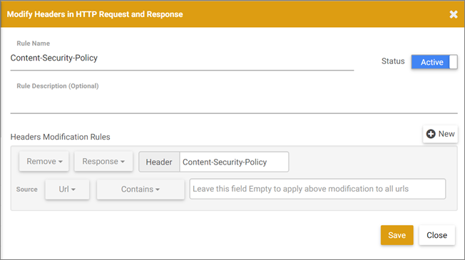

# Resolución de problemas relacionados con [!DNL Adobe Target] [!UICONTROL Compositor de experiencias visuales] y [!UICONTROL Compositor de experiencias mejorado] {#vec-eec-issues}

>[!BEGINSHADEBOX]

**En esta página:** Aprenda a resolver los problemas que afectan tanto al **[!UICONTROL Compositor de experiencias visuales]** (VEC) como al **[!UICONTROL Compositor de experiencias mejorado]** (EEC).

>[!ENDSHADEBOX]

Los problemas de visualización y otros problemas a veces ocurren en [!DNL Target] **[!UICONTROL Compositor de experiencias visuales]** (VEC) y **[!UICONTROL Compositor de experiencias mejorado]** (EEC) en ciertas condiciones. Los siguientes elementos describen los problemas que afectan a ambos compositores y cómo resolverlos.

## Navegador y seguridad

### Políticas de cookies de Google Chrome samesite {#samesite}

Las políticas de aplicación de cookies de SameSite de [!DNL Google Chrome] afectan al VEC y EEC en las siguientes versiones.

>[!NOTE]
>
>El siguiente cambio se aplica a las tres versiones. El VEC no se puede usar en páginas del sitio protegidas con contraseña a menos que la extensión [VEC Helper](/help/main/c-experiences/c-visual-experience-composer/r-troubleshoot-composer/visual-editing-helper-extension.md) esté instalada y habilitada. Las cookies de inicio de sesión del sitio se consideran cookies de terceros, por lo que no se envían con solicitudes de inicio de sesión dentro del editor VEC en modo **[!UICONTROL Browse]**. La única excepción es cuando las cookies de inicio de sesión ya tienen los atributos `SameSite=None` y `Secure` establecidos.

* **Chrome 94 (21 de septiembre de 2021):** Para todos los usuarios con Chrome 94 y versiones posteriores, se ha eliminado el indicador de línea de comandos `--disable-features=SameSiteByDefaultCookies,CookiesWithoutSameSiteMustBeSecure`.
* **Chrome 91 (25 de mayo de 2021):** Para todos los usuarios con Chrome 91 y versiones posteriores, las marcas `#same-site-by-default-cookies` y `#cookies-without-same-site-must-be-secure` se han eliminado de `chrome://flags`. Este comportamiento ahora está habilitado de forma predeterminada.
* **Chrome 80 (agosto de 2020):** Para todos los usuarios con Chrome 80 y versiones posteriores:

  * [!DNL Target] bibliotecas no se pueden descargar mientras se edita una actividad si aún no están en el sitio. La llamada de descarga se realiza desde el dominio del cliente a un dominio [!DNL Adobe] protegido y se rechaza por no autenticarse.
  * El EEC no funciona porque no puede establecer el atributo SameSite para las cookies en el dominio `adobemc.com`. Sin este atributo, el explorador rechaza estas cookies, lo que provoca que el EEC falle.

+++ Determinar qué cookies están bloqueadas

Para determinar qué cookies están bloqueadas por las directivas de aplicación de cookies de SameSite, use [!DNL Developer Tools] en [!DNL Chrome].

1. Mientras ve el VEC en [!DNL Chrome], haga clic en el icono de **[!UICONTROL elipsis]** en la esquina superior derecha de Chrome > **[!UICONTROL Más herramientas]** > **[!UICONTROL Herramientas para desarrolladores]**.
1. Haga clic en la ficha **[!UICONTROL Red]** y, a continuación, busque las cookies bloqueadas.

   >[!NOTE]
   >
   >Use la casilla de verificación **[!UICONTROL Ha bloqueado las cookies]** para que sea más fácil encontrar las cookies bloqueadas.

+++

+++ Los encabezados de Política de seguridad de contenido (CSP) bloquean las bibliotecas de [!DNL Target] del sitio web

Si los encabezados CSP del sitio web bloquean las bibliotecas de [!DNL Target], el sitio web se cargará pero no se podrá editar. Asegúrese de que las bibliotecas de [!DNL Target] no estén bloqueadas.

>[!NOTE]
>
>Además de la siguiente información, se puede usar la [extensión del explorador Adobe Target VEC Helper](/help/main/c-experiences/c-visual-experience-composer/r-troubleshoot-composer/vec-helper-browser-extension.md) para [!DNL Google Chrome].

Como solución alternativa, configure una regla [!DNL Requestly] para quitar los encabezados CSP, como se muestra en la siguiente ilustración.

Se puede configurar una regla [!DNL Requestly] similar para cualquier encabezado que haga que un recurso no se cargue dentro del VEC. Siempre que sea necesario eliminar encabezados con [!DNL Requestly], siga uno de estos procedimientos:

* Añada reglas de URL para que la URL se abra en el VEC, de modo que los encabezados solo se eliminen para esas URL.
* Habilite la regla mientras la edita en el VEC y desactívela cuando el VEC no esté en uso.

+++

+++ No se admiten iframes de varios niveles

[!DNL Target] no admite iframes de varios niveles. Si el sitio web carga un iframe que tiene un iframe secundario, at.js interactúa únicamente con el iframe principal. Las bibliotecas de [!DNL Target] no interactúan con el iframe secundario.

Como solución alternativa, añada una página en la experiencia con la URL del iframe secundario.

+++

+++ Las experiencias no se pueden editar en un sitio con eliminación de iFrames o en páginas sin la implementación de [!DNL Target]

Habilite **[!UICONTROL Compositor de experiencias mejorado]** (EEC) para resolver este problema. Haga clic en **[!UICONTROL Administración]** > **[!UICONTROL Compositor de experiencias visuales]** y, a continuación, active la casilla que habilita el **[!UICONTROL Compositor de experiencias mejorado]**.

El EEC usa un proxy administrado por [!DNL Adobe] para cargar la página y editarla. Este proxy permite la edición en sitios con eliminación de iFrames y en sitios y páginas donde aún no se ha agregado el código [!DNL Adobe Target]. Las actividades no se muestran en el sitio hasta que el código se haya añadido. Es posible que algunos sitios no se carguen a través del EEC, en cuyo caso al borrar esta opción se cargará la página a través de un iFrame.

>[!NOTE]
>
>Las páginas hospedadas localmente y las páginas a las que no se puede tener acceso fuera de la red no son accesibles para el servidor proxy [!DNL Adobe] y no se pueden abrir en el EEC. Estas páginas pueden incluir direcciones URL por fases, direcciones URL de prueba de aceptación del usuario o páginas hospedadas localmente.

+++

## Carga y visualización de página

+++ Cuando se edita una página, aparece un control de número en lugar de la página

Esta situación puede suceder si la dirección URL contiene el carácter #. Para solucionar el problema, cambie al modo **[!UICONTROL Examinar]** en el VEC o EEC y vuelva al modo **[!UICONTROL Componer]**. El control de número debería desaparecer y la página debería cargarse.

+++

+++ El VEC o EEC parece roto o no se inicializa cuando se vuelve a editar una actividad guardada

Si el sitio web ha cambiado fuera del VEC después de definir la experiencia, los selectores en los que se realizaron acciones anteriormente no se encuentran cuando la actividad se abre para reeditarla. La página parece no funcionar, pero no se muestra ninguna advertencia.

+++

+++ Los titulares giratorios y otro contenido que contenga JavaScript no se mostrarán en el VEC o EEC

De forma predeterminada, el VEC bloquea los elementos de JavaScript. Deshabilitar JavaScript permite trabajar con estos elementos. Según la configuración del sitio, es posible que algunos elementos se sigan mostrando de forma incorrecta o que no estén disponibles.

+++

+++ Para las actividades de Automated Personalization, el intercambio de imágenes aparece dañado en el VEC o EEC

Si agrega una oferta de imagen a una ubicación, en el VEC o EEC se ocupa la dimensión completa del espacio de la imagen original. Cuando se muestra, la imagen no se expande y se muestra tal cual, así que no produce ningún impacto en la publicación.

+++

## Edición de resultados

+++ Si se cambia un elemento de la página, se cambian varios elementos

Si se usa el mismo ID de elemento DOM en varios elementos de la página, al cambiar uno de estos elementos se cambiarán todos los elementos con dicho ID. Para evitarlo, utilice un ID solo una vez en cada página. Esta es una práctica recomendada estándar para HTML. Para obtener más información, consulte [Escenarios de modificación de página](/help/main/c-experiences/c-visual-experience-composer/r-troubleshoot-composer/vec-scenarios.md#vec-scenarios).

+++

+++ Los estilos de texto en negrita y cursiva no se muestran o el texto desaparece después de aplicar Editar texto/Editar HTML o Cambiar texto/Cambiar HTML

Cuando se usa **[!UICONTROL Editar texto]**/**[!UICONTROL Editar HTML]** en el VEC para actividades de **[!UICONTROL Prueba A/B]** o **[!UICONTROL Segmentación de experiencias]**, o se usa **[!UICONTROL Cambiar texto]**/**[!UICONTROL Cambiar HTML]** para actividades de **[!UICONTROL Automated Personalization]** o **[!UICONTROL Prueba multivariable]**, para que el texto esté en negrita o en cursiva, es posible que los estilos no se apliquen en la página o que el texto desaparezca de la página en el VEC. Esto sucede porque la forma en que el editor de texto enriquecido aplica estos estilos puede interferir con el marcado del sitio web.

Si se produce este problema:

1. Haga clic en el botón **[!UICONTROL HTML]** del editor de texto enriquecido para introducir el modo de edición de la fuente.
1. Busque los elementos de texto con estilo.

   * Si quiere texto en negrita, cambie los elementos `<strong>` por `<b>`.
   * Si quiere texto en cursiva, cambie los elementos `<em>` por `<i>`.

+++
