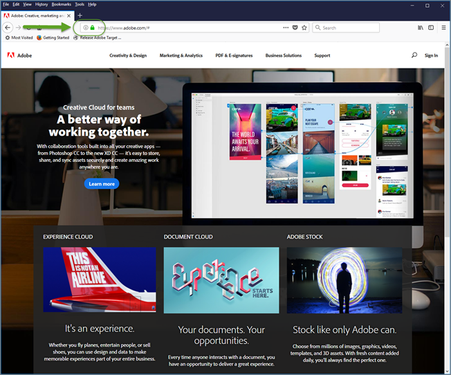

# Resolución de problemas relacionados con [!UICONTROL Compositor de experiencias mejorado] {#eec-issues}

>[!BEGINSHADEBOX]

**En esta página:** Aprenda a resolver los problemas que afectan solamente al **[!UICONTROL Compositor de experiencias mejorado]** (EEC), como páginas que no se cargan porque las direcciones IP del proxy EEC están bloqueadas.

>[!ENDSHADEBOX]

Mostrar problemas que a veces ocurren en el [!DNL Adobe Target] **[!UICONTROL Compositor de experiencias mejorado]** (EEC) en ciertas condiciones. Los siguientes elementos describen los problemas que afectan únicamente al EEC y cómo resolverlos.

## Lista de permitidos de las direcciones IP del proxy EEC {#eec-ip-addresses}

El EEC no carga una URL de control de calidad interna que no es accesible desde una dirección IP pública. La inclusión en la lista de permitidos de las direcciones IP del servidor [!DNL Adobe] utilizado para el proxy EEC resuelve este problema. Estas direcciones IP solo son necesarias para la edición de actividades y los visitantes del sitio no las necesitan incluidas en la lista de permitidos. Pida al equipo de TI que realice una lista de permitidos de las siguientes direcciones IP.

### EE. UU. (va7)

```
40.70.154.136/29
52.254.106.240/28
52.254.106.160/28
52.254.107.16/28
20.186.185.181
20.22.83.112
20.186.185.227
52.254.106.192/28
52.254.106.0/28
52.254.107.128/28
52.254.107.80/28
52.254.106.176/28
52.254.107.32/28
52.254.105.192/28
52.254.107.64/28
52.254.106.208/28
52.254.107.0/28
52.254.106.224/28
20.14.241.153
20.186.185.239
4.152.211.251
52.254.107.144/28
52.254.106.144/28
```

### EMEA (nld2)

```
51.138.17.16/28
51.138.17.48/28
51.138.16.128/28
51.138.17.32/28
51.138.16.240/28
51.138.17.112/28
51.138.16.160/28
51.138.16.208/28
51.138.17.80/28
51.138.17.0/28
51.138.17.96/28
51.138.16.144/28
20.31.145.248
20.126.189.248
51.138.16.224/28
51.138.16.192/28
51.138.12.94
51.138.12.11
51.138.16.176/28
51.138.12.100
51.138.17.64/28
51.138.12.160/28
```

### APAC (aus)

```
20.43.104.160/28
20.227.35.177
20.40.188.227
20.43.104.112/28
20.43.104.128/28
20.43.104.144/28
20.40.188.166
20.53.206.128
20.43.104.80/28
20.43.104.16/28
20.43.105.48/28
20.43.104.96/28
20.43.104.48/28
20.40.188.194
20.43.104.32/28
20.40.191.224/28
20.43.105.16/28
20.40.191.96/28
20.43.104.176/28
20.40.191.240/28
20.43.104.64/28
20.43.105.32/28
20.43.104.192/28
20.43.105.0/28
20.43.104.0/28
```

### Direcciones IP heredadas

Las siguientes direcciones IP heredadas deben seguir incluidas en la lista de permitidos hasta nuevo aviso.

```
34.254.77.200
54.73.207.147
54.229.152.123
3.224.194.242
54.90.51.39
34.228.136.112
54.150.116.11
18.178.142.8
54.199.107.77
99.80.139.221
54.78.56.224
54.247.179.246
54.80.219.243
34.201.235.54
54.196.224.236
35.75.212.45
52.199.184.130
18.180.161.176
```

+++ El EEC muestra un mensaje de error que indica que el dominio del sitio web lo está bloqueando

El siguiente mensaje de error se puede mostrar en [!DNL Target]:

`Error: Your website domain (ISP) is blocking the Enhanced Experience Composer. You can allowlist the Enhanced Experience Composer's IP addresses or turn off Enhanced Experience Composer in Configure > Page Delivery menu.`


Este mensaje de error tiene dos causas posibles:

* El dominio del sitio web (ISP) bloquea el EEC. Para resolver el problema, lista de permitidos las direcciones IP enumeradas en [Lista de permitidos de las direcciones IP del proxy EEC](#eec-ip-addresses).
* Las direcciones IP están incluidas en la lista de permitidos, pero el sitio web no admite TLS 1.2. Para resolver el problema, consulte el siguiente elemento.

+++

+++ El EEC no se carga en páginas seguras de un sitio que utiliza TLS 1.0

El mensaje de error descrito en el elemento anterior se puede mostrar cuando las direcciones IP están incluidas en la lista de permitidos, pero el sitio web no admite TLS 1.2. [!DNL Target] actualmente usa la versión 1.2 como configuración predeterminada. Antes de [!DNL Target] 18.4.1 (25 de abril de 2018), la configuración predeterminada admitía TLS 1.0. Para obtener más información, consulte [Cambios de cifrado de TLS (Transport Layer Security)](https://experienceleague.adobe.com/docs/target-dev/developer/implementation/tls-transport-layer-security-encryption.html?lang=es){target=_blank}.

Para comprobar la versión TLS de un sitio web en Firefox (otros navegadores tienen pasos similares):

1. Abra el sitio web afectado en Firefox.
1. Haga clic en el icono **[!UICONTROL Mostrar información del sitio]** en la barra de direcciones del explorador.

   

1. Haga clic en **[!UICONTROL Mostrar detalles de conexión]** > **[!UICONTROL Más información]**.

   

1. Examine la información de versión TLS en **[!UICONTROL Detalles técnicos]**.

   

1. Si el sitio web muestra TLS 1.0, consulte [Cambios en el cifrado de TLS (Seguridad de capa de transporte)](https://experienceleague.adobe.com/docs/target-dev/developer/implementation/tls-transport-layer-security-encryption.html?lang=es){target=_blank} para obtener información acerca de la directiva de compatibilidad con TLS de [!DNL Target]. Para solucionar la situación por el momento (válido hasta el 12 de septiembre de 2018), póngase en contacto con el [Servicio de atención al cliente](/help/main/cmp-resources-and-contact-information.md#reference_ACA3391A00EF467B87930A450050077C) para configurar con la versión TLS y el dominio.

+++

+++ Los errores de tiempo de espera o &quot;acceso denegado&quot; se muestran cuando los sitios se cargan con el proxy habilitado

Asegúrese de que las direcciones IP del proxy no estén bloqueadas en el entorno. Las direcciones se enumeran en [Lista de permitidos de las direcciones IP del proxy EEC](#eec-ip-addresses).

+++
