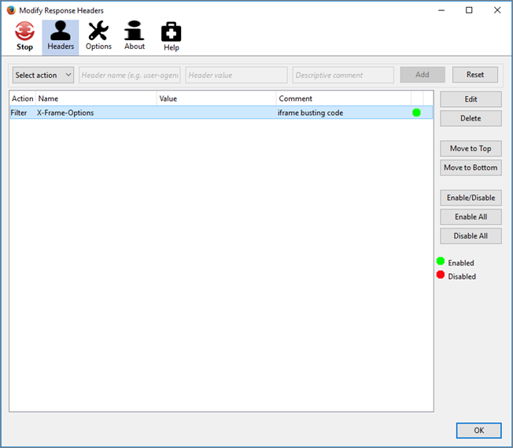

# Resolución de problemas relacionados con [!UICONTROL Compositor de experiencias visuales] {#vec-issues}

>[!BEGINSHADEBOX]

**En esta página:** Aprenda a resolver los problemas que afectan solamente al **[!UICONTROL Compositor de experiencias visuales]** (VEC).

>[!ENDSHADEBOX]

Los problemas de visualización a veces ocurren en el [!DNL Adobe Target] **[!UICONTROL Compositor de experiencias visuales]** (VEC) bajo ciertas condiciones. Los siguientes elementos describen los problemas que afectan únicamente al VEC y cómo resolverlos.

+++ Las bibliotecas de [!DNL Target] no se cargan cuando el sitio web se abre en el VEC

Cuando se abre un sitio web en **[!UICONTROL Compositor de experiencias visuales]**, [!DNL Target] agrega los parámetros `mboxEdit=1` y `mboxDisable=1` a la dirección URL.

Un sitio web que recorta o quita estos parámetros mientras se navega de una página a otra sin una recarga de página, especialmente una aplicación de una sola página, rompe la funcionalidad [!DNL Target] y las bibliotecas [!DNL Target] no se cargan. Para evitar este problema, mantenga ambos parámetros en la dirección URL.

+++

+++ Una página no se abre en el EEC o se carga lentamente, o las actividades y experiencias se cargan lentamente en el VEC

Varios problemas pueden afectar el rendimiento de la página en los [!DNL Target] compositores de experiencias. Los más comunes son los siguientes:

* La página no tiene mbox.
* El sitio utiliza el bloqueo de proxy, que impide que la página se abra en cualquiera de los compositores de experiencias.
* El sitio no permite que se abra en un iFrame.

Cuando se produzca un problema en **[!UICONTROL Enhanced Experience Composer]**, desactívelo y use **[!UICONTROL Visual Experience Composer]** en su lugar. Para ello, vaya a **[!UICONTROL Administración]** > **[!UICONTROL Compositor de experiencias visuales]** y desactive la opción **[!UICONTROL Habilitar el compositor de experiencias mejorado]**.

El siguiente mensaje de error se puede mostrar en la consola:

Cuando ninguno de los dos compositores funciona, una extensión de explorador que sobrescribe el encabezado X-Frame-Options del sitio, como [!DNL Requestly] ([!DNL Chrome] o [!DNL Firefox]) o Modificar encabezados de respuesta ([!DNL Firefox]), permite que el sitio se cargue en iFrames y, por lo tanto, habilita el VEC. Cuando no se puedan usar las extensiones de explorador, use [Compositor de experiencias basadas en formularios](/help/main/c-experiences/form-experience-composer.md). También se puede usar la extensión [[!DNL Adobe Target] **[!UICONTROL Ayuda de edición visual ]**](/help/main/c-experiences/c-visual-experience-composer/r-troubleshoot-composer/visual-editing-helper-extension.md) para [!DNL Google Chrome], además de los procedimientos siguientes.

>[!NOTE]
>
>Estas extensiones solo están pensadas para la edición de VEC.
>
>Con [!DNL Requestly], siempre que sea necesario quitar encabezados, realice una de las siguientes acciones:
>
>* Añada reglas de URL para que la URL se abra en el VEC, de modo que los encabezados solo se eliminen para esas URL.
>* Habilite la regla mientras la edita en el VEC y desactívela cuando el VEC no esté en uso.
>
>Con **[!UICONTROL Modificar encabezados de respuesta]** ([!DNL Firefox]), las reglas de URL no están disponibles, por lo que la regla debe habilitarse mientras se edita en el VEC y deshabilitarse cuando el VEC no está en uso.

Una vez configurada una extensión, las páginas se cargarán en **[!UICONTROL Compositor de experiencias visuales]** incluso cuando **[!UICONTROL Compositor de experiencias mejorado]** esté deshabilitado.

+++

+++ Quitar el encabezado X-Frame-Options con Requestly (Chrome o Firefox)

1. Desactive **[!UICONTROL Enhanced Experience Composer]**.
1. Instale la extensión del explorador [!DNL Requestly] en [!DNL Chrome] o [!DNL Firefox].
1. Abra la extensión y seleccione **[!UICONTROL Modificar encabezados]**.
1. Introduzca un nombre de regla.
1. En las reglas de modificación, cree una regla que elimine el encabezado:

   * Cambie de **[!UICONTROL Agregar]** a **[!UICONTROL Eliminar]**.
   * Cambie de **[!UICONTROL Solicitud]** a **[!UICONTROL Respuesta]**.
   * Introduzca &quot;X-Frame-Options&quot; como nombre del encabezado.

1. Repita el paso anterior e introduzca &quot;x-frame-options&quot; como nombre del encabezado.

   >[!NOTE]
   >
   >Los encabezados manipulados con [!DNL Requestly] distinguen entre mayúsculas y minúsculas.

1. Cambie **[!UICONTROL Equals]** a **[!UICONTROL Contains]** como condición para la dirección URL de origen e introduzca la URL de la actividad que se cargará en el VEC.

   

1. Haga clic en **[!UICONTROL Guardar]**.

   

La página debería cargarse rápidamente en **[!UICONTROL Compositor de experiencias visuales]**.

+++

+++ Eliminación del encabezado X-Frame-Options con Modificar encabezados de respuesta (Firefox)

1. Instale la extensión [!DNL Modify Response Headers] en [!DNL Firefox] y reinicie el explorador.
1. De las extensiones [!DNL Firefox], seleccione la extensión [!DNL Modify Response Headers].
1. Haga clic en **[!UICONTROL Preferencias]**.
1. Seleccione **[!UICONTROL Filter]** de la lista desplegable **[!UICONTROL Action]**.
1. En el campo **[!UICONTROL Nombre de encabezado]**, escriba **[!UICONTROL X-Frame-Options]**.
1. Repita los dos pasos anteriores para agregar un filtro con **[!UICONTROL x-frame-options]**.
1. Haga clic en **[!UICONTROL Agregar]**.
1. Haga clic en **[!UICONTROL Inicio]**.

+++

+++ Una página no se muestra en el VEC

Compruebe las siguientes causas:

* **Versión de extensión:** la versión más reciente de la extensión [[!DNL Adobe Experience Cloud] **[!UICONTROL Ayuda de edición visual ]**](/help/main/c-experiences/c-visual-experience-composer/r-troubleshoot-composer/visual-editing-helper-extension.md) proporciona la mejor compatibilidad con el VEC. Para comprobar la versión instalada, vaya a**[!UICONTROL  Extensiones ]**>**[!UICONTROL  Administrar extensiones ]**y, a continuación, haga clic en**[!UICONTROL  Detalles ]**.
* **Bibliotecas de creación:** el VEC necesita bibliotecas de creación para modificar la página web. Están incrustados en la biblioteca at.js, que la extensión descarga de [!DNL Adobe] servidores cada vez que se utiliza el VEC, independientemente de si at.js o [!DNL Adobe Experience Platform Web SDK] ya se encuentran en la página. Compruebe que los encabezados at.js configurados en **[!UICONTROL Administración]** > **[!UICONTROL Implementación]** no contengan cambios no válidos.
* **Solicitudes bloqueadas:** la página no debe bloquear las solicitudes que son obligatorias para la carga cuando está incrustada en un iFrame. Este bloqueo incluye `frame-ancestors` directivas CSP, código JavaScript personalizado en el sitio web, etiquetas meta HTML y el encabezado `x-frame-options`.
* **Nombres de archivo reservados:** El JavaScript de la página no debe interferir con las bibliotecas de creación. No utilice ni incluya archivos con los siguientes nombres reservados:

  * `target-vec-helper.js`
  * `target-vec.js`
  * `target.js`
  * `admin.css`
  * `sizzle.js`
  * `mixContentCheck.html`

  Anular accidentalmente variables o eventos definidos en estos archivos también puede causar problemas con el VEC.

* **Página no segura en un sitio seguro:** el explorador bloquea la página. Haga clic en el icono a la izquierda de la dirección URL en la barra de direcciones y, a continuación, haga clic en **[!UICONTROL Deshabilitar la protección en esta página]**.
* **URL no válida:** la URL especificada no es válida.
* **Cookies:** si el sitio web no se puede cargar en el VEC o se comporta de forma inesperada, la aceptación de sus cookies en el explorador antes de cargar el sitio web en [!DNL Target] puede resolver el problema.

+++

+++ El VEC parece roto en el modo Examinar

En el modo **[!UICONTROL Examinar]**, el VEC aparece dañado cuando se abre una dirección URL que carece de las bibliotecas [!DNL Target] ([at.js](https://experienceleague.adobe.com/docs/target-dev/developer/client-side/at-js-implementation/overview.html?lang=es){target=_blank} o [Adobe Experience Platform Web SDK](https://experienceleague.adobe.com/docs/target-dev/developer/client-side/aep-web-sdk.html?lang=es){target=_blank}) o que contiene un encabezado de eliminación de fotogramas. Por motivos de seguridad del explorador, [!DNL Target] no puede obtener acceso correctamente a la dirección URL a la que se navegó o la dirección URL del VEC no se actualiza de manera consistente cuando se carga la página.

El VEC carga la página web en un `<iframe>`, y los mecanismos de seguridad actuales de los exploradores impiden que la interfaz de usuario de [!DNL Target] acceda a los elementos del marco en la directiva del mismo origen. Los exploradores bloquean los scripts que intentan tener acceso a un marco con un origen diferente, incluida información como `location.href`.

Use la nueva extensión [Ayuda de edición visual](/help/main/c-experiences/c-visual-experience-composer/r-troubleshoot-composer/visual-editing-helper-extension.md) para insertar la biblioteca [!DNL Target] en las páginas, de modo que las páginas puedan explorarse de manera óptima.

+++

+++ Los problemas se deben a conflictos de CSS en el VEC

Compruebe si algún archivo CSS afecta a la visibilidad mientras la página se carga en el editor. Por ejemplo, la propiedad `overflow: hidden` del cuerpo de la página puede causar problemas de desplazamiento o eventos de clic en el déclencheur que interfieran con el menú de creación.

+++
