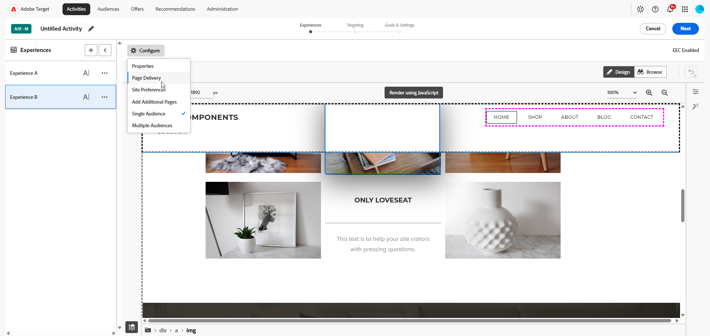
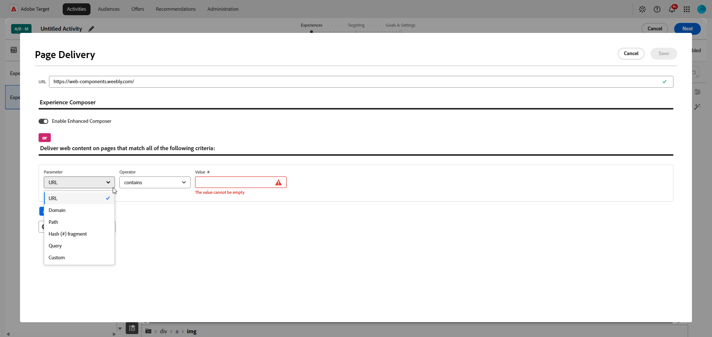

# Incluir la misma experiencia en páginas similares {#similar-pages}

>[!BEGINSHADEBOX]

**En esta página:** Aprenda a utilizar las reglas de entrega de páginas en el [!UICONTROL Compositor de experiencias visuales] (VEC) para incluir la misma experiencia en páginas que tienen una estructura similar.

>[!ENDSHADEBOX]

Una plantilla de página de [!DNL Adobe Target] proporciona estructura a las páginas. Cuando las páginas contienen elementos similares, las variaciones en esos elementos de página de estructura similar se pueden probar en varias páginas o en un dominio completo.

Para funcionar correctamente, esta función debe utilizarse en páginas que tengan una estructura similar o que contengan elementos de plantilla que estén estructurados igual en todas las páginas.

>[!IMPORTANT]
>
>El uso de esta función para cambiar elementos en páginas que no son similares probablemente cause resultados inesperados.

Esta función se puede utilizar, por ejemplo, para realizar una de las siguientes acciones:

* Probar una barra de navegación global reorganizando o quitando elementos.
* Quitar un elemento de todas las páginas de productos que usen una plantilla de página en particular.
* Añadir un banner a todas las páginas de productos.
* Cambiar el diseño de la plantilla de artículo

## Especificar las páginas para una experiencia {#specify-pages}

Las páginas en las que aparece una experiencia se especifican mediante reglas de entrega de páginas. Las reglas pueden incluir páginas específicas o aplicar los cambios en el sitio o dominio.

1. Cree o edite una actividad como se describe en [Actividades](/help/main/c-activities/activities.md).

1. En el [!UICONTROL Compositor de experiencias visuales] (VEC), haga clic en el icono **[!UICONTROL Configurar]** (  ) y, a continuación, seleccione **[!UICONTROL Entrega de páginas]**.

   

1. Haga clic en **[!UICONTROL Agregar regla]** y, a continuación, especifique los criterios para que las páginas agreguen la experiencia.

1. Especifique el intervalo de páginas: **[!UICONTROL URL]**, **[!UICONTROL Dominio]**, **[!UICONTROL Ruta]**, **[!UICONTROL Fragmento almohadilla (#)]** (la parte de una dirección URL que sigue al símbolo #), **[!UICONTROL Consulta]** o **[!UICONTROL Personalizado]**.

   Para obtener más información sobre cómo evalúa [!DNL Target] las direcciones URL, consulte [Preguntas frecuentes sobre objetivos y audiencias](/help/main/c-target/c-troubleshooting-targets-and-audiences/troubleshooting-targets-and-audiences.md).

   

1. Seleccione un operador. El operador especifica cómo se relacionan los elementos que hay a continuación del operador con el intervalo de páginas.

1. Escriba las cadenas que establecen dónde se agregará la experiencia, como el dominio o las cadenas contenidas en el nombre de la página.

   Por ejemplo, si se seleccionan **[!UICONTROL Dominio]** y **[!UICONTROL Es (distingue mayúsculas de minúsculas)]**, escriba el dominio en el que se agregará la experiencia a todas las páginas.

   Se pueden incluir varios elementos. Cuando varios elementos utilizan la lógica OR, lo que significa que cualquier elemento de la lista hace que la condición sea verdadera.

1. (Opcional) Haga clic en **[!UICONTROL Agregar regla]** y repita los pasos del 3 al 6 para escribir criterios adicionales.

   Cuando hay varios criterios se unen entre sí con la lógica AND. [!DNL Target] agrega la experiencia a todas las páginas que cumplan los criterios especificados.

>[!IMPORTANT]
>
>[!DNL Target] no puede comprobar las páginas para asegurarse de que se muestran según lo esperado, por lo que siempre que se utiliza esta característica es recomendable probar las páginas afectadas antes de hacerlas públicas.

## Casos de uso {#use-cases}

Las reglas de plantilla se pueden utilizar en un sitio de diferentes maneras, como se muestra en el siguiente caso de uso.

### Procesar la misma actividad en todo el dominio {#entire-domain}

Las reglas de plantilla pueden procesar la misma actividad en todo el dominio, por ejemplo:

* Para incluir un encabezado o pie de página global
* Para incluir un banner global (por ejemplo, anuncios de COVID-19)
* Para incluir una promoción de envío gratuito global

1. Cree o edite una actividad como se describe en [Actividades](/help/main/c-activities/activities.md).

1. Para especificar el dominio donde aparece la experiencia, en el [!UICONTROL Compositor de experiencias visuales], haga clic en el icono **[!UICONTROL Configurar]** (  ) y, a continuación, seleccione **[!UICONTROL Entrega de páginas]**.

1. Haga clic en **[!UICONTROL Agregar regla]** > **[!UICONTROL Dominio]**.

1. En la lista desplegable **[!UICONTROL Elegir evaluador]**, seleccione **[!UICONTROL Contiene]** y, a continuación, especifique el dominio.

   
