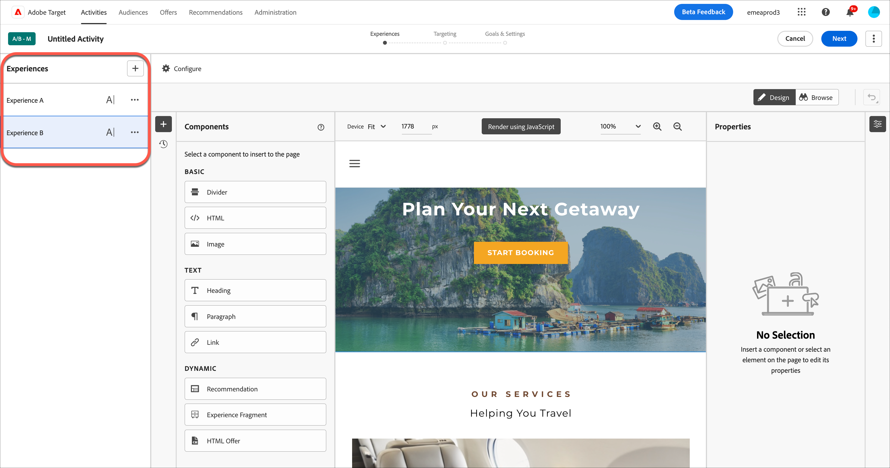

# [!UICONTROL Cambios en el Compositor de experiencias visuales] {#vec-changes}

>[!BEGINSHADEBOX]

**En esta página:** Descubra cómo el [!UICONTROL Compositor de experiencias visuales] (VEC) actualizado introducido en la versión [!DNL Adobe Target Standard/Premium] 25.2.1 difiere de la versión anterior.

>[!ENDSHADEBOX]

La versión de [!DNL Adobe Target Standard/Premium] 25.2.1 (17 de febrero de 2025) presenta un [!UICONTROL Compositor de experiencias visuales] (VEC) actualizado. Este artículo explica las diferencias entre las versiones anteriores y actualizadas del VEC.

>[!IMPORTANT]
>
>El [!UICONTROL Compositor de experiencias visuales] actualizado requiere la extensión [!DNL Adobe Experience Cloud] [**[!UICONTROL Ayuda de edición visual &#x200B;]**](/help/main/c-experiences/c-visual-experience-composer/r-troubleshoot-composer/visual-editing-helper-extension.md) disponible en [!DNL Chrome Web Store].

El VEC se muestra cuando se crea una actividad o cuando se edita una actividad existente.

## Cambios importantes en el VEC

Las siguientes secciones explican los cambios más importantes en el VEC actualizado en comparación con la versión anterior.

### [!UICONTROL Experiencias] carril

Al igual que en la versión anterior, el carril **[!UICONTROL Experiences]** permanece en el lado izquierdo del VEC. El carril **[!UICONTROL Experiencias]** no se puede contraer.

Las experiencias se crean, cambian de nombre o se eliminan mediante el carril **[!UICONTROL Experiencias]**.

Haga clic en el icono **[!UICONTROL Agregar]** (  ) para agregar una nueva experiencia. Haga clic en el icono **[!UICONTROL Más acciones]** (  ) para duplicar, eliminar o redirigir una experiencia.

### [!UICONTROL Componentes] carril (nuevo)

El nuevo carril **[!UICONTROL Componentes]** agrega varios componentes a la página web, que se pueden editar según sea necesario.

Para agregar un componente nuevo, seleccione el componente que desee en el carril **[!UICONTROL Componentes]**, pase el ratón sobre un elemento existente de la página y, a continuación, elija insertar el componente antes o después del elemento seleccionado.

Si el carril **[!UICONTROL Modificaciones]** se muestra en esta área en lugar del carril **[!UICONTROL Componentes]**, haga clic en el icono **[!UICONTROL Mostrar componentes]** (  ). El icono **[!UICONTROL Mostrar componentes]** (  ) y el icono **[!UICONTROL Mostrar modificaciones]** (  ) actúan como alternadores que muestran las opciones adecuadas.

Para contraer el carril **[!UICONTROL Componentes]** y ampliar el lienzo **[!UICONTROL Diseño]** mientras el carril **[!UICONTROL Componentes]** está abierto, haga clic en el icono (  ).

### [!UICONTROL Modificaciones] carril

Para abrir el carril **[!UICONTROL Modificaciones]**, haga clic en el icono **[!UICONTROL Mostrar modificaciones]** (  ) en el carril **[!UICONTROL Componentes]**. El carril **[!UICONTROL Modificaciones]** ha cambiado de posición del lado derecho al lado izquierdo del lienzo de edición.

>[!NOTE]
>
>Para contraer el carril **[!UICONTROL Modificaciones]** y ampliar el lienzo **[!UICONTROL Diseño]** mientras el carril **[!UICONTROL Modificaciones]** está abierto, haga clic en el icono **[!UICONTROL Mostrar modificaciones]** (  ).

El carril **[!UICONTROL Modificaciones]** muestra todos los cambios realizados en la página en el VEC y permite cambios adicionales (como Selector de CSS, Mbox y Código personalizado).

Haga clic en el icono **[!UICONTROL Más opciones]** (  ) para agregar una modificación, eliminar todas las modificaciones o eliminar todas las modificaciones no válidas. Haga clic en **[!UICONTROL Seleccionar]** para realizar operaciones masivas: **[!UICONTROL Aplicar a todas las páginas]** o **[!UICONTROL Eliminar]**.

Para volver a mostrar el carril **[!UICONTROL Modificaciones]**, haga clic en el icono **[!UICONTROL Ocultar modificaciones]** (  ) en el carril **[!UICONTROL Modificaciones]**.

### [!UICONTROL Propiedades] carril (nuevo)

El carril **[!UICONTROL Propiedades]** cambia las propiedades de los elementos seleccionados en la página, ya sean estos elementos HTML u objetos específicos de [!DNL Target], como recomendaciones u ofertas.

Haga clic en los iconos de la parte superior del carril para editar el código HTML o eliminar, duplicar u ocultar elementos. Los cambios aparecen en el carril **[!UICONTROL Modificaciones]**.

El carril **[!UICONTROL Propiedades]** se puede contraer en el carril derecho. Haga clic en el icono **[!UICONTROL Mostrar u ocultar propiedades]** (  ) a la derecha del carril para contraer o mostrar el carril **[!UICONTROL Propiedades]**.

### Configuración de actividades

Haga clic en el icono **[!UICONTROL Configurar]** (  ) que se muestra en la parte superior del lienzo de diseño para mostrar el menú de propiedades de la actividad.

Las distintas opciones asignan propiedades, editan las reglas de entrega de páginas, especifican las preferencias del sitio, agregan páginas adicionales y habilitan o deshabilitan actividades de audiencia múltiple o de varias páginas. Asignar **[!UICONTROL propiedades]** es una característica de [[!DNL Target Premium]](/help/main/c-intro/intro.md#premium).

La posición y la funcionalidad son similares a la interfaz de usuario del VEC anterior.

### Modos [!UICONTROL Diseño]/[!UICONTROL Examinar]

Use los alternadores **[!UICONTROL Diseño]**/**[!UICONTROL Examinar]** que se muestran en la parte superior del carril de **[!UICONTROL Propiedades]** para cambiar entre el modo de diseño y el de exploración.

Utilice el modo **[!UICONTROL Examinar]** para navegar por el sitio y elegir la vista o la página que desea actualizar. Vuelva al modo **[!UICONTROL Diseño]** para agregar o editar los cambios.

### [!UICONTROL Deshacer]/[!UICONTROL Rehacer]

Los cambios se pueden deshacer haciendo clic en el icono **[!UICONTROL Deshacer]** (  ).

Para rehacer una acción, expande el grupo de botones **[!UICONTROL Deshacer]**/**[!UICONTROL Rehacer]** y elige **[!UICONTROL Rehacer]**.

### [!UICONTROL Diseñar] lienzo

El lienzo **[!UICONTROL Design]** permite seleccionar las ventanillas móviles, entre las que se incluyen las de ajuste a pantalla, **[!UICONTROL Escritorio]**, **[!UICONTROL Tableta]**, **[!UICONTROL Horizontal móvil]** y **[!UICONTROL Vertical móvil]**.

El VEC actualizado también permite acercar o alejar la vista haciendo clic en el icono correspondiente (  o  ).

## Ilustración visual que muestra cambios en la IU

La siguiente ilustración muestra los cambios de interfaz de usuario de alto nivel realizados en el VEC actualizado. La parte izquierda de la ilustración muestra la interfaz de usuario del VEC anterior, y la parte derecha muestra la interfaz de usuario actualizada. Los números coincidentes muestran dónde se han movido o cambiado varios elementos.

{width="800" zoomable="yes"}

## Más información sobre la IU actualizada

* [[!DNL Target Standard/Premium] 25.2.1 (17 de febrero de 2025) notas de la versión](/help/main/r-release-notes/release-notes-for-previous-releases.md#ui-update-2): Proporciona un resumen de los cambios clave de la interfaz de usuario en [!DNL Target] para **[!UICONTROL Actividades]**, **[!UICONTROL Recommendations]** y [!UICONTROL Compositor de experiencias visuales] (VEC).

* [[!DNL Target Standard/Premium] 25.1.1 (9 de enero de 2025) notas de la versión](/help/main/r-release-notes/release-notes-for-previous-releases.md#ui-update-1): Proporciona un resumen de los cambios clave de la interfaz de usuario en [!DNL Target] para la **[!UICONTROL Biblioteca de ofertas]**.

* [Comprender la [!DNL Target] IU](/help/main/c-intro/understand-the-target-ui.md): Proporciona una breve descripción de [!DNL Target], con vínculos para obtener información detallada e instrucciones paso a paso.

* [[!UICONTROL Compositor de experiencias visuales] opciones](/help/main/c-experiences/c-visual-experience-composer/viztarget-options.md): Explica la interfaz de usuario de VEC actualizada y sus opciones.

* [[!DNL Target] Preguntas más frecuentes sobre la actualización de la interfaz de usuario](/help/main/c-intro/updated-ui-faq.md): responde preguntas comunes sobre la nueva interfaz de usuario de [!DNL Target] y [!UICONTROL Compositor de experiencias visuales] (VEC), incluidos los cambios de navegación, las ubicaciones de las características y la obsolescencia de la opción de versión de la interfaz de usuario temporal.
