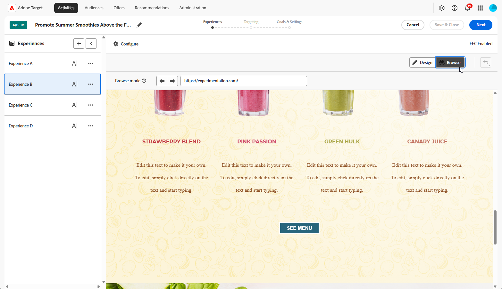

# Introducción al [!UICONTROL Compositor de experiencias visuales] {#vec-overview}

>[!BEGINSHADEBOX]

**En esta página:** Aprenda a abrir el [!UICONTROL Compositor de experiencias visuales] (VEC), editar experiencias y administrar la carga de páginas.

>[!ENDSHADEBOX]

El [!UICONTROL Compositor de experiencias visuales] (VEC) de [!DNL Adobe Target] es un editor de WYSIWYG que permite crear y probar experiencias personalizadas directamente en sitios web y páginas web móviles, sin necesidad de editar código.

Las experiencias y ofertas para actividades [!DNL Target] se crean arrastrando y soltando elementos, intercambiando contenido y cambiando diseños de página. El compositor también proporciona opciones para editar HTML y JavaScript.

## Requisitos del explorador {#browser-requirements}

[!DNL Safari] es compatible con la interfaz [!DNL Adobe Target]. Se pueden crear actividades basadas en formularios en [!DNL Safari] con todas las funciones, excepto el VEC y el [!UICONTROL Compositor de experiencias mejorado] (EEC). Si el VEC se abre en [!DNL Safari], una superposición solicitará al usuario que cambie a [!DNL Google Chrome] para editar experiencias.

Los exploradores como [!DNL Firefox] pueden bloquear las páginas que contienen contenido mixto, como una página no segura dentro de un sitio seguro, y evitar que se muestren en el VEC. Si una página no se muestra, haga clic en el icono situado junto a la dirección URL en la barra de direcciones del explorador y, a continuación, haga clic en **[!UICONTROL Deshabilitar la protección en esta página]**. Este problema no afecta a cómo se muestran las páginas a los visitantes del sitio.

## Abra el VEC. {#open-the-vec}

Para establecer la página que se abre de forma predeterminada en el VEC, escriba una URL predeterminada de [!UICONTROL Compositor de experiencias visuales] en la pestaña [!DNL Target] **[!UICONTROL Administración]** > **[!UICONTROL Compositor de experiencias visuales]**. Si no se establece ninguna dirección URL predeterminada, el VEC se abre con una página en blanco en la que se puede especificar una dirección URL.

## Editar experiencias {#edit-experiences}

### Ver y nombrar experiencias {#view-and-name-experiences}

Las pestañas del carril **[!UICONTROL Experiencias]** muestran cómo se muestra la página a diferentes audiencias o con diferentes experiencias. Un nombre descriptivo para cada experiencia facilita la identificación en la lista. Por ejemplo, al probar la posición del vínculo a Inicio en una barra de navegación, la experiencia en la que aparece primero puede llamarse &quot;Primero el vínculo a Inicio&quot;.

### Selección y modificación de elementos {#select-and-modify-elements}

Al mover el cursor sobre la página, se resaltan elementos individuales con un cuadro contextual. Al hacer clic en un elemento resaltado, se muestran las opciones de edición para ese tipo de elemento. Por ejemplo, si selecciona una imagen y hace clic en **[!UICONTROL Cambiar oferta de imagen]**, la reemplazará y si selecciona un botón podrá cambiar el color del texto.

El contenido de dentro de un iframe incrustado en la página no se puede editar. Para editar ese contenido, asegúrese de que el documento del iframe esté habilitado para [!DNL Target] y luego cargue la dirección URL del iframe directamente en el VEC.

Los cambios en la estructura de la página fuera del VEC pueden afectar a las ubicaciones utilizadas por una actividad. Si esas ubicaciones cambian, es posible que [!DNL Target] no encuentre los elementos que se modificaron, lo que puede causar problemas al editar experiencias.

### Examinar y diseñar {#browse-and-design}

Haz clic en **[!UICONTROL Examinar]** para navegar a una página accesible desde la página actual, como una página de envío o un carro de compras, y prueba los cambios allí.

En el modo Examinar, también se puede acceder a los elementos que aparecen al pasar el ratón por encima, como los menús flotantes y los minicarros. Cuando llegue la página o el elemento que desea editar, haga clic en **[!UICONTROL Diseño]** para editar la experiencia.

Si un estado de movimiento del cursor por encima depende de JavaScript, asegúrate de que **[!UICONTROL Deshabilitar JavaScript]** no esté seleccionado. JavaScript debe estar habilitado para poder editar los elementos que dependen de él.

Para obtener más información acerca de las opciones de edición disponibles, consulte [Opciones del Compositor de experiencias visuales](/help/main/c-experiences/c-visual-experience-composer/viztarget-options.md).

## Administrar carga de página {#manage-page-loading}

Algunas opciones de edición permanecen disponibles mientras se carga una página o después de que no se haya cargado. También se puede cancelar la carga de la página para acceder a estas opciones sin esperar.

### Edición de una página mientras se carga o después de que la página no se haya cargado {#loading}

Algunos cambios se pueden realizar antes de que una página termine de cargarse en el VEC o después de que no se cargue, por ejemplo, porque el código personalizado ya no funciona.

Las opciones de edición disponibles permiten lo siguiente:

* Realice cambios sencillos, como añadir código personalizado o cambiar el nombre de una experiencia
* Copie el código personalizado existente de una página que ya no sea accesible
* Realice ediciones sencillas en una página que no se puede cargar en el VEC

Las opciones **[!UICONTROL Experiences]**, **[!UICONTROL Components]** y **[!UICONTROL Configure]** siguen estando accesibles mientras la página se carga o después de que no se cargue.

### Cancelación de la carga de una página dentro del VEC {#cancel-loading}

Cancelar la carga de la página en el VEC permite editar la actividad sin esperar a que la página termine de cargarse. Esto resulta útil para lo siguiente:

* Realice pequeñas ediciones en las modificaciones existentes
* Eliminar una o más modificaciones existentes
* Inserción o edición de código personalizado
* Corrija una URL de página introducida incorrectamente
* Habilitar o deshabilitar JavaScript antes de cargar la página en el VEC
* Agregar reglas de prueba de plantilla a los criterios **[!UICONTROL Entrega de página]**
* Omitir la opción global [!UICONTROL Compositor de experiencias mejorado] (EEC) al cargar una página a través de EEC o en modo de solo iframe

Una vez cancelada la carga de la página, es posible cambiar entre experiencias en la actividad sin esperar a que se cargue la página. Haga clic en **[!UICONTROL Recargar]** para volver a mostrar la página en el VEC.

>[!IMPORTANT]
>
>Si se edita el código personalizado o se realizan otras modificaciones después de cancelar la carga de la página, realice pruebas de control de calidad (QA) para verificar que los cambios se entreguen según lo esperado.

Para detener la carga de la página, haga clic en **[!UICONTROL Cancelar carga]** mientras se carga la página. La página permanece descargada para esta actividad durante la sesión de edición actual, a menos que se vuelva a cargar.

Haga clic en **[!UICONTROL Recargar]** para reanudar la administración de experiencias en la actividad actual o agregar nuevas modificaciones.
