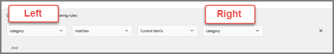

# Uso de reglas de inclusión dinámicas y estáticas {#inclusion-rules}

>[!BEGINSHADEBOX]

**En esta página:** Aprenda a agregar reglas de filtrado dinámicas y estáticas a los criterios y promociones de [!DNL Adobe Target Recommendations].

>[!ENDSHADEBOX]

Las reglas de inclusión limitan los artículos que pueden aparecer en las recomendaciones. Se crean para criterios y promociones en [!DNL Adobe Target], con reglas de filtrado dinámicas o estáticas. El proceso, los casos de uso y los ejemplos son similares para criterios y promociones, por lo que esta página cubre ambos.

## Adición de reglas de filtrado {#add-filtering-rules}

Los siguientes pasos agregan una regla de filtrado a los criterios.

1. Mientras [crea criterios](/help/main/c-recommendations/c-algorithms/create-new-algorithm.md#create-criteria) (**[!UICONTROL Recommendations]** > **[!UICONTROL Criterios]** > **[!UICONTROL Crear criterios]** > **[!UICONTROL Crear criterios]**), haga clic en **[!UICONTROL Agregar regla de filtrado]** en **[!UICONTROL Reglas de inclusión]**.

   

1. En el cuadro &quot;Qué otras reglas debe obedecer la recomendación&quot;, haga clic en la lista desplegable **[!UICONTROL Filtro estático]** y, a continuación, seleccione la opción que desee.

   

   Las opciones disponibles varían en función del sector seleccionado y la clave de recomendación.

Para agregar una regla de filtrado a una promoción, seleccione **[!UICONTROL Promocionar por atributo]** mientras [crea la promoción](/help/main/c-recommendations/t-create-recs-activity/adding-promotions.md) y luego haga clic en **[!UICONTROL Agregar regla de filtrado]**.

## Tipos de filtro {#filter-types}

Las secciones siguientes describen las opciones de filtrado para **[!UICONTROL Filtrado dinámico]** y **[!UICONTROL Filtrar por valor]**, tanto para criterios como para promociones.

### Filtrado dinámico

Las reglas de inclusión dinámica se adaptan al visitante o a la solicitud, mientras que las reglas de inclusión estáticas utilizan valores fijos.

* Las reglas de inclusión dinámica ofrecen recomendaciones al hacer coincidir un atributo en un parámetro de perfil del usuario o en una llamada de mbox.

  Por ejemplo, se puede crear una recomendación &quot;Criterios más populares&quot;. Del conjunto de recomendaciones devueltas, cualquier recomendación puede filtrarse (en tiempo real) con un atributo que se pasa cuando el usuario accede a una página donde se muestran las recomendaciones.

* Se puede crear cualquier cantidad de reglas de inclusión dinámica. Las reglas de inclusión se unen con un operador AND, por lo que todas las reglas deben cumplirse para que un elemento se incluya en una recomendación.

Las siguientes opciones están disponibles para el filtrado dinámico:

| Opción de filtrado dinámico | Detalles |
| --- | --- |
| [**[!UICONTROL Coincidencia de atributos de entidad]**](/help/main/c-recommendations/c-algorithms/entity-attribute-matching.md) | Filtra dinámicamente comparando un grupo de posibles elementos recomendados con un elemento específico con el que ha interactuado el visitante.
Use **[!UICONTROL Coincidencia de atributos de entidad]** para mostrar las recomendaciones que tienen más probabilidades de atraer al visitante, como la marca favorita del visitante. |
| [**[!UICONTROL Coincidencia de atributos de perfil]**](/help/main/c-recommendations/c-algorithms/profile-attribute-matching.md) | Filtra dinámicamente comparando elementos (entidades) con un valor del perfil del visitante.
Use **[!UICONTROL Coincidencia de atributos de perfil]** para mostrar recomendaciones que coincidan con un valor almacenado en el perfil del visitante, como tamaño o marca favorita. |
| [**[!UICONTROL Coincidencia de parámetros]**](/help/main/c-recommendations/c-algorithms/parameter-matching.md) | Filtra dinámicamente comparando elementos (entidades) con un valor de la solicitud (API o mbox).
Use **[!UICONTROL Coincidencia de parámetros]** para recomendar contenido que coincida con los parámetros de página o los parámetros del visitante, como dimensiones de dispositivo o ubicación geográfica. |

### Filtrar por valor

Las reglas estáticas limitan qué artículos se incluyen en la recomendación, en lugar de utilizar colecciones. La siguiente opción está disponible para filtrar por valor:

| Filtrado por opción de valor | Detalles |
| --- | --- |
| [**[!UICONTROL Filtro estático]**](/help/main/c-recommendations/c-algorithms/static-value.md) | Filtra por uno o más valores estáticos que se introducen manualmente. |

## Operadores disponibles {#operators}

Los siguientes ejemplos muestran cómo se pueden utilizar las promociones y exclusiones dinámicas para el marketing.

>[!NOTE]
>
>Los operadores de &quot;lista&quot; requieren que tanto las entidades como los atributos de perfil se almacenen como matrices. Una lista separada por comas no funciona.

| Operador | Disponible con | Ejemplos |
|--- |--- |--- |
| **[!UICONTROL es igual a cualquiera de]** | **[!UICONTROL Coincidencia de atributos de entidad]**, **[!UICONTROL Coincidencia de atributos de perfil]**, **[!UICONTROL Coincidencia de parámetros]** y **[!UICONTROL Filtro estático]** | Cuando un visitante está viendo un elemento en el sitio web (como un producto, un artículo, una película, etc.), las promociones dinámicas que utilizan el operador &quot;es igual que&quot; pueden promocionar otros elementos de:<ul><li>La misma marca</li><li>La misma categoría</li><li>La misma categoría Y de la marca de la casa</li><li>La misma tienda</li></ul> |
| **[!UICONTROL no es igual a ninguno de]** | **[!UICONTROL Coincidencia de atributos de entidad]**, **[!UICONTROL Coincidencia de atributos de perfil]**, **[!UICONTROL Coincidencia de parámetros]** y **[!UICONTROL Filtro estático]** | Cuando un visitante está viendo un elemento en el sitio web (como un producto, un artículo, una película, etc.), las promociones dinámicas que usen el operador &quot;**[!UICONTROL no es igual a ninguno de]**&quot; pueden promocionar otros elementos de:<ul><li>Una serie de TV diferente</li><li>Un género diferente</li><li>Una serie de productos diferente</li><li>Un ID de estilo diferente</li></ul> |
| **[!UICONTROL es mayor o igual que cualquiera de]** | **[!UICONTROL Coincidencia de atributos de entidad]**, **[!UICONTROL Coincidencia de atributos de perfil]**, **[!UICONTROL Coincidencia de parámetros]** y **[!UICONTROL Filtro estático]** | Cuando un visitante está viendo un elemento en el sitio web (como un producto), el operador &quot;**[!UICONTROL &quot; es mayor o igual que cualquiera de]**&quot; puede promocionar otros elementos que:<ul><li>Cuestan lo mismo o son más caros</li></ul> |
| **[!UICONTROL es menor o igual que cualquiera de]** | **[!UICONTROL Coincidencia de atributos de entidad]**, **[!UICONTROL Coincidencia de atributos de perfil]**, **[!UICONTROL Coincidencia de parámetros]** y **[!UICONTROL Filtro estático]** | Cuando un visitante está viendo un elemento en el sitio web (como un producto), el operador &quot;**[!UICONTROL &quot; es menor o igual que cualquiera de]**&quot; puede promocionar otros elementos que:<ul><li>Cuestan lo mismo o son menos caros</li></ul> |
| **[!UICONTROL contiene alguno]** | **[!UICONTROL Coincidencia de atributos de entidad]**, **[!UICONTROL Coincidencia de atributos de perfil]**, **[!UICONTROL Coincidencia de parámetros]** y **[!UICONTROL Filtro estático]** | Cuando un visitante está viendo un elemento en el sitio web (como un producto), el operador &quot;**[!UICONTROL contiene cualquiera de]**&quot; puede promocionar otros elementos que:<ul><li>El título contiene la misma marca</li></ul> |
| **[!UICONTROL no contiene ninguno]** | **[!UICONTROL Coincidencia de atributos de entidad]**, **[!UICONTROL Coincidencia de atributos de perfil]**, **[!UICONTROL Coincidencia de parámetros]** y **[!UICONTROL Filtro estático]** | Cuando un visitante está viendo un elemento en el sitio web (como un producto), el operador &quot;**[!UICONTROL no contiene ninguno de]**&quot; puede promocionar otros elementos que:<ul><li>El título no contiene palabrotas</li></ul> |
| **[!UICONTROL comienza con cualquiera de]** | **[!UICONTROL Coincidencia de atributos de entidad]**, **[!UICONTROL Coincidencia de atributos de perfil]**, **[!UICONTROL Coincidencia de parámetros]** y **[!UICONTROL Filtro estático]** | Cuando un visitante está viendo un elemento en el sitio web (como un producto), el operador &quot;**[!UICONTROL comienza con cualquiera de]**&quot; puede promocionar otros elementos que:<ul><li>El nombre del producto comienza con iPhone</li></ul> |
| **[!UICONTROL termina con cualquiera de]** | **[!UICONTROL Coincidencia de atributos de entidad]**, **[!UICONTROL Coincidencia de atributos de perfil]**, **[!UICONTROL Coincidencia de parámetros]** y **[!UICONTROL Filtro estático]** | Cuando un visitante está viendo un elemento en el sitio web (como un producto), el operador &quot;**[!UICONTROL termina con cualquiera de]**&quot; puede promocionar otros elementos que:<ul><li>El contenido termina con EN, que indica el idioma inglés</li></ul> |
| **[!UICONTROL está entre]** | **[!UICONTROL Coincidencia de atributos de entidad]**, **[!UICONTROL Coincidencia de atributos de perfil]** y **[!UICONTROL Coincidencia de parámetros]** | Cuando un visitante está viendo un elemento en el sitio web (como un producto, un artículo, una película, etc.), las promociones dinámicas que utilizan el operador &quot;**[!UICONTROL está entre]**&quot; pueden promocionar otros elementos que son:<ul><li>Más caro</li><li>Menos costoso</li><li>Costo más o menos 30%</li><li>Episodios posteriores en la misma temporada</li><li>Libros anteriores de una serie</li></ul> |
| **[!UICONTROL lista contiene un elemento en]** (lista del lado derecho) | **[!UICONTROL Coincidencia de atributos de perfil]** y **[!UICONTROL Coincidencia de parámetros]** | En la coincidencia de atributos de perfil, cuando un visitante está viendo un elemento en el sitio web (como un producto, un artículo, una película, etc.), la lista &quot;**[!UICONTROL contiene un elemento en]**&quot; y el operador puede promocionar otros elementos que:<ul><li>Disponible en la ubicación geográfica del visitante</li></ul>**Ejemplo**: Recomendar elementos que solo están disponibles en el área geográfica del visitante.
La regla de filtrado puede tener este aspecto:
`availableGeographies list contains an item in user.currentGeography`
**Nota**: cuando se usa este operador, se espera una lista en el [lado derecho](#caveats) de la regla. |
| **[!UICONTROL lista no contiene ningún elemento en]** (lista del lado derecho) | **[!UICONTROL Coincidencia de atributos de perfil]** y **[!UICONTROL Coincidencia de parámetros]** | En la coincidencia de atributos de perfil, cuando un visitante está viendo un elemento en el sitio web (como un producto, un artículo, una película, etc.), la lista &quot;**[!UICONTROL no contiene un elemento en]**&quot; el operador puede excluir otros elementos que son:<ul><li>En la lista de los últimos diez elementos que el visitante ha visto</li></ul>**Ejemplo**: Los elementos que el visitante ha visto recientemente y en los que no ha mostrado interés no se promocionan.
La regla de filtrado puede tener este aspecto:
`id is not contained in list user.lastViewedItems`
**Nota**: cuando se usa este operador, se espera una lista en el [lado derecho](#caveats) de la regla. |
| **[!UICONTROL lista contiene un elemento en]** (listas de ambos lados) | **[!UICONTROL Coincidencia de atributos de entidad]**, **[!UICONTROL Coincidencia de atributos de perfil]** y **[!UICONTROL Coincidencia de parámetros]** | En la coincidencia de atributos de perfil, cuando un visitante está viendo un elemento en el sitio web (como un evento deportivo o un concierto), la lista &quot;**[!UICONTROL contiene un elemento en]**&quot; el operador puede promocionar otros elementos que son:<ul><li>Asociado a uno de los equipos favoritos del visitante</li></ul>**Ejemplo**: recomienda los juegos asociados con uno de los equipos favoritos del visitante.
La regla de filtrado puede tener este aspecto:
`teamsPlaying list contains an item in user.favoriteTeams`
**Nota**: cuando se usa este operador, se espera una lista en [ambos lados](#caveats) de la regla. |
| **[!UICONTROL lista no contiene ningún elemento en]** (listas de ambos lados) | **[!UICONTROL Coincidencia de atributos de entidad]**, **[!UICONTROL Coincidencia de atributos de perfil]** y **[!UICONTROL Coincidencia de parámetros]** | En la coincidencia de parámetros, cuando un visitante está viendo un elemento en el sitio web (como un producto, un artículo, una película, etc.), la lista &quot;**[!UICONTROL no contiene un elemento en]**&quot; el operador puede excluir otros elementos que son:<ul><li>Incluido en una lista de tipos prohibidos</li></ul>**Ejemplo**: se excluyen los artículos que solo están disponibles para visitantes adultos, como el tabaco y el alcohol.
La regla de filtrado puede tener este aspecto:
`itemType is not contained in list mbox.prohibitedTypes`
**Nota**: cuando se usa este operador, se espera una lista en [ambos lados](#caveats) de la regla. |
| **[!UICONTROL la lista contiene todos los elementos en]** | **[!UICONTROL Coincidencia de atributos de entidad]**, **[!UICONTROL Coincidencia de atributos de perfil]** y **[!UICONTROL Coincidencia de parámetros]** | En la coincidencia de atributos de perfil, cuando un visitante está viendo un elemento en el sitio web (como una publicación de trabajo o una fórmula), la lista &quot;**[!UICONTROL contiene todos los elementos en]**&quot; el operador puede promocionar otros elementos que:<ul><li>Incluir un conjunto de aptitudes</li><li>Incluir un conjunto de ingredientes necesarios</li></ul>**Ejemplo 1**: Un visitante tiene un conjunto de aptitudes (Java, C++ y HTML). Los elementos del catálogo son trabajos con las aptitudes requeridas (Java y HTML). El perfil del visitante debe contener todas las habilidades necesarias antes de recomendar el trabajo al visitante.
La regla de filtrado puede tener este aspecto:
`profile.jobSeekerSkills contains all items in entity.requiredSkills`
**Ejemplo 2**: Un usuario tiene una lista de ingredientes de la despensa. La receta tiene una lista de ingredientes necesarios. El perfil del visitante debe contener todos los ingredientes necesarios antes de recomendar la fórmula al visitante.
La regla de filtrado puede tener este aspecto:
`profile.ingredientsInPantry contains all items in recipe.ingredientsRequired`
**Nota**: cuando se usa este operador, se espera una lista en [ambos lados](#caveats) de la regla. |
| **[!UICONTROL lista no contiene todos los elementos en]** | **[!UICONTROL Coincidencia de atributos de entidad]**, **[!UICONTROL Coincidencia de atributos de perfil]** y **[!UICONTROL Coincidencia de parámetros]** | En la coincidencia de atributos de entidad, cuando un visitante está viendo un elemento en el sitio web (como un evento deportivo o un concierto), el operador &quot;**[!UICONTROL list no contiene todos los elementos en]**&quot; puede promocionar otros elementos que:<ul><li>No incluya un conjunto de equipos</li></ul>**Ejemplo**: un evento deportivo incluye dos equipos. El perfil del visitante indica que este visitante no desea ver los juegos de estos equipos, por lo que no se debe recomendar un juego si estos equipos están jugando.
La regla de filtrado puede tener este aspecto:
`profile.leastfavoriteTeams does not contain all items in entity.teamsPlaying`
**Nota**: cuando se usa este operador, se espera una lista en [ambos lados](#caveats) de la regla. |

## Gestión de valores vacíos {#empty-values}

Hay varias opciones disponibles para administrar valores vacíos al filtrar por **[!UICONTROL Coincidencia de atributos de entidad]**, **[!UICONTROL Coincidencia de atributos de perfil]** y **[!UICONTROL Coincidencia de parámetros]**, para criterios y promociones.

Anteriormente, si un valor estaba en blanco no se devolvía ningún resultado. La lista desplegable &quot;Si *x* está vacío&quot; especifica la acción que se realizará cuando los criterios tengan valores vacíos, como se muestra en la siguiente ilustración:

Para seleccionar la acción que desee, pase el ratón sobre el icono del engranaje (  ) y, a continuación, elija la acción que desee:

| Acción | Disponible para | Detalles |
|--- |--- |--- |
| **[!UICONTROL Ignorar esta regla de filtrado]** | **[!UICONTROL Coincidencia de atributos de perfil]** y **[!UICONTROL Coincidencia de parámetros]** | Esta acción es la predeterminada para **[!UICONTROL coincidencia de atributos de perfil]** y **[!UICONTROL coincidencia de parámetros]**.
La regla se ignora. Por ejemplo, si hay tres reglas de filtrado y la tercera regla no pasa ningún valor, la tercera regla con los valores vacíos se puede ignorar en lugar de no devolver ningún resultado. |
| **[!UICONTROL No mostrar ningún resultado para estos criterios]**
(Solo criterios) | **[!UICONTROL Coincidencia de atributos de entidad]**, **[!UICONTROL Coincidencia de atributos de perfil]** y **[!UICONTROL Coincidencia de parámetros]** | Esta acción es la predeterminada para **[!UICONTROL Coincidencia de atributos de entidad]**.
Así es como [!DNL Target] administró los valores vacíos antes de que se agregara esta opción: no se muestran resultados para este criterio. |
| **[!UICONTROL No promocionar ningún elemento]**
(Solo promociones) | **[!UICONTROL Coincidencia de atributos de entidad]**, **[!UICONTROL Coincidencia de atributos de perfil]** y **[!UICONTROL Coincidencia de parámetros]** | Esta acción es la predeterminada para **[!UICONTROL Coincidencia de atributos de entidad]**.
Así es como [!DNL Target] administró los valores vacíos antes de que se agregara esta opción: no se muestran resultados para esta promoción. |
| **[!UICONTROL Usar un valor estático]** | **[!UICONTROL Coincidencia de atributos de entidad]**, **[!UICONTROL Coincidencia de atributos de perfil]** y **[!UICONTROL Coincidencia de parámetros]** | Se puede utilizar un valor estático cuando un valor está vacío. |

## Advertencias {#caveats}

>[!IMPORTANT]
>
>Es posible que no se puedan usar atributos de tipo de datos diferentes en los criterios dinámicos o promociones en tiempo de ejecución con los operadores &quot;es igual que&quot; y &quot;no es igual que&quot;. Cuando el lado izquierdo tenga atributos predefinidos o personalizados, elija cuidadosamente los valores **[!UICONTROL Value]**, **[!UICONTROL Margin]**, **[!UICONTROL Inventory]** y **[!UICONTROL Environment]** en el lado derecho.

En la tabla siguiente se muestran las reglas compatibles y las reglas que podrían no ser compatibles durante la ejecución:

| Reglas compatibles | Reglas potencialmente incompatibles |
|--- |--- |
| value - está entre - 90 % and 110 % de Elemento actual - salesValue | salesValue - está entre - 90 % y 110% de Elemento actual - value |
| value - está entre - 90 % y 110 % de Elemento actual - value | clearancePrice - está entre - 90 % y 110 % de Elemento actual - margin |
| margin - está entre - 90 % y 110 % de Elemento actual - margin | storeInventory - es igual que - Elemento actual - inventory |
| inventory - es igual que - Elemento actual - inventory |  |
