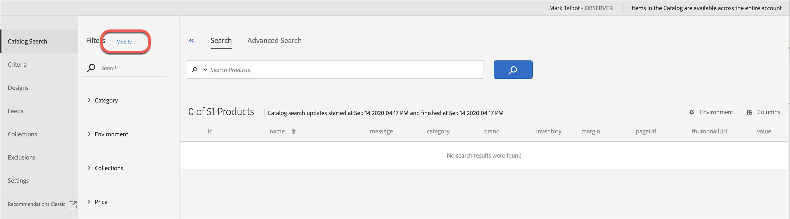

# [!UICONTROL Buscar en el catálogo] {#catalog-search}

>[!BEGINSHADEBOX]

**En esta página:** Aprenda a buscar en el catálogo de [!DNL Adobe Recommendations] para encontrar productos o contenido, y a filtrar, ver y quitar elementos.

>[!ENDSHADEBOX]

La página **[!UICONTROL Búsqueda en el catálogo]** de [!DNL Adobe Recommendations] se usa para encontrar los productos o el contenido en el catálogo. La tarea más básica de esta página es buscar un elemento. La página también permite cambiar el entorno, filtrar las facetas, modificar las columnas de la tabla, etc.

El catálogo es todo el conjunto de productos (entidades). Puede contener muchas colecciones, que organizan los productos en grupos lógicos.

El índice del catálogo se crea automáticamente cuando se carga la primera fuente y se actualiza según la [programación especificada](/help/main/c-recommendations/c-products/feeds.md#steps).

El catálogo se actualiza automáticamente cuando se reciben actualizaciones mediante archivos de fuentes, la API o actualizaciones de mbox. Las actualizaciones se suelen completar en una hora. Si las actualizaciones están en curso, se muestra la hora en la que se inició la más reciente. Si no hay actualizaciones en curso, se muestra la hora de inicio y finalización de la más reciente.

## Buscar en el catálogo

Utilice los resultados de búsqueda para revisar los elementos del catálogo y, si es necesario, eliminarlos.

1. Haga clic en **[!UICONTROL Recommendations]** > **[!UICONTROL Búsqueda en el catálogo]**.

1. (Opcional) Para filtrar los resultados, haga clic en el icono **[!UICONTROL Mostrar filtros]** (  ) y, a continuación, seleccione los filtros que desee aplicar. Los filtros disponibles son **[!UICONTROL Entorno]**, **[!UICONTROL Colecciones]**, **[!UICONTROL Categoría]**, **[!UICONTROL Marca]**, **[!UICONTROL Inventario]** y **[!UICONTROL Valor]**.

   [Los entornos](/help/main/administrating-target/environments.md) organizan los sitios y entornos de preproducción para la administración y la creación de informes separados. Para cambiar el entorno, seleccione el entorno que desee en la lista desplegable **[!UICONTROL Entorno]**.

   

1. Escriba un término de búsqueda en el campo **[!UICONTROL Buscar en]**.

1. (Opcional) Refine la búsqueda seleccionando una opción de búsqueda en el menú de opciones, que se abre desde la flecha hacia abajo en el campo **[!UICONTROL Buscar en]**.

   Las opciones de búsqueda son las siguientes:

   * ID
   * Nombre
   * Mensaje

1. Haga clic en el icono **[!UICONTROL Personalizar tabla]** (  ) para modificar las columnas activas en la página **[!UICONTROL Búsqueda en el catálogo]**.

   

1. Desplácese por los elementos de los resultados de búsqueda para ver miniaturas y otra información del producto.

   >[!NOTE]
   >
   >En una búsqueda en el catálogo de un atributo personalizado con un valor numérico, los resultados tratan el atributo personalizado como un tipo de cadena en lugar de un valor numérico.
   >
   >El tipo de un atributo no se puede cambiar en este momento. Para solicitar un cambio, [abra un problema con el cliente](/help/main/cmp-resources-and-contact-information.md#reference_ACA3391A00EF467B87930A450050077C) que haga referencia a los atributos cuyo tipo debe cambiar de cadena a numérico.

1. Haga clic en un elemento de los resultados de búsqueda para ver sus detalles, incluidos el ID, el nombre, el mensaje, la categoría, etc.

   

1. Para quitar el elemento del catálogo, haga clic en **[!UICONTROL Quitar del catálogo]**.

   Toda la información sobre ese elemento se elimina del índice del catálogo. El elemento se vuelve a incluir en el catálogo solo si se vuelve a añadir en una fuente de datos. Un elemento eliminado también debe eliminarse de forma independiente de las fuentes.

   

<!--
### Perform an advanced search {#advanced-search}

You can use [!UICONTROL Advanced Search] to further refine your search results or to save your search results as a [collection](/help/main/c-recommendations/c-products/collections.md) or [exclusion](/help/main/c-recommendations/c-products/exclusions.md).

1. Click the **[!UICONTROL Advanced Search]** link.

   

1. Use the drop-down lists to specify the parameter, operator, and values for your search.

1. (Optional) Click **[!UICONTROL Add Rule]** to add an additional search rule.

   Each additional search rule is joined with the AND operator.

1. Click **[!UICONTROL Search]**.

1. (Optional) Click **[!UICONTROL Save As]**, then click **[!UICONTROL Collection]** or **[!UICONTROL Exclusion]**.

   

   For more information, see [Create a collection or exclusion based on Advanced Search](#save-as) below.
-->

<!--
## Modify the Catalog Search page (filters and columns)

You can temporarily modify the available filters and columns on the [!UICONTROL Catalog Search] page for the current session.

### Modify filters

You can add additional filter facets to the [!UICONTROL Catalog Search] page.

1. In the **[!UICONTROL Filters]** panel, click **[!UICONTROL Modify]**.

   

1. Select the desired search facets (ID, name, message, etc.), then click **[!UICONTROL Save]**.

   

Keep in mind that the additional filter facets are available in the current session only.
-->

<!--
## Create a collection or exclusion based on Advanced Search {#save-as}

You can create [collections](/help/main/c-recommendations/c-products/collections.md) or [exclusions](/help/main/c-recommendations/c-products/exclusions.md) using [!UICONTROL Advanced Search] on the [!UICONTROL Catalog Search] page ([!UICONTROL Recommendations] > [!UICONTROL Catalog Search] > [!UICONTROL Advanced Search]).

1. Perform an [advanced search](#advanced-search).

1. Click **[!UICONTROL Save As]**, then click **[!UICONTROL Collection]** or **[!UICONTROL Exclusion]**.

   

   >[!IMPORTANT]
   >
   >The [!UICONTROL Advanced Search] functionality is case-insensitive; however, products returned at the time of delivery are based on case-sensitive search. This mismatch might lead to confusion. Ensure that you consider case-sensitivity when you create collections or exclusions based on results using the [!UICONTROL Advanced Search] functionality. For example, if you perform a search for "Holiday," that initial search lists results containing "Holiday" and "holiday." If you then create a catalog with the intent to return products containing "holiday," only products containing "holiday" are returned. Products containing "Holiday" are not returned. Exclusions are handled in a similar fashion.
-->
