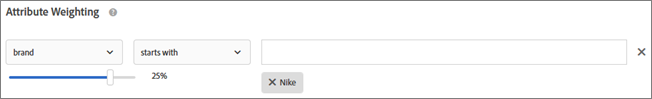

# Preguntas más frecuentes de Recommendations {#recommendations-faq}

>[!BEGINSHADEBOX]

**En esta página:** Encuentre respuestas a las preguntas más frecuentes acerca de [!DNL Adobe Target] [!DNL Recommendations] actividades.

>[!ENDSHADEBOX]

## Datos y API {#data-and-apis}

+++ ¿Se muestran los objetos de [!DNL Recommendations] creados mediante la API en la interfaz de usuario de [!DNL Target]?

Sí. Los objetos de [!UICONTROL Recommendations] (**[!UICONTROL Criterios]**, **[!UICONTROL Diseños]**, **[!UICONTROL Colecciones]** y **[!UICONTROL Exclusiones]**) creados mediante la API están disponibles en la interfaz de usuario y se pueden editar mediante la API o la interfaz de usuario de [!DNL Target].

+++

+++ ¿Pueden administrarse las ofertas visuales creadas en la interfaz de usuario de [!DNL Target] con las API [!DNL Target]?

No. Las actividades [!DNL Recommendations] con ofertas visuales creadas en la interfaz de usuario [!DNL Target] no se pueden administrar con las API [!DNL Target]. Estas actividades se muestran en la lista **[!UICONTROL Actividades]**, pero no se pueden leer ni actualizar (con GET o PUT).

+++

+++ ¿Cuál es el límite de tamaño de una llamada API para insertar o actualizar productos? ¿Se pueden actualizar 50 000 productos en una llamada en lugar de una fuente?

[!DNL Target] impone a las publicaciones un límite de 50 MB en el nivel de aplicación, pero solo cuando se pasa el encabezado de tipo de contenido `application/x-www-form-urlencoded`.

Se puede intentar realizar una sola llamada con 50 000 productos. Si la llamada falla, se puede dividir en lotes. Adobe recomienda lotes de 5000 o 10 000 productos para reducir la probabilidad de tiempo de espera agotado debido a la carga del sistema.

+++

+++ ¿Cuál es el tamaño máximo de un archivo CSV para una carga de fuente?

No hay un límite estricto en el número de filas o en el tamaño del archivo para la carga de un archivo CSV de fuente. Como práctica recomendada, Adobe recomienda limitar el archivo CSV a 1 GB para evitar errores durante la carga. Lo ideal es que un archivo que supere 1 GB se divida en varios archivos de fuentes.

El número máximo de columnas de atributos personalizados es 100 y los atributos personalizados están limitados a 4096 caracteres. Hay otros límites en la longitud de las columnas requeridas disponibles en la página Limitaciones de [[!DNL Target] ](/help/main/r-troubleshooting-target/target-limits.md).

+++

+++ ¿Por qué **[!UICONTROL Búsqueda en el catálogo]** no muestra los resultados correctos al buscar en un atributo personalizado con un valor numérico?

Cuando se realiza una búsqueda en el catálogo de un atributo personalizado con un valor numérico, los resultados tratan el atributo como una cadena en lugar de como un valor numérico.

Actualmente no hay ninguna funcionalidad disponible que permita a los clientes cambiar el tipo de un atributo. Para realizar un cambio, [abra un problema con el cliente](/help/main/cmp-resources-and-contact-information.md#reference_ACA3391A00EF467B87930A450050077C) que haga referencia a los atributos cuyo tipo debe cambiar de cadena a numérico.

+++

## Actualización del tiempo {#update-timing}

+++ ¿Cuánto tiempo tardan las actualizaciones de los elementos del catálogo en reflejarse en el sitio?

El lapso de tiempo y los resultados varían en función de cómo se actualicen los elementos.

| Actualizar | Recommendations | Buscar en el catálogo |
| --- | --- | --- |
| Atributos de elemento actualizados a través de un mbox o la API | En 15 minutos | Después del índice del catálogo (de 3 a 8 horas) |
| Atributos de elemento actualizados mediante una fuente | Después de la ingesta de fuente (2-8 horas) | Después de la ingesta de fuentes (de 2 a 8 horas) y el siguiente índice de catálogo (de 3 a 8 horas), en un plazo total de 5 a 16 horas |
| Elemento eliminado del catálogo a través de la interfaz de usuario o la API de [!DNL Target] | En 15 minutos | Después del índice del catálogo (de 3 a 8 horas) |
| Elemento añadido al catálogo mediante un mbox o la API | Después de que se ejecute el siguiente algoritmo. Las ejecuciones de algoritmos se programan cada 12 horas para algoritmos de 1 a 2 días, y cada 24 horas para algoritmos de más de 7 días | Después del índice del catálogo (de 3 a 8 horas) |
| Elemento añadido al catálogo mediante una fuente | Después de la ingesta de fuentes (de 2 a 8 horas) y de que se ejecute el algoritmo siguiente, que se programan cada 12 horas para algoritmos de 1 a 2 días, y cada 24 horas para algoritmos de más de 7 días, en un plazo total de 2 a 32 horas | Después de la ingesta de fuentes (de 2 a 8 horas) y del índice del catálogo (de 3 a 8 horas), en un plazo total de 5 a 16 horas |

Hasta que las actualizaciones estén disponibles, se mostrará el siguiente contenido:

* Para artículos actualizados o eliminados, se muestran las recomendaciones y los atributos de artículos existentes.
* Para un elemento añadido, las recomendaciones existentes se muestran si el elemento añadido no es una clave solicitada. Las recomendaciones de copia de seguridad se muestran si el elemento agregado es una clave solicitada.

Tras importar un archivo de fuentes o recibir actualizaciones de entidad mediante la API o un mbox, los cambios siguientes se reflejarán en menos de 60 minutos:

* Si un elemento se ha excluido anteriormente, pero ahora debe incluirse, este se incluye en la siguiente ejecución del algoritmo (de 12 a 24 horas).

  Esta situación se produce porque [!DNL Target] aplica exclusiones tanto en línea como sin conexión. Cuando se excluye un elemento recientemente, la exclusión en línea se aplica rápidamente. Cuando se incluye un elemento reciente, la exclusión en línea desaparece rápidamente, pero la exclusión sin conexión no desaparece hasta que se ejecuta el siguiente algoritmo.

* Si un elemento se incluyó anteriormente, pero ahora debe excluirse, este se excluye según las líneas de tiempo de la tabla, según la fuente: 15 minutos a través de un mbox o la API, o de 12 a 24 horas a través de una fuente.

Los siguientes cambios no se reflejan hasta que se ejecute el siguiente algoritmo (en 12-24 horas):

* Atributos de elemento utilizados en las reglas de recopilación de la actividad.
* Atributos de elemento utilizados en una promoción basada en un atributo o en una colección asociada con la actividad.
* Categoría del elemento en la que aparece para una &quot;Categoría actual&quot; o &quot;Categoría favorita&quot; en los algoritmos **[!UICONTROL Principales vendedores]** o **[!UICONTROL Más visitados]**.
* La clasificación de los elementos recomendados, cuando el atributo modificado es un atributo personalizado que se utiliza como clave personalizada para un algoritmo.
* La clasificación de los artículos recomendados en función de uno o más atributos modificados, cuando la lógica de recomendación es &quot;Elementos con atributos similares&quot; o cuando se utilizan factores de &quot;Similitud de contenido&quot; o &quot;Ponderación de atributos&quot;.

>[!NOTE]
>
>Un archivo de fuente se considera importado cuando su estado cambia de “Importación de elementos” a “Preparación de las actualizaciones del índice de búsqueda”. Las actualizaciones pueden tardar más de 60 minutos en reflejarse en la interfaz de usuario **[!UICONTROL Búsqueda en el catálogo]**. **[!UICONTROL Búsqueda en el catálogo]** está actualizada cuando el estado de la fuente cambia a &quot;Actualizaciones completadas&quot;. Aunque **[!UICONTROL Búsqueda en el catálogo]** aún no esté actualizada, el sitio reflejará las actualizaciones dentro de los lapsos de tiempo enumerados arriba. El tiempo de actualización del índice de **[!UICONTROL Búsqueda en el catálogo]** más reciente se muestra en la página **[!UICONTROL Búsqueda en el catálogo]**.

+++

+++ ¿Cuánto tiempo se tarda en reflejar en el sitio un cambio en la configuración de una actividad, oferta, promociones o configuración de criterios de [!UICONTROL Recommendations]?

* Un cambio en la configuración de la promoción puede tardar hasta cinco horas en reflejarse en el sitio.
* Es posible que un cambio en la configuración de otros criterios no se refleje hasta que se ejecute el siguiente algoritmo:

  * Algunas configuraciones de criterios, como la adición de una regla de inclusión dinámica, se reflejan instantáneamente.
  * Otras configuraciones de criterios, por ejemplo la eliminación de una regla de inclusión dinámica o un cambio en la ventana retrospectiva, no se pueden incorporar hasta que se ejecute el siguiente algoritmo.
  * Estos cambios almacenan en déclencheur la ejecución de un algoritmo, que puede tardar hasta 24 horas en completarse. Los algoritmos también se ejecutan en una programación, cada 12 a 24 horas.

+++

+++ ¿Cuánto tiempo tarda el comportamiento de un usuario en reflejarse (por ejemplo, haciendo clic en el producto A y comprando el producto B) en las recomendaciones que recibe el mismo usuario?

* El producto o contenido que se está viendo o comprando influye en las recomendaciones que el usuario recibe en la misma vista de página o en la solicitud de contenido de [!DNL Target].
* El comportamiento histórico del usuario, como &quot;último producto visualizado&quot;, &quot;producto más visualizado&quot; y el historial general de visualización y compra, se actualiza con esa solicitud. Influye en las recomendaciones que el usuario recibe en la siguiente vista de página o solicitud de contenido. Por ejemplo, los algoritmos de **[!UICONTROL Artículos vistos recientemente]** y **[!UICONTROL Recomendados para ti]** se actualizan con cada vista o compra de producto, y la actualización se refleja en la solicitud de contenido posterior.

+++

+++ ¿Cuánto tiempo tarda el comportamiento de un usuario en reflejarse en las recomendaciones que reciben otros usuarios?

El comportamiento de los usuarios en conjunto se incorpora al procesamiento del algoritmo sin conexión. Este procesamiento se produce con cada algoritmo ejecutado, cada 12 a 24 horas.

+++

+++ ¿Persisten las recomendaciones basadas en artículos vistos recientemente en varios dispositivos para un único visitante?

Cuando un visitante inicia una sesión, el ID de sesión está vinculado a un solo equipo Edge y se almacena una caché de perfiles temporal en este equipo. Las solicitudes posteriores de la misma sesión leen esta caché de perfil, incluidos los artículos vistos recientemente.

Cuando finaliza la sesión (por lo general, cuando caduca tras 30 minutos sin actividad), el estado de la sesión, incluidos los artículos vistos recientemente, persiste en un almacenamiento de perfiles más permanente en el mismo perímetro geográfico. Las sesiones posteriores de distintos dispositivos pueden acceder a estos elementos visualizados recientemente, siempre que la nueva sesión esté vinculada al perfil del cliente mediante el mismo Marketing Cloud ID (MCID), Experience Cloud ID (ECID) o CustomerID o `mbox3rdPartyId`.

Si un visitante tiene dos sesiones activas a la vez, los elementos visualizados recientemente en un dispositivo no actualizan los elementos visualizados recientemente en el otro dispositivo, a menos que los dispositivos se vean obligados a compartir el ID de sesión. Existe una solución alternativa, pero [!DNL Target] no admite directamente el uso compartido de un ID de sesión entre varios dispositivos. El cliente debe administrar este uso compartido de ID.

Este comportamiento también se produce cuando un visitante está activo en un dispositivo y se activa en el otro dispositivo unos minutos después. La sesión del primer dispositivo no caduca durante 30 minutos y pueden producirse hasta cinco minutos de retraso antes de que el estado del perfil se escriba en el estado permanente y se procese. Al probar este comportamiento, espere 35 minutos para que la sesión caduque y el perfil se almacene.

Si el visitante no tiene dos sesiones activas a la vez, los artículos vistos recientemente en un dispositivo actualizarán los vistos recientemente en el otro dispositivo, siempre y cuando la sesión haya finalizado. Al probar este comportamiento, espere 35 minutos para que la sesión caduque.

+++

## Criterios, diseños y promociones {#criteria-designs-promotions}

+++ ¿Por qué no están disponibles para su selección todos los criterios, incluidos los personalizados, al crear una actividad de [!DNL Recommendations]?

Los criterios disponibles dependen de la categoría actual. Cuando se crean ofertas de recomendaciones, el selector de algoritmo muestra criterios basados en el ID de categoría. Si la ubicación donde se aplican los criterios no contiene el ID de categoría, determinados criterios no están disponibles en el selector de algoritmo. Si se utiliza una ubicación en la que el ID de categoría está presente en el mbox, el selector de criterios contendrá todos los criterios aplicables.

[!DNL Target] tiene un valor de [Filtrar los criterios no compatibles](https://experienceleague.adobe.com/docs/target-dev/developer/recommendations.html){target=_blank} que controla el filtrado inteligente del selector de algoritmo. Para obtener acceso al valor **[!UICONTROL Filtrar los criterios no compatibles]**, haga clic en **[!UICONTROL Administración]** > **[!UICONTROL Recommendations]**.


* Si el ajuste **[!UICONTROL Filtrar los criterios no compatibles]** no está habilitado, [!DNL Target] no filtra los algoritmos en el selector de algoritmos y se muestran todos ellos.
* Si la configuración está habilitada, en las actividades [!UICONTROL Compositor de experiencias visuales] (VEC), [!DNL Target] lee entityId y el ID de categoría de la ubicación seleccionada. A continuación, muestra algoritmos basados en `currentItem|currentCategory`, si los valores respectivos están presentes en esa ubicación. Como resultado, solo los algoritmos compatibles con la ubicación seleccionada se muestran en el selector de algoritmos de forma predeterminada. Los algoritmos no compatibles se pueden seguir viendo desactivando la casilla de verificación **[!UICONTROL Compatible]** al seleccionar los criterios.

  

[!DNL Target] no muestra la casilla de verificación **[!UICONTROL Compatible]** en los siguientes casos especiales:

* Tanto entityId como el ID de categoría están presentes en la ubicación, por lo que no se filtra nada.
* Se utiliza [!DNL mbox.js] versión 55 o anterior.
* No se activó ninguna llamada de mbox desde la página (`!config.isAutoCreateGlobalMbox && !config.isRegionalMbox`).
* Los parámetros de [!DNL Target] no están definidos.

>[!NOTE]
>
>El ajuste **[!UICONTROL Filtrar los criterios no compatibles]** se aplica solo a las actividades creadas en el [!UICONTROL Compositor de experiencias visuales] (VEC). Esta configuración no se aplica a las actividades creadas en **[!UICONTROL Compositor de experiencias basadas en formularios]**, porque [!DNL Target] no tiene contexto de ubicación.

+++

+++ ¿Cuál es la diferencia entre la ponderación de atributos general y la específica para similitudes de contenido?

Existen dos formas de ponderación de atributos: la &quot;ponderación de atributos estándar&quot; y la &quot;ponderación de atributos de similitud de contenido&quot;.

* La &quot;ponderación de atributos estándar&quot; se aplica a la mayoría de los tipos de criterio, no solo a **[!UICONTROL Similitud de contenido]**. Este tipo de ponderación da más peso a ciertos valores de atributo. En el ejemplo siguiente, los productos de Nike reciben un empujón en las recomendaciones generadas.

  

* La &quot;ponderación de atributos de similitud de contenido&quot; se aplica únicamente a los criterios **[!UICONTROL Similitud de contenido]**. Este tipo de ponderación es más dinámico y se basa en la &quot;clave de recomendación&quot; actual (el elemento que se está viendo en ese momento). En el siguiente ejemplo (marca x 16), es más probable que un visitante que ve zapatillas Nike se recomiende otros productos Nike (no necesariamente solo zapatillas) que las zapatillas de la competencia. Es más probable que un visitante que vea zapatillas de Adidas reciba la recomendación de productos de Adidas.

  

+++

+++ ¿Se debe especificar el nombre del mbox al crear [!DNL Recommendations] criterios, promociones o reglas de prueba de plantilla?

Cuando se crea un criterio, promoción o regla de prueba de plantilla [!DNL Recommendations] basada en un parámetro de mbox, `mboxParameter` ya no solicita `mboxName`. El nombre del mbox es ahora opcional. Este cambio permite el uso de parámetros de varios mboxes o una referencia a un parámetro que aún no se haya registrado en el perímetro.

Para seleccionar el parámetro deseado, utilice uno de los siguientes métodos:

* Al crear un criterio, una promoción o una regla de prueba de plantilla, seleccione un nombre de parámetro en la lista. Empiece a escribir los primeros caracteres del nombre del parámetro o escriba el nombre completo.
* Si el nombre del mbox es conocido pero el nombre del parámetro no, utilice la casilla de verificación para filtrar por un mbox conocido que pase el parámetro deseado.

Con cualquiera de los métodos, no hay ningún vínculo entre el mbox y el parámetro. Los criterios, las promociones y las reglas de prueba de plantilla funcionarán según el parámetro en todos los mboxes que pasen dicho parámetro.

Cuando se edita un criterio, promoción o regla de prueba de plantilla existente, el filtrado muestra el nombre de mbox que se suministró durante la creación.

+++

+++ ¿Qué se puede hacer cuando los caracteres especiales rompen una matriz?

Utilice valores escapados en JavaScript. Las comillas ( &quot; ) pueden romper la matriz. El siguiente fragmento de código es un ejemplo de valores escapados:

```
#set($String='') 
#set($escaper=$String.class.forName('org.apache.commons.lang.StringEscapeUtils')) 
<script type="text/javascript"> 
console.log("$escaper.escapeJavaScript($entity1.name)") 
console.log("$escaper.escapeJavaScript($entity2.name)") 
console.log('$escaper.escapeJavaScript($entity3.name)') 
names.push("$escaper.escapeJavaScript($entity4.name)") 
</script>
```

+++

+++ ¿Se puede excluir dinámicamente una entidad?

Sí. Los ID de entidad de las entidades que se excluirán de las recomendaciones se pueden pasar en la cadena de consulta. Por ejemplo, se pueden excluir los artículos que ya están en el carro de compras.

Para habilitar la funcionalidad de exclusión, utilice el parámetro mbox `excludedIds`. Este parámetro apunta a una lista de identificadores de entidad separados por comas, por ejemplo `mboxCreate(..., "excludedIds=1,2,3,4,5")`. El valor se envía cuando se solicitan las recomendaciones.

La exclusión solo se realiza para la llamada actual [!DNL Target]. Los elementos no se excluyen en llamadas a [!DNL Target] subsiguientes a menos que se vuelva a pasar el valor `excludedIds`. Para excluir los elementos del carro de compras de las recomendaciones de cada página, siga pasando el valor `excludedIds` en cada página.

Para excluir `entityIds`, añada el token `&excludes=${mbox.excludedIds}` a la dirección URL de contenido de la oferta. Cuando se extrae la dirección URL de contenido, los parámetros requeridos se sustituyen por los parámetros de solicitud de mbox actuales.

De forma predeterminada, esta característica está habilitada para las recomendaciones de nueva creación. Las recomendaciones existentes deben guardarse para admitir entidades excluidas dinámicamente.

>[!NOTE]
>
>Si se excluyen demasiadas entidades, las recomendaciones se comportan como si no hubiera suficientes entidades para rellenar la plantilla de recomendaciones.

+++

+++ ¿Por qué no se puede guardar una actividad [!DNL Recommendations] heredada después de definir una nueva audiencia?

Asegúrese de que la audiencia tiene un nombre único. Si la audiencia tiene el mismo nombre que una audiencia existente, la actividad [!DNL Recommendations] heredada (una actividad [!DNL Recommendations] creada antes de octubre de 2016) no se puede guardar.

+++

+++ ¿Se puede usar un algoritmo creado en [!DNL Adobe Recommendations Classic] en [!DNL Recommendations Premium]?

Un algoritmo creado en [!DNL Recommendations Classic] no es compatible con [!DNL Recommendations Premium]. El algoritmo heredado podría utilizarse en [!DNL Target Premium], pero puede crear problemas de sincronización cuando la actividad se desactiva o elimina en la interfaz de usuario de [!DNL Target Premium]. Para obtener más información sobre las diferencias entre las dos soluciones, vea [[!DNL Recommendations Classic] frente a [!DNL Recommendations] actividades en [!DNL Target Premium]](/help/main/c-recommendations/c-recommendations-faq/recommendations-classic-versus-recommendations-activities-target-premium.md).

+++

+++ ¿Cómo se pueden recomendar solo nuevos artículos o vídeos?

Los clientes de medios y publicaciones a menudo desean que los artículos recomendados incluyan solo los artículos o vídeos más recientes. Por ejemplo, un cliente de [!DNL Target] utilizó el siguiente método para recomendar artículos con menos de 60 días de antigüedad:

1. Pase la fecha de publicación del artículo, en formato AAAAMMDD, como atributo de entidad personalizado. Por ejemplo:

   | Atributo de la entidad | Ejemplo |
   | --- | --- |
   | issueDate | 2021218 |
   | lastViewDate | 2021701 |
   | parentCategory | comentario |
   | publishDate | 20210113 |
   | publishDateDisplay | 13 de enero de 2021 |

1. Cree un script de perfil que devuelva la fecha de hoy menos 60 días, también en formato AAAAMMDD.

   

1. Usar una regla de inclusión dinámica en los criterios para `publish date > today's date minus 60 days`.

   

Este ejemplo también se puede realizar con la coincidencia de parámetros, pasando el valor `priorDate60` como parámetro de mbox.

+++

## Resolución de problemas {#troubleshooting}

+++ ¿Por qué, a veces, [!DNL Target] no puede mostrar recomendaciones?

[!DNL Target] a veces no puede mostrar recomendaciones debido al bajo número de recomendaciones disponibles.

El número de valores generados para cada criterio es tres veces el número de entidades especificadas en el diseño. El filtrado en tiempo de ejecución (por ejemplo, la coincidencia de atributos de mbox o inventario) se aplica después de que se generen los valores 3x, por lo que menos de 3 valores pueden permanecer en el momento de la entrega. Para mitigar esta situación, aumente el número de entidades en el diseño ocultando entidades adicionales.

Puede usar el siguiente JavaScript al comienzo del diseño para incrementar el número de entidades solicitadas. En este ejemplo, el recuento de entidades solicitadas es 30 (3 x 10).

```
#foreach($entity in $entities) 
 #if( $foreach.count > 10 ) 
  #break 
 #end 
 #set ($foo = $entity.id) 
#end 
```

+++

+++ ¿Qué significa la respuesta NO_CONTENT que a veces se devuelve en el seguimiento de contenido de [!DNL Recommendations]?

NO_CONTENT se devuelve cuando las recomendaciones no están disponibles para la combinación de algoritmo y clave solicitada. Esta situación suele ocurrir cuando las copias de seguridad están desactivadas para el algoritmo y una o más de las siguientes condiciones también son verdaderas:

* Los resultados aún no están listos.

  Esta situación suele ocurrir cuando se guarda por primera vez una actividad recién creada, o después de realizar cambios de configuración en la colección, los criterios o las promociones utilizados en la actividad.

* Los resultados están listos, pero aún no se han almacenado en caché en el servidor Edge más cercano para la combinación de algoritmo y clave solicitada.

  La solicitud inicia una operación de almacenamiento en caché, por lo que este problema se resuelve después de que se vuelva a cargar la página o después de unos minutos.

* Los resultados están listos, pero no están disponibles para el valor de clave proporcionado.

  Esta situación suele ocurrir cuando se solicitan recomendaciones para un artículo que se añadió al catálogo después de que se ejecute el algoritmo más reciente. Se resuelve después de que se ejecute el siguiente algoritmo.

* El procesamiento parcial de la plantilla está deshabilitado y no hay suficientes resultados disponibles para rellenarla.

  Esta situación suele ocurrir con una regla de inclusión dinámica que filtra de forma agresiva muchos elementos de los posibles resultados. Para evitar esta situación, habilite las copias de seguridad y no aplique la regla de inclusión a las copias de seguridad, o utilice los criterios en secuencia con criterios filtrados de forma menos agresiva.

+++

+++ ¿Qué se debe hacer cuando una colección de [!DNL Recommendations] pasa a cero (0)?

Tenga en cuenta lo siguiente cuando una colección que anteriormente no estaba en cero pase a cero:

* Vuelva a guardar la colección y compruebe si el número se actualiza. Al volver a guardar, se vuelven a ejecutar todos los algoritmos que utilizan esa colección.
* Compruebe que se muestra el entorno correcto. Haga clic en **[!UICONTROL Administración]** > **[!UICONTROL Recomendaciones]** y, a continuación, compruebe la configuración de **[!UICONTROL Grupo de hosts predeterminado]** en la sección **[!UICONTROL Catálogo de productos]**.

  

* Compruebe que el índice esté actualizado. Haga clic en **[!UICONTROL Recommendations]** > **[!UICONTROL Búsqueda en el catálogo]** y compruebe cuántas horas hace que se actualizó el índice (por ejemplo, &quot;Indexado hace 3 horas&quot;). El índice se puede actualizar según sea necesario.
* Compruebe si ha habido algún cambio en la fuente o en la capa de datos que haga que las entidades dejen de coincidir con las reglas de recopilación. Asegúrese de que las mayúsculas y minúsculas coincidan (las reglas distinguen entre mayúsculas y minúsculas).
* Compruebe si la fuente se ha ejecutado correctamente o si alguien ha cambiado el directorio FTP, la contraseña, etc.
* [!DNL Target] actualiza el envío (en la página o aplicación del cliente) lo más rápido posible y también debe proporcionar una representación en la interfaz de usuario para el experto en marketing. [!DNL Target] no retrasa las actualizaciones de entrega hasta que las actualizaciones de la IU se sincronizan con ellas. Use [mboxTrace](/help/main/c-activities/c-troubleshooting-activities/content-trouble.md) para ver qué hay en el sistema en el momento en que ingresa una solicitud.

+++

+++ ¿Por qué la acción **[!UICONTROL Descargar datos]** falla en una actividad [!DNL Recommendations]?

Cuando se hace clic en **[!UICONTROL Descargar datos]** en la página **[!UICONTROL Información general de la actividad]** de una actividad [!DNL Recommendations], la interfaz de usuario [!DNL Target] puede mostrar el error `Error while fetching recommendation data file.`

Este error suele producirse cuando la actividad tiene un conjunto de resultados muy grande. El CSV generado supera el tamaño de respuesta que se puede devolver a través de la interfaz de usuario en una sola descarga. Los datos de recomendación en sí están intactos. Solo la ruta de descarga en el explorador no puede entregar un archivo de ese tamaño.

+++

## Problemas conocidos {#known-issues}

Los siguientes son problemas conocidos de las actividades [!UICONTROL Recommendations]:

* Cuando [!DNL Target] devuelve una oferta JSON con `getOffer()`, devuelve un tipo de JSON. Sin embargo, un diseño JSON [!DNL Recommendations] devuelve un tipo de HTML.
* Las entidades caducadas caducan correctamente después de 60 días de no recibir actualizaciones a través de una fuente o la API. Sin embargo, las entidades caducadas no se quitan del índice **[!UICONTROL Búsqueda en el catálogo]** después de la caducidad. Las entidades eliminadas a través de una fuente o la API tampoco se eliminan actualmente del índice **[!UICONTROL Búsqueda en el catálogo]**. (IRI-857)
* Las ofertas [!DNL Recommendations] en las actividades A/B y de segmentación de experiencias no muestran una previsualización concreta de la bandeja [!DNL Recommendations]. (TGT-33426)
* El estado de la fuente de criterios personalizados que se muestra en la lista de criterios (tarjeta) se actualiza cada diez minutos, y es posible que pasen más de diez minutos de la fecha en circunstancias excepcionales. El estado que se muestra en la vista de edición de criterios personalizados se obtiene en tiempo real y siempre está actualizado. (TGT-35896, TGT-36173)
