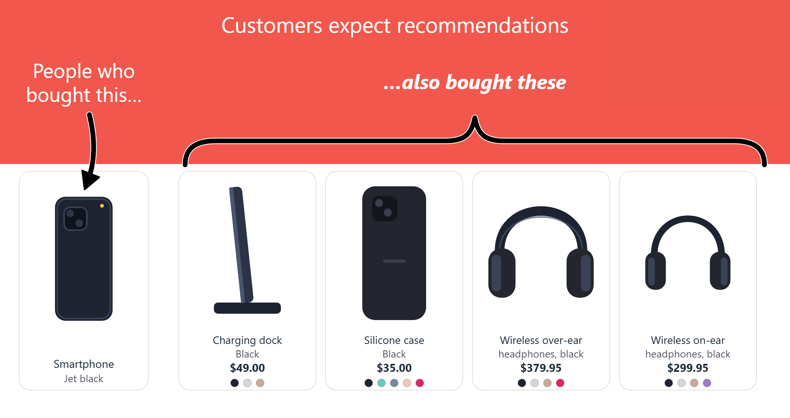
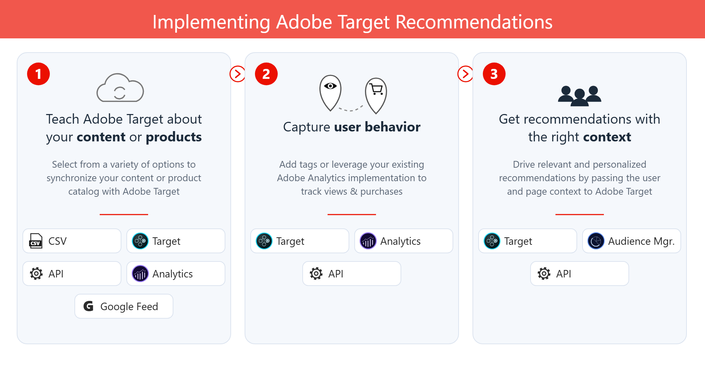
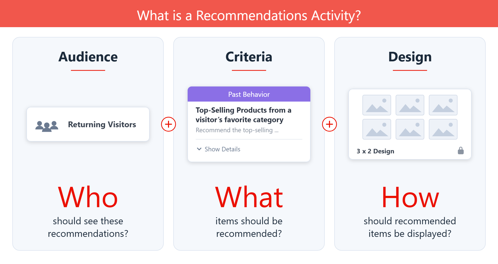

# Introducción a Recommendations {#introduction-to-recommendations}

>[!BEGINSHADEBOX]

**En esta página:** aprenda cómo las actividades de [!DNL Recommendations] en [!DNL Adobe Target] muestran productos o contenido relevantes a los visitantes, y cómo planificar y generar una implementación y actividad de [!DNL Recommendations].

>[!ENDSHADEBOX]

Esta página se basa en el seminario web *Introducción a Recommendations*. Una actividad de [!DNL Recommendations] muestra automáticamente productos o contenido que podría interesar a los clientes optimizando las sugerencias en tiempo real en función de las visitas anteriores. La página también describe cómo generar una actividad [!DNL Recommendations] en la interfaz de usuario de [!DNL Target].

## Primeros pasos

Los clientes esperan cada vez más recomendaciones y las utilizan como punto de partida para explorar otras opciones disponibles. Casi todos han comprado un producto que vieron por primera vez en una recomendación, ya sea en una tienda o en una propiedad digital.

La forma en que la gente consume medios y contenido está cada vez más impulsada por recomendaciones personalizadas, y marcas digitales como Netflix, Spotify y YouTube inician la experiencia del cliente con recomendaciones. Dado que hay más alternativas que nunca, es fundamental identificar el contenido más relevante para un cliente en el momento de la interacción.

Los especialistas en marketing utilizan [!DNL Adobe Target] para impulsar experiencias personalizadas en una amplia variedad de industrias, tipos de clientes y canales. En la tabla siguiente se muestran algunos ejemplos de cómo los clientes utilizan [!DNL Target] para ofrecer recomendaciones personalizadas.

| Caso de uso | Ejemplo |
|---|---|
| Publicación | Los editores web utilizan [!DNL Target Recommendations] para recomendar artículos a los visitantes del sitio y aumentar la participación. |
| Tutoriales en vídeo | [!DNL Adobe Creative Cloud] usa [!DNL Target] para recomendar tutoriales de vídeo a usuarios de Photoshop en la aplicación de Photoshop. |
| Juegos | Las empresas de juegos usan [!DNL Target] para recomendar juegos y contenido a los usuarios de sus consolas. |
| Ventas B2B | Las empresas entre empresas utilizan [!DNL Target] para recomendar vídeos, documentos técnicos y anuncios de blogs a posibles clientes B2B, entregar descargas y proporcionar ayuda a los clientes existentes. |
| Viajes | Un vendedor de viajes alemán usa [!DNL Target] para recomendar hoteles (entre otras cosas) a los viajeros. Para obtener más información, consulte [Adobe Summit session](https://2017.summit.adobe.com/na/sessions/summit-online/online-2017/#17608){target=_blank}. |
| Comercial | Un retailer líder B2B usa [!DNL Target] para recomendar categorías y productos principales para los visitantes de retorno en el explorador y en su aplicación móvil. |

## Elementos de buenas recomendaciones

Las mejores recomendaciones son relevantes y personalizadas. Tres elementos impulsan la relevancia y la personalización:

* **Controles de experto en marketing** para aumentar la relevancia de los elementos recomendados. Los especialistas en marketing saben qué atributos de sus productos o contenido debe tener en cuenta un modelo de recomendaciones. Por ejemplo, en un sitio de vídeo, los usuarios pueden estar interesados en películas del mismo director, pero probablemente no en películas del mismo estudio. [!DNL Target] proporciona controles para mejorar los algoritmos con este conocimiento del dominio.
* **Modelos sofisticados** para dar sentido a los millones de elementos de catálogo y a los eventos de interacción. [!DNL Target] tiene capacidades de aprendizaje automático creadas durante más de una década de experiencia y administra miles de millones de recomendaciones por año.
* **Contexto de usuario** para garantizar que las recomendaciones sean oportunas y relevantes. Por ejemplo, las recomendaciones no deben incluir el vídeo que alguien acaba de ver ni la camiseta que alguien acaba de agregar al carro de compras. El perfil de usuario [!DNL Target] se puede usar en las recomendaciones para garantizar la personalización.

## Implementación de Recommendations de [!DNL Target]

Comience con una estrategia que defina los siguientes puntos:

* **Elementos para recomendar**: Productos, vídeos o contenido.
* **Ubicaciones para recomendaciones**: Los canales (web, móvil, en tienda, un quiosco, etc.), las partes del recorrido del cliente y las páginas del sitio que contienen recomendaciones.
* **Medición de éxito**: Cómo determinar si las recomendaciones son exitosas, por ejemplo, comparando una experiencia sin recomendaciones con una experiencia con recomendaciones, o comparando dos tipos diferentes de recomendaciones. Algunas métricas, como el impacto en el valor de duración del cliente, son difíciles de medir directamente, por lo que una métrica más concreta suele ser más fácil de usar, como los ingresos por visita, el valor de pedido promedio o el número de clics. En algunos casos, el objetivo es minimizar una métrica, por ejemplo, el número de llamadas de asistencia.

Una vez definida la estrategia, la implementación de [!DNL Target Recommendations] implica tres pasos amplios:

### Enseñe a [!DNL Target] sobre su contenido o productos

Al comenzar con [!DNL Recommendations], pasa información sobre todos los elementos que desea recomendar.

El método más sencillo y usado es enviar un archivo CSV diaria o semanalmente desde un sistema de administración de la información de productos o desde un sistema de administración de contenido. Otras opciones son pasar información sobre la capa de datos desde la página mediante la biblioteca de JavaScript [!DNL Adobe Target], usar las API para pasar información directamente desde el sistema de origen o usar la integración [!DNL Adobe Analytics] si ya está pasando datos del catálogo a [!DNL Analytics]. Puede utilizar varias opciones juntas, por ejemplo, al pasar la mayoría de los datos diariamente a través de un archivo CSV y las actualizaciones de inventario con más frecuencia a través de una API. El departamento de TI suele participar en la configuración de este paso.

Sea el que sea el método que elija, incluya metadatos sobre cada elemento en tres categorías:

* **Datos que desea mostrar al usuario que recibe la recomendación.** Por ejemplo, el nombre de la película y una URL de imagen de miniatura.
* **Datos que son útiles para aplicar controles de mercadotecnia y comercialización.** Por ejemplo, la clasificación de la película, para que no recomiende las de mayores de 17 años.
* **Datos que son útiles para determinar la similitud de elementos con otros elementos.** Por ejemplo, el género de la película o los actores que salen en ella.

### Capturar el comportamiento del usuario

Agregue etiquetas o use la implementación de [!DNL Analytics] existente para que [!DNL Target] tenga en cuenta los elementos que los usuarios ven y compran. Si la compra no es relevante para su contexto, realice un seguimiento de un tipo diferente de evento de conversión, por ejemplo, descargar un PDF, completar una encuesta, suscribirse a una newsletter o ver un vídeo.

Si ya usa [!DNL Target] para ejecutar actividades de prueba A/B en el sitio, es posible que ya haya completado este paso. Si ya usa [!DNL Adobe Analytics] para informar sobre las visitas al sitio y el comportamiento de conversión, puede usar [!DNL Analytics] como fuente de datos de comportamiento. De lo contrario, la opción más sencilla es configurarlo con un administrador de etiquetas como las etiquetas en [[!DNL Adobe Experience Platform]](https://experienceleague.adobe.com/docs/target-dev/developer/client-side/at-js-implementation/deploy-at-js/implement-target-using-adobe-launch.html?lang=es){target=_blank}. Las interacciones sin conexión o en la aplicación también se pueden enviar a [!DNL Target] mediante la API en tiempo real.

### Obtener recomendaciones con el contexto correcto

Además del comportamiento del usuario en suma, [!DNL Target] necesita el contexto específico donde se muestran las recomendaciones, que incluye información sobre la página y perfil de usuario. [!DNL Target] utiliza esta información para filtrar elementos y mejorar la personalización de las recomendaciones.

## Cree su primera actividad de Recommendations

Una actividad de [!DNL Recommendations] combina una audiencia, criterios y un diseño. [!DNL Target] incluye 14 audiencias integradas, 42 criterios integrados y 10 plantillas de diseño integradas. Puede personalizar cada uno de estos elementos o agregarlos.

[!DNL Target] utiliza el concepto de la tarjeta de criterios, que es como una fórmula de personalización. Elegir o crear los criterios adecuados es importante para lograr los resultados de personalización deseados. Una tarjeta de criterios funciona como una funnel que le lleva a través de todo el catálogo hasta el conjunto final de recomendaciones.

Las secciones siguientes describen las partes de este funnel y cómo funcionan en [!DNL Target].

### Filtros estáticos (colecciones y exclusiones)

Los filtros estáticos son reglas aplicables ampliamente relacionadas con atributos de catálogo que no espera cambiar con frecuencia, por lo que puede utilizarlos en varias recomendaciones.

### Algoritmo (lógica y clave de recomendación)

El siguiente paso es elegir una lógica y clave de recomendación, que son la base de la recomendación. La clave de recomendación es lo que está “buscando” para elegir la recomendación.

[!DNL Target] incluye un catálogo de algoritmos.

### Reglas empresariales en línea

El último paso es la aplicación de reglas empresariales en línea, que mejoran los algoritmos con conocimiento del dominio y contexto actual, en función de lo que el visitante esté haciendo en su propiedad digital.

