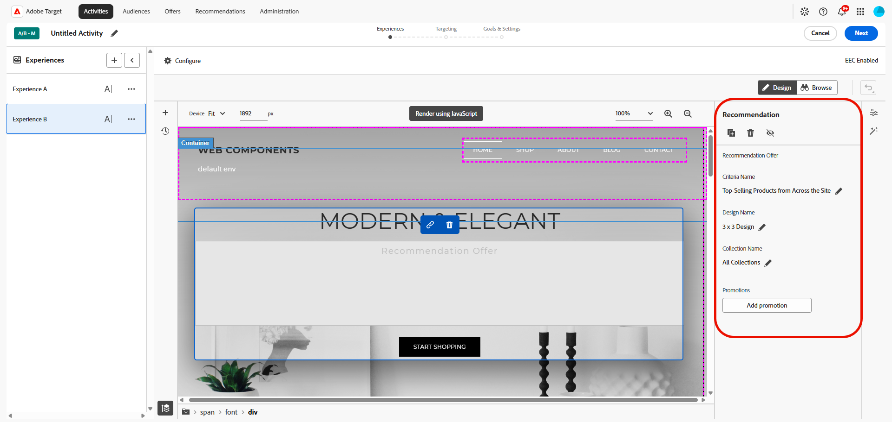

# Recomendaciones como oferta {#recommendations-as-an-offer}

>[!BEGINSHADEBOX]

**En esta página:** Obtenga información sobre cómo agregar, editar y eliminar una recomendación como oferta en [!UICONTROL Prueba A/B] y [!UICONTROL Segmentación de experiencias] (XT) actividades.

>[!ENDSHADEBOX]

Además de las actividades de [!UICONTROL Recommendations], las recomendaciones se pueden incluir dentro de la [!UICONTROL prueba A/B] (incluidas las actividades de [!UICONTROL Asignación automática] y [!UICONTROL Segmentación automática]) y las actividades de [!UICONTROL Segmentación de experiencias] (XT). Esto permite lo siguiente:

* Recomendaciones de prueba y segmentación y contenido que no sea de recomendación dentro de la misma actividad.
* Experimente con la colocación de recomendaciones en la página, incluido el orden de varias recomendaciones.
* Insertar automáticamente tráfico a la experiencia de recomendaciones de mejor rendimiento con **[!UICONTROL Asignación automática]**.
* Asigne de forma dinámica a los visitantes experiencias de recomendaciones adaptadas según su perfil con **[!UICONTROL Segmentación automática]**.

## Adición de una recomendación como oferta {#add-recs-offer}

Se agrega una recomendación como oferta mientras se crea una experiencia con el [!UICONTROL Compositor de experiencias visuales] (VEC) en una actividad [!UICONTROL prueba A/B] o XT.

1. Inicie el flujo de trabajo guiado de tres pasos del VEC para crear una actividad [Prueba A/B](/help/main/c-activities/t-test-ab/t-test-create-ab/test-create-ab.md) o [Segmentación de experiencias](/help/main/c-activities/t-experience-target/t-xt-create/xt-create.md) (XT).

   >[!NOTE]
   >
   >En las pruebas A/B, la opción [Asignación automática](/help/main/c-activities/automated-traffic-allocation/automated-traffic-allocation.md) inserta automáticamente en el tráfico las recomendaciones de mejor rendimiento, y la opción [Segmentación automática](/help/main/c-activities/auto-target/auto-target-to-optimize.md) asigna a los visitantes experiencias de recomendaciones adaptadas según su perfil.

1. Al crear una [experiencia](/help/main/c-experiences/c-visual-experience-composer/viztarget-options.md), agregue la recomendación como una oferta de una de las siguientes maneras:

   * Haga clic en el elemento al que se agrega la recomendación, haga clic en **[!UICONTROL Reemplazar contenido]** y, a continuación, seleccione **[!UICONTROL Recomendación]**.

     

   * En el carril **[!UICONTROL Componentes]**, seleccione **[!UICONTROL Recomendación]** en **[!UICONTROL Dinámica]**, pase el ratón sobre un elemento existente de la página y, a continuación, haga clic en **[!UICONTROL Insertar antes]** o **[!UICONTROL Insertar después]** para colocar la recomendación antes o después de ese elemento.

1. Acceda al menú **[!UICONTROL Mostrar propiedades]** y haga clic en **[!UICONTROL Seleccionar una recomendación]**.

1. Seleccione los [criterios](/help/main/c-recommendations/c-algorithms/algorithms.md) que desee y haga clic en **[!UICONTROL Siguiente]**.

1. Seleccione el [diseño](/help/main/c-recommendations/c-design-overview/design-overview.md) que desee y haga clic en **[!UICONTROL Siguiente]**.

1. En el cuadro de diálogo **[!UICONTROL Opciones]**, especifique lo siguiente:

   * Elija una [colección](/help/main/c-recommendations/c-products/collections.md).
   * Si es necesario, configure las opciones [Promoción principal y Promoción secundaria](/help/main/c-recommendations/t-create-recs-activity/adding-promotions.md).

1. Haga clic en **[!UICONTROL Guardar]**.

1. Termine de configurar la actividad [!UICONTROL Prueba A/B] o XT con el flujo de trabajo guiado de tres pasos.

## Edición de una oferta de Recommendations {#edit-recs-offer}

Los criterios, el diseño, la colección y las promociones de una oferta de Recommendations se pueden cambiar una vez agregada la oferta, desde el panel **[!UICONTROL Recomendación]**.

1. Haga clic en la oferta para editar y examinar las opciones del menú del panel derecho.

   

1. Seleccione una de las siguientes opciones:

   * [Cambiar criterios](/help/main/c-recommendations/c-algorithms/algorithms.md)
   * [Cambiar diseño](/help/main/c-recommendations/c-design-overview/design-overview.md)
   * [Cambiar colección](/help/main/c-recommendations/c-products/collections.md)
   * [Cambiar promoción](/help/main/c-recommendations/t-create-recs-activity/adding-promotions.md)

1. Realice las ediciones necesarias.

## Eliminar una oferta de Recommendations {#delete-recs-offer}

Se puede eliminar una oferta de Recommendations que ya no se necesite del panel **[!UICONTROL Recomendación]**.

Haga clic en la oferta que desea eliminar y, a continuación, haga clic en el icono de la bandeja (  ) en el panel **[!UICONTROL Recomendación]**.

## Visualización del estado de una oferta de Recommendations {#status}

El estado de la oferta de recomendaciones (algoritmo) se muestra en la parte inferior de la página **[!UICONTROL Información general]** para [!UICONTROL Prueba A/B] y las actividades XT que contienen ofertas de recomendaciones. El estado es uno de los siguientes:

* **[!UICONTROL Resultados preparados]**
* **[!UICONTROL Resultados no preparados]**
* **[!UICONTROL Error de fuente]**

## Vídeo de formación: Recommendations como oferta 

>[!VIDEO](https://video.tv.adobe.com/v/28878)
