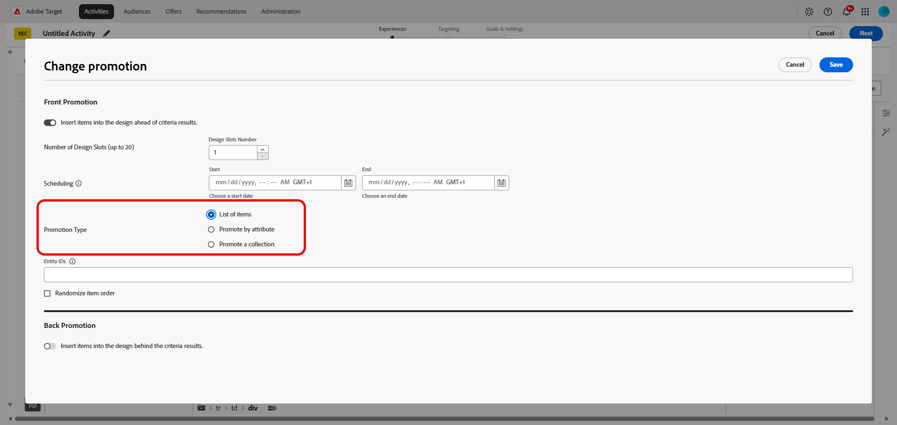

# Agregar promociones {#add-promotions}

>[!BEGINSHADEBOX]

**En esta página:** Aprenda a agregar elementos promocionados a un diseño de [!DNL Recommendations] y a determinar su criterio de ordenación.

>[!ENDSHADEBOX]

Las promociones colocan elementos específicos en un diseño de [!DNL Recommendations], además de los elementos recomendados según los criterios. Utilizan espacios disponibles en el diseño y tienen prioridad sobre los resultados de criterios y las recomendaciones de copia de seguridad. Por ejemplo, si un diseño tiene seis espacios y dos de ellos se utilizan para promociones, quedan cuatro espacios para los artículos recomendados en función de criterios.

Las promociones se eliminan de la duplicación de elementos recomendados por los criterios de la actividad, por lo que un elemento determinado no aparece dos veces en una sola bandeja de recomendaciones.

>[!NOTE]
>
>El uso de promociones cambia la estructura y la salida CSV. Estos cambios pueden afectar a cualquier proceso externo que incluya CSV, como el correo electrónico.

## Añadir una promoción {#add-promotion}

Una promoción define qué elementos se promocionan, cuántos espacios de diseño utilizan y el periodo durante el cual se muestran.

1. En la página **[!UICONTROL Opciones]**, haga clic en la opción **[!UICONTROL Promoción principal]** o **[!UICONTROL Promoción secundaria]**.

   La siguiente ilustración muestra la opción **[!UICONTROL Promoción principal]** en la posición &quot;Activada&quot;. Las promociones se pueden insertar antes y después de los resultados de criterios.

   

1. Establezca el **[!UICONTROL número de espacios de diseño]** que se utilizarán para los elementos promocionados.

   Se pueden usar hasta 20 espacios, según el diseño de [!DNL Recommendations]. Cada ranura utilizada no está disponible para las recomendaciones devueltas según los criterios.

1. Establezca una fecha de **inicio** y una fecha de **fin** para los elementos promocionados.

   Si no se establece ninguna fecha de inicio, la promoción se inicia inmediatamente. Si no se establece ninguna fecha de finalización, la promoción se ejecuta indefinidamente.

1. Seleccionar un **[!UICONTROL tipo de promoción]**:

   * **[!UICONTROL Lista de elementos]**: escriba los valores `entity.id` de los elementos que desea promocionar, separados por comas.
   * **[!UICONTROL Promocionar por atributo]**: agregue reglas para definir los atributos de los elementos que se promocionarán. Esta opción permite coincidencias dinámicas mediante reglas de inclusión estáticas y dinámicas. Para obtener información detallada, ejemplos y casos de uso, consulte [Usar reglas de inclusión dinámicas y estáticas](/help/main/c-recommendations/c-algorithms/use-dynamic-and-static-inclusion-rules.md#inclusion-rules).
   * **[!UICONTROL Promocionar una colección]**: elija la colección de elementos que desea promocionar. Se pueden crear nuevas colecciones para las promociones. Ver [Crear una colección](/help/main/c-recommendations/c-products/collections.md#task_1256DFF6842141FCAADD9E1428EF7F08).

   El tipo de promoción también determina el orden de los elementos promocionados. Consulte [Tipos de promociones y criterio de ordenación](#promotion-sort-order).

   

1. Haga clic en **[!UICONTROL Guardar]**.

Las promociones se aplican a todas las experiencias de la actividad.

## Tipos de promociones y criterio de ordenación {#promotion-sort-order}

El orden de los elementos promocionados depende del tipo de promoción, como se muestra en la tabla siguiente.

| Tipo de promoción | Orden predeterminado | Orden de copia | Opción de filtrado dinámico |
| --- | --- | --- | --- |
| **[!UICONTROL Lista de elementos]** | Orden ingresado en la interfaz de usuario o API de [!DNL Target] | Aleatorio (cuando se selecciona mediante la interfaz de usuario o la API) | No |
| **[!UICONTROL Promocionar por atributo]** | `entity.value` (orden descendente) | Sin aleatorización | Sí |
| **[!UICONTROL Promocionar una colección]** | `entity.value` (orden descendente) | Sin aleatorización | No |

* **[!UICONTROL Lista de elementos]**: el criterio de ordenación predeterminado es el orden introducido en la interfaz de usuario o la API de [!DNL Target]. La casilla de verificación **[!UICONTROL Ordenar elementos de forma aleatoria]** está disponible para este tipo. Cuando la lista incluye más elementos que el número de espacios definido para las promociones, esta opción aleatoriza qué elementos promocionados se muestran en el diseño. En cada visita, [!DNL Target] selecciona aleatoriamente los elementos habilitados para las promociones en la plantilla de todo el conjunto de promociones.
* **[!UICONTROL Promocionar por atributo]** y **[!UICONTROL Promocionar una colección]**: El orden predeterminado se basa en el atributo `entity.value`, en orden numérico descendente. No es aplicable el orden aleatorio.

Si las entidades no tienen un atributo `entity.value` (por ejemplo, la empresa no vende productos), se puede pasar un valor numérico como la fecha de publicación al atributo `entity.value`. A continuación, los elementos promocionados se ordenan por la fecha de publicación más reciente, en orden descendente. El atributo `entity.value` es del tipo double y no acepta cadenas.
