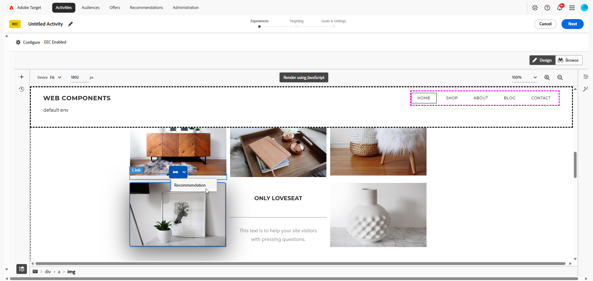
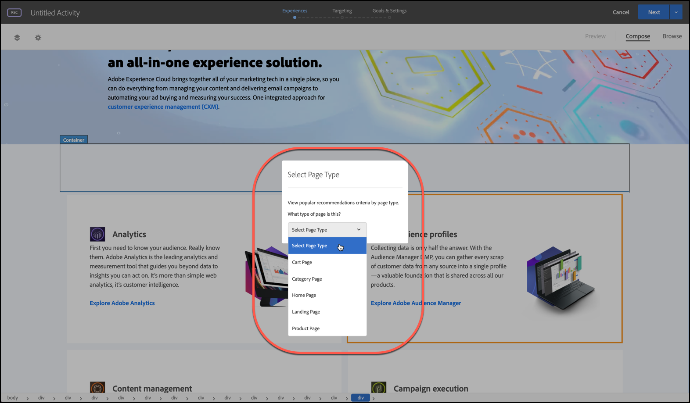

# Crear una actividad [!DNL Recommendations] {#create-recs-activity}

>[!BEGINSHADEBOX]

**En esta página:** Aprenda a crear una actividad de [!DNL Recommendations] en el [!DNL Target] **[!UICONTROL Compositor de experiencias visuales]** (VEC), desde la selección de la ubicación hasta la configuración de la actividad.

>[!ENDSHADEBOX]

Una actividad [!DNL Recommendations] muestra los elementos recomendados en una página. La creación de la actividad en el [!DNL Target] **[!UICONTROL Compositor de experiencias visuales]** (VEC) permite colocar las recomendaciones directamente en una página habilitada para [!DNL Target], en la ubicación exacta donde los visitantes deben verlas.

## Cree la actividad y seleccione la ubicación {#create-activity}

La dirección URL de actividad y la ubicación definen la página y el área de esa página donde se muestran las recomendaciones.

1. En el menú **[!UICONTROL Actividades]**, haga clic en **[!UICONTROL Crear actividad]** > **[!UICONTROL Recommendations]**.

   

1. Seleccione **[!UICONTROL Visual]**, si es necesario.

   Para usar **[!UICONTROL Compositor de experiencias basadas en formularios]** en su lugar, seleccione **[!UICONTROL Formulario]**. Consulte [Compositor de experiencias basadas en formularios](/help/main/c-experiences/form-experience-composer.md). Para ver una comparación de los compositores, incluido el VEC de **[!UICONTROL aplicación de una sola página]**, consulte [Experiencias y ofertas](/help/main/c-experiences/experiences.md). Para ver los problemas de VEC, consulte [Solución de problemas del Compositor de experiencias visuales](/help/main/c-experiences/c-visual-experience-composer/r-troubleshoot-composer/troubleshoot-composer.md).

1. (Condicional) Elija un [espacio de trabajo](/help/main/administrating-target/c-user-management/property-channel/property-channel.md).

1. Especifique la URL de la actividad y haga clic en **[!UICONTROL Crear]**.

   La dirección URL de actividad es la página donde se muestran las recomendaciones. [!DNL Target] no diferencia entre los protocolos de URL ([!DNL https] y [!DNL http]), por lo que `http://www.adobe.com/es` y `https://www.adobe.com/es` coinciden.

   El VEC se abre y muestra la página.

1. Haga clic en el elemento donde deben mostrarse las recomendaciones y seleccione **[!UICONTROL Reemplazar contenido]** > **[!UICONTROL Recomendación]**.

   <!--
   * **[!UICONTROL Replace w/ Recommendations]**: Deletes the current content of the element and replaces it with the recommendations.
   * **[!UICONTROL Insert Recommendations Before]**: Places the recommendations before the element, above or to the left of it, depending on the page construction.
   * **[!UICONTROL Insert Recommendations After]**: Places the recommendations after the element, below or to the right of it, depending on the page construction.

   

   Use **[!UICONTROL Expand Selection]** to expand the selection to the parent container, so that it includes the desired page elements.
   -->

   Los visitantes que cumplen los requisitos para la recomendación ven los artículos recomendados en el área especificada. Los visitantes que no cumplan los requisitos verán el contenido predeterminado.

   >[!NOTE]
   >
   >Las actividades de **[!UICONTROL Recommendations]** solo admiten una modificación o recomendación a la vez. Para mostrar varias recomendaciones, cree varias actividades [!DNL Recommendations] o use pruebas A/B o XT.

   

<!--
1. Select a page type: Cart Page, Category Page, Home Page, Landing Page, Product Page, Search Results Page, Thank You Page, or Other.

   

   The page type determines which criteria are suggested in the next section.
-->

1. Acceda al menú **[!UICONTROL Mostrar propiedades]** y haga clic en **[!UICONTROL Seleccionar una recomendación]**.

   

## Selección de los criterios {#select-criteria}

Los criterios determinan qué artículos se recomiendan y cómo se eligen para cada visitante.

1. Seleccione la casilla de uno o más [criterios](/help/main/c-recommendations/c-algorithms/algorithms.md).

   

   Cuando se seleccionan varios criterios, el tráfico se divide a partes iguales entre ellos y los porcentajes no se pueden cambiar para cada criterio. Por ejemplo, si se seleccionan dos criterios y la actividad muestra el contenido predeterminado al 20 % de los participantes, el 40 % de los participantes verá las recomendaciones de cada criterio.

   >[!NOTE]
   >
   >No todos los criterios se ejecutan correctamente en cada página. Para que las recomendaciones de artículo o categoría actual sean compatibles, la página o el mbox deben pasar `entity.id` o `entity.categoryId`. Es mejor mostrar solo criterios compatibles. Para que haya criterios incompatibles disponibles para la actividad, desactive la casilla de verificación **[!UICONTROL Compatible]**. Es posible que no se muestre esta casilla de verificación, según la configuración de **[!UICONTROL Administración]** > **[!UICONTROL Recomendaciones]** > **[!UICONTROL Filtrar criterios no compatibles]**. Para obtener más información, consulte [Configuración](https://experienceleague.adobe.com/docs/target-dev/developer/recommendations.html?lang=es){target=_blank}.

1. Opcionalmente, busque o cree criterios:

   * Para buscar un criterio existente cuando la lista sea larga, escriba en el campo de búsqueda hasta que aparezca el criterio deseado. Algunos criterios se suministran con [!DNL Recommendations] y el equipo también puede crear criterios personalizados.
   * Para crear un nuevo criterio, haz clic en **[!UICONTROL Crear criterio]** y luego ingresa la información del nuevo criterio. Consulte [Crear criterios](/help/main/c-recommendations/c-algorithms/create-new-algorithm.md).
   * Para agrupar criterios en una secuencia, cree una secuencia de criterios. Consulte [Crear secuencias de criterios](/help/main/c-recommendations/c-algorithms/create-criteria-sequence.md).

1. Haga clic en **[!UICONTROL Siguiente]**.

## Seleccione el diseño y las promociones {#select-design}

Un diseño es una plantilla que determina el aspecto de las recomendaciones en la ubicación seleccionada, y una colección determina qué elementos pueden aparecer. Las promociones se pueden añadir de forma opcional a las recomendaciones.

1. Seleccionar un [diseño](/help/main/c-recommendations/c-design-overview/design-overview.md).

   

   * Para usar diseños existentes, selecciona la casilla de uno o más diseños y luego haz clic en **[!UICONTROL Siguiente]**. Solo se puede seleccionar un diseño cuando se han seleccionado varios criterios.
   * Para crear un diseño personalizado, haga clic en **[!UICONTROL Crear diseño]** e introduzca el nombre y el código del nuevo diseño. Haga clic en **[!UICONTROL Siguiente]**, seleccione o cargue una imagen y, a continuación, haga clic en **[!UICONTROL Listo]** > **[!UICONTROL Listo]**.

   [!DNL Target] incluye varios diseños preconfigurados. Para obtener más información sobre diseños personalizados, vea [Crear un diseño](/help/main/c-recommendations/c-design-overview/create-design.md#create-design) y [Personalizar un diseño mediante Velocity](/help/main/c-recommendations/c-design-overview/customizing-a-template.md#customize-design).

1. Haga clic en **[!UICONTROL Siguiente]**.

1. En la página **[!UICONTROL Opciones]**, seleccione la colección.

   La colección determina qué artículos cumplen los requisitos para aparecer en las recomendaciones. Para obtener más información, incluido cómo crear una colección, vea [Usar una colección en una actividad](/help/main/c-recommendations/c-products/collections.md#use-collection).

1. (Opcional) Añada promociones principales y secundarias a las recomendaciones. Ver [Agregar promociones](/help/main/c-recommendations/t-create-recs-activity/adding-promotions.md#add-promotions).

1. Haga clic en **[!UICONTROL Guardar]**.

   La pantalla del VEC muestra el diseño de recomendaciones de la página.

## Revisión y finalización de la actividad {#complete-activity}

Revisar las recomendaciones y el flujo de actividad antes de guardar ayuda a confirmar que se han implementado la audiencia, los criterios y el diseño adecuados.

1. (Opcional) Haga clic en **[!UICONTROL Vista previa]** para ver cómo se muestra la actividad a los visitantes. Este modo permite la interacción con las recomendaciones, ya que un visitante interactuaría con ellas. Haga clic en **[!UICONTROL Componer]** para volver al VEC.

1. Revise la recomendación en el VEC y luego haga clic en **[!UICONTROL Siguiente]**.

1. Revise la actividad en el diagrama de flujo y realice los cambios que sean necesarios. Haga clic en **[!UICONTROL Siguiente]** cuando termine.

   

   El diagrama de flujo cubre la audiencia de la actividad, las experiencias y las métricas de éxito. Desde el diagrama se pueden realizar los siguientes cambios:

   * **Audiencia**: todos los visitantes ven las recomendaciones de forma predeterminada, pero se puede seleccionar una audiencia existente. Como alternativa a la creación de una audiencia nueva, se puede crear una [audiencia solo de actividad](/help/main/c-target/creating-activity-only-audience.md#concept_A6BADCF530ED4AE1852E677FEBE68483), o se pueden combinar [múltiples audiencias](/help/main/c-target/combining-multiple-audiences.md#section_2F1CE9434CC04174B4BA2BFC89B85D77), para generar una audiencia ad-hoc.
   * **Criterios**: vea los criterios o cambie la colección (junto a la etiqueta **[!UICONTROL Criterios]**).
   * **Grupo de control**: cambie el porcentaje de participantes que ven la experiencia de control. En una actividad [!DNL Recommendations], el grupo de control ve la página sin ninguna recomendación.
   * **Diseño**: vea el código de diseño o cambie o quite el diseño.

1. Especifique la configuración de la actividad, por ejemplo un nombre (obligatorio) y un objetivo (opcional). Para ver la configuración, incluidas las reglas del nombre de la actividad, consulte [Configuración de actividades de Recommendations](/help/main/c-recommendations/t-create-recs-activity/recs-activity-settings.md#recs-activity-settings).

1. Haga clic en **[!UICONTROL Guardar y cerrar]**.

## Administrar la actividad {#manage-activity}

Una vez guardada la actividad, la página **[!UICONTROL Información general]** muestra un resumen de la actividad. En esta página, están disponibles las siguientes acciones:

* Active, edite o realice un control de calidad de la actividad.
* Comparta la actividad en la fuente de Experience Cloud.
* Vea las URL de experiencia y descargue los datos.
* Cambiar el porcentaje de participantes en la actividad que ven la experiencia de control.
* Muestre u oculte los detalles del criterio y vea el código de los diseños.

Hay dos páginas adicionales disponibles en la actividad:

* **[!UICONTROL Informes]**: muestra el informe sobre el rendimiento de la actividad [!DNL Recommendations].
* **[!UICONTROL Conflictos]**: muestra los [conflictos de actividades](/help/main/c-experiences/c-visual-experience-composer/activity-collisions.md) que puedan producirse. Se producen conflictos cuando varias actividades envían contenido a la misma página y pueden provocar que se muestre contenido inesperado.

## Vídeo de formación: Crear una actividad de Recommendations (7:15) 

>[!VIDEO](https://video.tv.adobe.com/v/33946?captions=spa)
